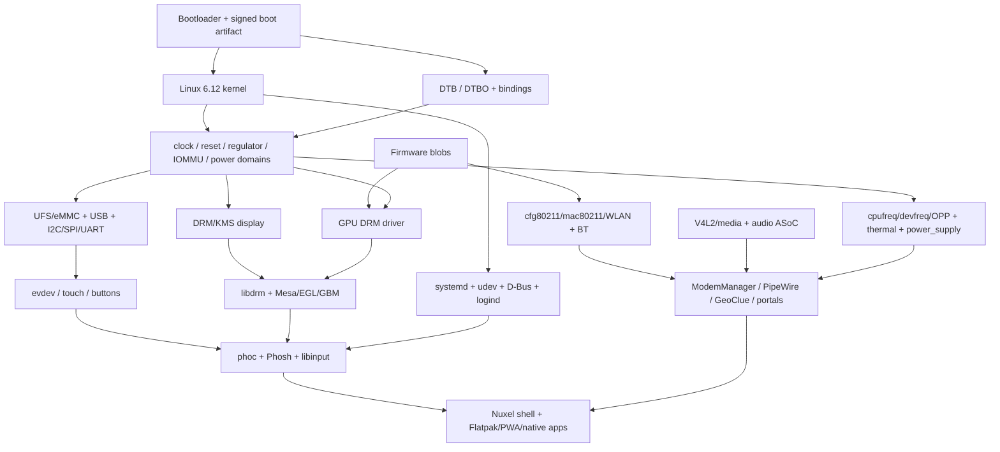
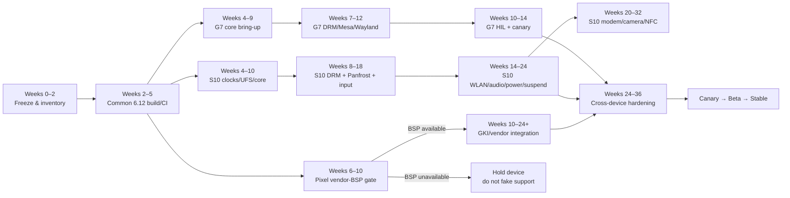

# Nuxel Linux Phone OS: Linux Kernel 6.x Migration and Upgrade Plan

## Executive summary

The supplied Nuxel repository is **not in a single kernel state**. It contains three materially different device ports and therefore cannot safely be migrated by treating “kernel v6.x” as a repository-wide version bump.

The recommended target is **Linux 6.12.y**, initially pinned to **6.12.113** or a later tested 6.12 LTS point release. As of 17 October 2026, kernel.org lists 6.12.113 as the current 6.12 long-term release, published on 15 October 2026; the 6.12 series has projected upstream maintenance through December 2028. Linux 6.18 is also an LTS with the same projected EOL, but moving directly to 6.18 would add another variable while Nuxel's Pixel/GKI design, configuration, documentation and patch set already target 6.12. citeturn13search24turn16view0

The repository audit shows:

| Device | Current Nuxel kernel path | Current maturity | Recommended 6.x strategy | Risk |
|---|---|---:|---|---|
| **Motorola Moto G7 Power / `ocean`** | `msm8953-mainline/linux`, unpinned `master`; Nuxel fragment | Mainline-oriented but repository says hardware verification is incomplete | Pin a known-good 6.12.y-derived msm8953 tree, upstream/rebase remaining board DTS and patches | **Medium** |
| **Samsung Galaxy S10+ / `beyond2lte`** | Samsung/Linux4 downstream **4.14.253** | Best documented real-device Nuxel boot; Fedora 43/systemd 258 works with significant 4.14 workarounds; fbdev only | Treat as a **new Exynos9820 BSP/mainlining project**, not a normal rebase | **Very high** |
| **Google Pixel 10 Pro XL / `mustang`** | Design targets `android16-6.12` / proposed `android-gs-mustang-6.12`; public GKI fallback explicitly non-bootable | Configuration largely aspirational; production vendor kernel/modules/DT/firmware are the blocker | Use Android 16 6.12 GKI **only with the corresponding vendor module/BSP stack**, or independently mainline every device block | **Very high / externally blocked** |

Repository evidence: `kernel/g7power/build-kernel.sh`, `kernel/s10plus/build-kernel.sh`, `kernel/build-kernel.sh`, `kernel/google-pixel-10-pro-xl/defconfig`, `docs/g7power-bringup.md`, `docs/s10plus-autonomous-boot-repair/STATUS.md`.

The principal finding is that the **G7 Power should be the reference 6.12 migration device**. It already follows a mainline-style Qualcomm architecture: DRM/MSM, standard input, standard power frameworks, Qualcomm Wi-Fi/Bluetooth infrastructure, DT-based hardware description and lk2nd. The S10+ should follow only after the common 6.12 platform has stabilised, because its working tree is an old Samsung 4.14 BSP containing substantial vendor-specific display, touch, power, camera, connectivity and modem code. Linux explicitly does not maintain a stable in-kernel driver API or binary kernel ABI, so such downstream drivers cannot simply be rebuilt against 6.12; they must be ported to contemporary subsystem APIs or replaced by upstream drivers. By contrast, Linux's userspace syscall ABI is designed to remain stable. citeturn6view0

The Pixel port is a third model again. Android GKI deliberately moves SoC/board support out of the generic kernel into vendor modules and provides a controlled KMI only within the corresponding Android/LTS family. For `android16-6.12`, the KMI is stable only within that branch, with `gki_defconfig`, its prescribed LLVM toolchain and the monitored KMI symbol set. A generic `android16-6.12` kernel therefore **does not substitute for the Pixel's missing vendor modules, device trees and firmware**. citeturn14view0turn14view1

The migration should consequently be executed as three tracks over a common platform:

1. **Freeze and normalise the repository**: eliminate unpinned kernel sources, distinguish authoritative from historical documentation, generate a machine-readable hardware/kernel dependency manifest and establish reproducible LLVM-based 6.12 builds.
2. **Bring up G7 Power on 6.12 first**, to validate common Nuxel userspace, systemd, Wayland/DRM, security, CI, OTA and HIL infrastructure.
3. **Rebuild the S10+ BSP subsystem-by-subsystem**, reaching serial/storage first, then input, DRM/KMS/Panfrost, networking, audio, power/thermal, suspend, and finally modem/camera/NFC.
4. **Gate Pixel work on acquisition of a legitimate 6.12 vendor BSP/module/DT/firmware set**. Do not mistake a bootable GKI `Image` for device support.
5. Replace the S10's framebuffer compatibility path with real **DRM/KMS + Wayland**, remove the 4.14/systemd compatibility hacks, introduce signed modules, immutable verified rootfs updates, A/B rollback where hardware supports it, and automated hardware-in-loop release gates.

A realistic programme is approximately **six to nine months with five to seven engineering FTE**, but this estimate has an important qualification: complete S10+ cellular/camera support and complete Pixel support are not schedulable with confidence until their vendor-driver/source/licensing gaps are resolved. The first production-quality 6.12 device, G7 Power, should be achievable considerably earlier.

## Repository audit, assumptions and dependency inventory

### Scope and assumptions

This report was built from the uploaded Nuxel ZIP, containing approximately 7,500 files after extraction. No public canonical Nuxel repository URL was provided, and web searches did not establish a public source-of-truth repository. Consequently, **the uploaded repository is treated as authoritative for Nuxel-specific facts**; public primary sources are used for Linux, GKI, Mesa, boot verification and kernel-interface behaviour.

Several assumptions must remain explicit:

| Assumption | Treatment in this plan |
|---|---|
| The uploaded snapshot is representative of the current Nuxel tree | Used as the repository baseline |
| Exact production hardware revisions are not independently established | Device-info values are treated as **repo declarations**, not independently verified facts |
| `VERSION` is more authoritative than stale README prose | Repo reports `v0.5.0-beta-rc1`; README still contains `v0.4.0-alpha` references |
| Linux 6.x means an LTS suitable for a phone product | **6.12.y** selected rather than arbitrary “latest 6.x” |
| Nuxel intends a non-Android GNU/Linux userspace | Preserve systemd/Phosh/Wayland/Flatpak architecture; Android GKI/AVB may still be used as boot/kernel infrastructure |
| Hardware secure boot behaviour of unlocked Samsung/Motorola devices is not assumed | dm-verity/module signing are separated from boot-ROM-rooted authentication |
| Pixel hardware details in repo manifests are not necessarily validated | Must be confirmed from actual stock image/vendor BSP before driver work |
| Static repository contents cannot prove every service is running on hardware | “Configured/enabled” and “observed on hardware” are kept separate |

The version inconsistency should itself become a release-blocking CI check. Repository evidence: `VERSION`, `README.md`.

### Repository component inventory

The repository already contains most categories expected from a phone distribution, but maturity varies markedly by device.

| Component class | Current Nuxel contents | Kernel dependency / migration concern | Target state |
|---|---|---|---|
| **Kernel** | Generic build wrapper plus `g7power`, `s10plus`, `google-pixel-10-pro-xl` trees/configs/patches | Three different source models; S10 is 4.14; G7 unpinned; Pixel fallback incomplete | Per-device locked source manifest, 6.12 baseline, SHA/tag verification |
| **Kernel modules/drivers** | Mostly supplied by selected external kernel tree; Nuxel kernel patches minimal | All OOT/vendor code exposed to non-stable kernel-internal API | Prefer in-tree drivers; source vendor modules only where unavoidable |
| **Device trees** | Kernel DTs plus generated/checked artifacts such as `.ocean.dts/.dtb`; device configs | Bindings and drivers must match; old vendor DTs cannot simply be copied into 6.12 | DTS/DTSI in kernel tree, YAML bindings, `dtbs_check` |
| **DT overlays** | Device-specific boot/DTBO concepts, especially G7/Pixel | Bootloader-specific overlay application; binding validation | Minimise overlays; deterministic build-time DT where possible |
| **BSPs** | Samsung downstream BSP; msm8953 mainline tree; proposed Pixel GKI/vendor approach | Biggest migration cost | Separate BSP branch per SoC, thin Nuxel patch queue |
| **Bootloader** | G7 ABOOT→lk2nd; S10 S-Boot; Pixel repo declares Google ABL | Image format/load-address/DT/initramfs differences | Preserve device-native first-stage chain, standardise Nuxel artifact metadata |
| **Init/initramfs** | systemd-centric phone rootfs; common initramfs; special embedded S10 initramfs | S10 special handling is bootloader-specific | systemd production baseline; device boot shims kept minimal |
| **Rootfs** | Fedora 43 phone rootfs on S10; generic Alpine/postmarketOS-style builder elsewhere | Library/package versions and init differ | Explicit distro profiles, not implicit hybrid behaviour |
| **Package managers** | DNF/RPM, apk/APKBUILD, Flatpak | Reproducibility and ownership split unclear | Declare package ownership by profile; lock repository snapshots |
| **Graphics** | Phosh/phoc, Wayland, Mesa packages; S10 custom framebuffer bridge | S10 has no DRM/KMS in current 4.14 runtime | Native DRM/KMS + Mesa/libdrm + phoc on every production device |
| **Audio** | PipeWire, WirePlumber, ALSA UCM | ALSA SoC drivers/DTS topology | Standard ASoC and UCM2 profiles |
| **Networking** | NetworkManager, iwd/wpa_supplicant, nftables | cfg80211/mac80211/vendor firmware | Standard upstream WLAN drivers |
| **Telephony** | ModemManager, libqmi/libmbim declared | Neither G7 X9 nor S10 Shannon path is shown production-ready | Device-specific MM plugin/proxy only after kernel transport works |
| **Bluetooth** | BlueZ | HCI transport + firmware | Standard `hci_qca`/`btbcm` where hardware permits |
| **Location** | GeoClue | GNSS kernel/serial/modem support | Device-specific provider behind GeoClue |
| **Camera** | Nuxel camera portal + PipeWire | V4L2/media-controller/ISP drivers are major BSP dependencies | V4L2/media-controller → PipeWire/portal |
| **Security** | AppArmor, seccomp, nftables, Bubblewrap/Flatpak; dm-verity/AVB intent | LSM configuration, namespaces, signing and boot chain | Signed 6.12 kernel/modules + verified immutable rootfs |
| **Firmware** | Per-device manifests/install/verify scripts | Many checksums still UNKNOWN/placeholder | SPDX/licence/provenance/SHA-256 manifest for every shipped blob |
| **SDK/development** | Build toolchain docs and development package set; no single locked Nuxel SDK found | Host variability | Reproducible SDK/container including LLVM, dt-schema, mkbootimg/AVB tools |
| **CI/CD** | GitHub Actions release workflow, validation scripts, VM smoke tests | No release HIL gate; Pixel omitted | Compile/static/VM/HIL/release pipelines |
| **OTA** | A/B/dm-verity/RAUC/OSTree-style design concepts appear in repo | Implementation not consistently unified across devices | One signed manifest format, per-device installation backend |
| **External utilities** | Vendored `avbtool`, patched Heimdall | Must track upstream/security/licensing | Pinned, checksummed sources and SBOM |

Repository evidence: top-level `Makefile`; `kernel/`; `boot/`; `device/`; `firmware/`; `images/`; `configs/`; `services/`; `shell/`; `.github/workflows/release.yml`; `ci/`; `external/avbtool`; `external/heimdall-nuxel`; `images/config/packages.yml`.

The current GitHub release workflow supports **G7 Power and S10+ only** and deliberately excludes `mustang` until bring-up devices are proven. It builds on Ubuntu 24.04, installs cross-compilers and kernel build dependencies, builds the G7 lk2nd chain, builds the special S10 A25 raw-Image/embedded-initramfs boot artifact, verifies artifacts and publishes only after a completely green device matrix. That fail-closed philosophy should be retained while the implementation moves to 6.12. Repository evidence: `.github/workflows/release.yml`.

### Device and driver inventory

#### G7 Power / ocean

The repository describes an SDM632/MSM8953-family device using the `msm8953-mainline/linux` tree. Its fragment enables the modern Qualcomm path: DRM, `DRM_MSM`, simpledrm/fbdev emulation, panel support, Ilitek touch, Qualcomm Bluetooth UART, WCD9335-family audio, MMC, USB DWC3/QCOM, EXT4/F2FS, namespaces, seccomp and AppArmor. Repository evidence: `kernel/g7power/build-kernel.sh`, `kernel/g7power/defconfig`, `device/g7power/deviceinfo`.

Important dependencies are:

| Function | Repo-selected path | 6.12 disposition |
|---|---|---|
| SoC clocks/resets/pinctrl/regulators | msm8953 mainline tree | **In-tree/mainline-style**; rebase and DT validation |
| Display | MSM DRM + DSI/panel | **Preferred target** |
| GPU | Adreno 506 | Kernel MSM DRM + Mesa Freedreno |
| Vulkan | Adreno 5xx | **Do not promise Vulkan**: Mesa explicitly says Turnip is for Adreno 6xx and has no plans for a5xx or earlier. citeturn10search3 |
| Touch | ILI2117 → `ili210x` | In-tree candidate; verify DT/IRQ/reset |
| Wi-Fi | WCN3680B → expected `wcn36xx` | Mainline-style; firmware/NVRAM verification required |
| Bluetooth | Qualcomm HCI UART → `hci_qca` | In-tree candidate |
| Audio | Qualcomm/WCD9335 path | Verify ASoC topology and codec support in chosen 6.12 tree |
| Storage | eMMC/MMC | In-tree |
| USB | DWC3 QCOM | In-tree |
| Modem | Snapdragon X9 | **Not repo-ready for ModemManager** |
| Camera | Unknown | Blocking inventory work |
| Fingerprint | Unknown | Blocking inventory work |

The G7 firmware manifest explicitly expects Adreno security firmware, WCNSS Wi-Fi data/calibration and Bluetooth firmware, with several exact filenames and checksums still unknown. Camera/modem/fingerprint entries are deliberately placeholders. Repository evidence: `firmware/g7power/manifest.yml`.

#### Galaxy S10+ / beyond2lte

The authoritative current S10 build script clones `Linux4/android_kernel_samsung_exynos9820` at a pinned commit and identifies it as Linux **4.14.253**, using Samsung's downstream `exynos9820-beyond2lte_defconfig`. `kernel/s10plus/defconfig` is informational rather than authoritative. Repository evidence: `kernel/s10plus/build-kernel.sh`, `kernel/s10plus/defconfig`.

The real-device status material is unusually valuable: the current Nuxel image reaches Fedora 43 with **systemd 258.11 as PID 1**, but the 4.14 kernel lacks kernel facilities expected by modern userspace, producing `ENOSYS` failures around process-management paths. Nuxel currently works around those failures by masking or replacing selected systemd services, including use of `dbus-daemon` instead of the preferred broker path in that recovery configuration. The status documentation reports a healthy overall system state after those workarounds. Repository evidence: `docs/s10plus-autonomous-boot-repair/STATUS.md`.

More importantly, the current 4.14 port has **no usable `/dev/dri`/DRM/KMS path** in the documented runtime. Nuxel therefore uses fbdev and a custom framebuffer/Wayland bridge instead of the intended phoc-on-KMS architecture. Repository evidence: `docs/s10plus-bootloop-repair/TEST-RESULTS.md`, `docs/s10plus-autonomous-boot-repair/STATUS.md`.

The migration impact is consequently:

| S10 subsystem | 4.14 state | 6.12 target | Assessment |
|---|---|---|---|
| CPU/interrupt/timer | Samsung downstream | Contemporary arm64/Exynos framework | Port/validate |
| Clock/reset/pinctrl | Samsung Exynos9820 vendor drivers | Mainline APIs/DT | **Large port** |
| Power domains/regulators | Vendor | genpd/regulator/OPP | **Large port** |
| Display | Samsung vendor framebuffer/display | DRM/KMS atomic + panel/bridge | **Critical rewrite/port** |
| GPU | Mali-G76 vendor stack | Panfrost kernel + Mesa preferred | Feasible GPU family, platform integration difficult |
| Touch | Samsung `sec_ts` / S6SY761 per repo | Upstreamable input/I²C driver or forward port | OOT/vendor |
| Wi-Fi | Samsung `bcmdhd` for BCM4375 | Prefer `brcmfmac` if hardware/firmware transport supports it | Replacement research |
| Bluetooth | Broadcom path | `btbcm`/standard HCI where possible | Moderate |
| Audio | CS47L93/Madera + CS35L40 per repo | ASoC/MFD/regulator/DTS | Significant |
| UFS | Samsung downstream | UFS core + Exynos platform glue | Critical early-boot dependency |
| Thermal | Samsung TMU/vendor policies | upstream thermal framework + cooling maps | Significant |
| Battery/charging | Samsung vendor power_supply | upstream power_supply/regulator/charger drivers | Significant |
| Camera | Samsung FIMC-IS/vendor | V4L2 media-controller | **Very high** |
| Modem | Shannon vendor stack | No demonstrated mainline/MM transport | **Very high** |
| NFC | S3NRN82 per repo | Driver availability to prove | High |
| Sensors | Not fully inventoried | IIO/input | Inventory first |

Linux makes the reason for this difficulty explicit: **there is no stable in-kernel source or binary driver interface**; structures, callbacks and functions are routinely changed and all in-tree callers are fixed together. The recommended long-term solution from upstream is therefore to get drivers into the main kernel rather than maintaining a private binary/OOT compatibility layer. citeturn6view0

The encouraging graphics point is that Mesa currently lists **Mali-G76, Bifrost v7** with OpenGL ES 3.1, OpenGL 3.1 and Vulkan 1.3 in the Panfrost/PanVK stack. That establishes GPU-architecture userspace support, but it does **not** establish S10 board support: the Exynos display controller, clocks, SMMU/IOMMU, GPU power supplies, power domains and DT must all work before that Mesa capability becomes useful. Mesa also notes that Mali GPUs are 3D engines rather than display controllers, so the display side remains a separate KMS requirement. citeturn12view0

#### Pixel 10 Pro XL / mustang

The Pixel port must be described more cautiously. Nuxel declares a Tensor G5/`gs501`, PowerVR GPU, Samsung display/touch, Exynos modem, Broadcom Wi-Fi and assorted PMIC/sensor hardware, but much of `kernel/google-pixel-10-pro-xl/defconfig` explicitly marks missing vendor-only or aspirational symbols. These details should therefore be treated as **repository assumptions pending hardware/BSP validation**, not as independently established hardware facts. Repository evidence: `device/google-pixel-10-pro-xl/deviceinfo`, `kernel/google-pixel-10-pro-xl/defconfig`, `firmware/google-pixel-10-pro-xl/manifest.yml`.

The current build wrapper distinguishes two very different paths:

* intended vendor tree: `android-gs-mustang-6.12`, `gs501_defconfig`;
* public fallback: Android common `android16-6.12` + Nuxel fragment on `gki_defconfig`.

The wrapper itself says the common fallback is not sufficient to produce a fully bootable Mustang kernel. That assessment is architecturally consistent with GKI: GKI deliberately excludes SoC/board-specific code and expects that support in vendor modules. Android documents the `android16-6.12` KMI as stable only inside that Android/LTS family, under `gki_defconfig` and the corresponding controlled Clang environment. citeturn14view0turn14view1

**Do not respond to missing Pixel vendor modules by importing arbitrary Android kernel modules into stock mainline 6.12.** Either obtain the matching vendor source/module/KMI set, or deliberately replace each block with an upstream implementation.

### System-service inventory and kernel dependency map

The current canonical Nuxel systemd units found in `configs/`, `services/`, `shell/` and the current S10 image builder are:

| Service / unit family | Purpose | Kernel interfaces that must survive 6.12 migration |
|---|---|---|
| `nuxel-apparmor-enforce.service` | Apply AppArmor policy | LSM/AppArmor, securityfs |
| `nuxel-firewall.service` | nftables policy | netfilter/nftables, netlink, namespaces |
| `nuxel-haptics-bridge.service` | Haptic abstraction | input/FF, LED, PWM or vendor actuator sysfs depending hardware |
| `nuxel-keyboard-apply.{path,service}` | Keyboard/session configuration | inotify/path events; input userspace |
| `nuxel-microsd-automount.service` | removable storage | MMC/block/udev/mount |
| `nuxel-power-mode.service` | power policy | cpufreq/devfreq/power_supply/thermal sysfs |
| `nuxel-rtc-check.{service,timer}` | RTC/time recovery | RTC class, system clock |
| `nuxel-bootmode-*` | boot/touch recovery logic | proc/cmdline, reboot, input |
| `nuxel-animation.service` | startup animation | current fbdev or target DRM/Wayland |
| `nuxel-bridge.service` | OS/application bridge | D-Bus, network, ModemManager APIs |
| `nuxel-http-bridge.service` | HTTP bridge | sockets/network namespaces |
| `nuxel-console.service` | console/recovery | tty/VT/framebuffer/input |
| `nuxel-notifications.service` | shell notifications | D-Bus |
| `nuxel-portal.service` | permission/portal integration | D-Bus, namespaces, security controls |
| `nuxel-button-manager.service` | physical buttons | evdev input |
| `nuxel-touch-arm.service` | S10 touch workaround/arming | input/I²C-facing device nodes |
| `nuxel-wayland.service` | compositor/session | DRM/KMS, evdev, libinput, dma-buf |
| `nuxel-wl-fb.service` | Wayland→framebuffer compatibility | fbdev; **retire after DRM success** |
| `nuxel-fallback.service` | fallback UI | framebuffer/input |
| `seatd.service` | seat/device ownership | DRM/input char devices, udev |
| `nuxel-web.service` | Web UI runtime | sockets/Wayland depending launcher |
| `nuxel-camera-portal.service` | camera portal | PipeWire; ultimately V4L2/media-controller |
| `nuxel-permd.service` | permissions | namespaces, cgroups, seccomp, LSM |
| user `nuxel-home-*` | Nuxel shell/home | Wayland/D-Bus |
| user `nuxel-phosh-agent.service` | Phosh integration | Wayland/D-Bus/logind |
| `nuxel-firstlight.service` | S10 first-boot/visual bring-up | current framebuffer/input path |

Repository evidence: `configs/*/systemd/`, `services/*/systemd/`, `services/nuxel-web.service`, `shell/config/systemd-user/`, `shell/nuxel-camera-portal/systemd/`, `shell/nuxel-shell/nuxel-permissions/systemd/`, `images/s10plus/nuxel-firstlight.service`.

The S10 rootfs builder explicitly enables the current UI/session chain and Nuxel bridge/portal/web services by creating `multi-user.target.wants` symlinks. Historical experimental copies under `tools/s10plus/a23` through `a33` should **not** be treated as independent production services; they are bring-up history and should eventually move to an archive/test-fixtures area. Repository evidence: `images/s10plus/build-phone-rootfs-inside-fedora.sh`, `tools/s10plus/`.

A useful migration dependency graph is:



Linux DT is specifically intended to describe hardware independently of hard-coded board logic; the kernel uses it for platform identification, runtime configuration and device population. Modern bindings should be schema-validated rather than copied wholesale from an old Android BSP. citeturn7view1turn7view3

## Target kernel architecture and compatibility strategy

### Why Linux 6.12 LTS

The repository itself already targets Linux 6.12 for Mustang, while kernel.org projects maintenance of 6.12 through December 2028. As of 17 October 2026, the current upstream 6.12 maintenance release is 6.12.113. citeturn13search24turn16view0

Use a policy such as:

```text
Nuxel kernel generation:     6.12
Allowed upstream base:       linux-6.12.y
Initial qualification base:  6.12.113
Update policy:               latest tested 6.12.y every 2–4 weeks
Emergency policy:            fast-track security/stability updates
Pixel GKI family:            android16-6.12-lts, where vendor BSP requires GKI
Next-generation evaluation:  6.18.y only after 6.12 production convergence
```

Do **not** pin permanently to 6.12.113. Pin each release to an immutable tag/commit, but continuously ingest 6.12.y maintenance updates; long-term kernels exist precisely to receive important fixes. citeturn16view0

### Migration-relevant kernel-interface changes

For Nuxel, “4.14 → 6.12” matters much more than any individual 6.x point release. The following interfaces should be considered mandatory review domains.

| Domain | Migration consequence |
|---|---|
| **Kernel internal API/KABI** | No compatibility assumption for any Samsung/vendor/OOT module; forward-port source or replace it. Linux explicitly provides no stable in-kernel API/KABI. citeturn6view0 |
| **Userspace syscall ABI** | Generally stable; keep Nuxel userspace and find real regressions rather than automatically rebuilding everything. citeturn6view0 |
| **Process APIs** | Modern pidfd support removes an important class of failures encountered by systemd 258 on the S10 4.14 runtime; delete workarounds only after test validation. |
| **DRM/KMS** | New target must be atomic KMS: planes → CRTC → encoder/bridge → connector/panel, with fences/dma-buf rather than a vendor framebuffer model. citeturn9view0 |
| **GPU memory sharing** | Standard DRM GEM/dma-buf/GBM path; eliminate Android-era private allocator assumptions |
| **Android ION** | Any old BSP use should be converted to dma-buf heaps or native DRM/media allocation; AOSP explicitly documents the ION→DMA-BUF heaps transition. citeturn14view0 |
| **Power management** | Port vendor wakelock/power code to runtime PM, wakeup sources, genpd, regulators, OPP, cpufreq/devfreq |
| **Thermal** | Express sensors, thermal zones, trips, cooling devices and policies through current thermal framework rather than vendor policy hooks. Linux 6.12 documents dedicated thermal/cooling APIs including Exynos TMU support. citeturn8view3 |
| **Interconnect/bandwidth** | Replace vendor bus-voting where possible with the kernel interconnect framework |
| **IOMMU/DMA** | Audit old physical-address/DMA assumptions; use DMA API and proper IOMMU domains |
| **GPIO** | Convert legacy integer GPIO handling toward descriptor-based gpiod APIs during driver ports |
| **Firmware** | Drivers should use the firmware-loader APIs and deterministic `/lib/firmware` names. `request_firmware()` and its variants are the standard interface. citeturn8view2 |
| **procfs/custom Nuxel hooks** | Use contemporary `proc_ops`; the Mustang Nuxel patch already follows this design |
| **Security** | AppArmor, seccomp, namespaces, cgroups v2, module signing and immutable-root verification become baseline rather than best-effort additions |
| **Modules** | Production modules should be signed; `CONFIG_MODULE_SIG_FORCE` rejects modules lacking a valid trusted signature. citeturn8view0 |
| **DT validation** | Add YAML bindings and `dtbs_check`; overlays should be deliberately controlled. citeturn7view2turn7view3 |
| **GKI/KMI** | Only Pixel/GKI builds get GKI's controlled KMI; do not generalise that stability guarantee to mainline S10/G7 kernels. citeturn14view1 |

### Driver compatibility matrix

Legend: **I** = upstream/in-tree target; **P** = source port required; **R** = replacement preferred; **B** = vendor binary/source dependency; **?** = hardware inventory incomplete.

| Device / subsystem | Current implementation | 6.12 target | Status | Required action |
|---|---|---|---|---|
| G7 SoC | msm8953 mainline fork | msm8953 6.12 support | I/P | Pin tree; rebase board changes |
| G7 display | MSM DRM | MSM DRM atomic | I | Validate DSI/panel modes |
| G7 GPU | Adreno 506 | MSM DRM + Freedreno | I | Firmware + Mesa qualification |
| G7 Vulkan | Not required | None for A506 | R | Do not claim Turnip; Mesa says no a5xx plan. citeturn10search3 |
| G7 touch | ILI2117/ili210x | ili210x | I | DT/IRQ regression tests |
| G7 Wi-Fi | WCN3680B/wcn36xx intent | wcn36xx | I/P | Confirm firmware/calibration names |
| G7 BT | hci_qca | hci_qca | I | Firmware + suspend testing |
| G7 modem | incomplete | transport + MM support | ? | Separate later milestone |
| G7 camera | unknown | V4L2/media | ? | Inventory first |
| S10 SoC | Samsung 4.14 vendor | mainline-style Exynos | P | BSP programme |
| S10 display | vendor display/fbdev | Exynos DRM atomic | P/R | Highest-priority graphics port |
| S10 GPU | vendor Mali | Panfrost + Mesa | R/P | Enable power/IOMMU; G76 supported in Mesa. citeturn12view0 |
| S10 touch | `sec_ts` | upstream input or port | P | Isolate minimum driver from BSP |
| S10 Wi-Fi | `bcmdhd` | brcmfmac preferred | R/P | Verify BCM4375 bus/firmware support |
| S10 BT | Broadcom vendor | standard HCI/btbcm | R/P | Board-specific power sequencing |
| S10 UFS | Samsung vendor glue | upstream UFS + Exynos glue | P | Boot-critical |
| S10 audio | Madera/CS35L40 vendor integration | ASoC | P | DTS + UCM2 |
| S10 thermal | vendor TMU/policies | thermal framework | P | Reconstruct trip/cooling tables |
| S10 camera | FIMC-IS/vendor | V4L2 media | P/R | Major independent workstream |
| S10 modem | Shannon | unknown upstream transport | B/P | Research/source blocker |
| S10 NFC | S3NRN82 | to establish | P/? | Confirm hardware and driver |
| Pixel generic core | Android GKI concept | `android16-6.12-lts` | I | Use only matching GKI ecosystem |
| Pixel SoC/board | vendor modules absent from fallback | matching vendor modules | B | Acquisition gate |
| Pixel display/touch | repo-declared vendor hardware | vendor module or new upstream driver | B/P | Cannot infer from GKI |
| Pixel GPU | repo-declared PowerVR DXT | vendor or proven upstream PowerVR path | B/P | Hardware support must be demonstrated, not inferred from `CONFIG_DRM_POWERVR` |
| Pixel modem | repo-declared Exynos modem | vendor transport + userspace integration | B/P | Separate telephony programme |
| Pixel Wi-Fi/BT | repo-declared Broadcom | brcmfmac/HCI if compatible | I/P | Validate exact firmware/device IDs |

For PowerVR generally, Linux 6.12 contains the DRM Imagination driver documentation, but the existence of `DRM_POWERVR` does not prove support for a particular unverified Pixel GPU generation. Nuxel must use an explicit supported-device check against the selected kernel/Mesa pair before enabling that Kconfig symbol as “device support”. citeturn9view3

For Mali generally, prefer Panfrost/PanVK where the model is supported rather than resurrecting a vendor `mali.ko`. Current Mesa documentation lists supported Midgard/Bifrost/Valhall and later GPUs and explicitly includes G76. citeturn12view0

For Adreno generally, use MSM DRM/Freedreno. On G7/A506, OpenGL/GLES is the reasonable open stack; **Turnip Vulkan is not an A5xx migration target**. citeturn10search3

## Build, BSP, firmware and graphics migration

### Establish the reproducible 6.12 build platform

The first code change should not be a driver patch. It should be a reproducible kernel-source manifest.

Create:

```text
kernel/
  manifests/
    common-6.12.yml
    g7power-6.12.yml
    s10plus-6.12.yml
    mustang-6.12.yml
  configs/
    common-arm64.config
    phone-security.config
    phone-containers.config
    phone-debug.config
  patches/
    common/
    g7power/
    s10plus/
    mustang/
```

A manifest should contain at minimum:

```yaml
device: g7power
kernel:
  version_line: "6.12"
  repository: "<approved source>"
  ref: "<immutable tag or commit>"
  sha1: "<commit>"
toolchain:
  type: llvm
  identity: "<container/toolchain digest>"
config:
  base: "<defconfig>"
  fragments:
    - common-arm64.config
    - phone-security.config
    - g7power.config
dtb:
  targets:
    - "<board>.dtb"
firmware_manifest: firmware/g7power/manifest.yml
```

Linux 6.12 supports arm64 cross-building with:

```bash
make LLVM=1 ARCH=arm64
```

and when LLVM tools are used throughout, a GNU `CROSS_COMPILE` prefix is generally unnecessary. Kernel 6.12's documented minimum is LLVM/Clang 13.0.1, but the kernel documentation recommends current stable LLVM rather than relying on that minimum. citeturn7view0turn6view1

For G7/S10 mainline-style kernels, use a pinned Nuxel toolchain container. For Pixel GKI, **do not substitute that container for the prescribed Android build environment**: GKI KMI reproducibility depends on its hermetic manifest/toolchain and build definitions. citeturn14view1

A standard configuration build should resemble:

```bash
set -euo pipefail

export ARCH=arm64
export O="$PWD/out/g7power"

make LLVM=1 O="$O" <base_defconfig>

scripts/kconfig/merge_config.sh -m -O "$O" \
    "$O/.config" \
    ../nuxel/kernel/configs/common-arm64.config \
    ../nuxel/kernel/configs/phone-security.config \
    ../nuxel/kernel/g7power/defconfig

make LLVM=1 O="$O" olddefconfig

# Fail CI if reviewable new symbols remain.
make LLVM=1 O="$O" listnewconfig

make -j"$(nproc)" LLVM=1 O="$O" Image modules dtbs
make LLVM=1 O="$O" savedefconfig
```

Do not continually carry full generated `.config` files as policy. Maintain a small base defconfig plus reviewed Nuxel fragments and regenerate the final config.

A common production fragment should start from requirements such as:

```text
CONFIG_DEVTMPFS=y
CONFIG_DEVTMPFS_MOUNT=y
CONFIG_CGROUPS=y
CONFIG_NAMESPACES=y
CONFIG_SECCOMP=y
CONFIG_SECCOMP_FILTER=y

CONFIG_DRM=y
CONFIG_DRM_KMS_HELPER=y
CONFIG_INPUT_EVDEV=y

CONFIG_FW_LOADER=y
CONFIG_PM=y
CONFIG_PM_SLEEP=y
CONFIG_CPU_FREQ=y
CONFIG_THERMAL=y

CONFIG_SECURITY=y
CONFIG_SECURITY_APPARMOR=y

CONFIG_MODULES=y
CONFIG_MODULE_SIG=y
CONFIG_MODULE_SIG_FORCE=y

CONFIG_EXT4_FS=y
CONFIG_F2FS_FS=y
CONFIG_OVERLAY_FS=y
```

Actual dependencies must be resolved by Kconfig rather than blindly forcing every line.

### Device-tree migration

For each physical phone, reverse the old vendor DT into a **hardware inventory**, not into a mechanical copy.

The conversion order should be:

1. CPU/memory/reserved-memory.
2. GIC/timer.
3. clocks and resets.
4. regulators and PMIC.
5. pinctrl/GPIO.
6. power domains.
7. IOMMU/SMMU.
8. storage.
9. serial/USB.
10. display/GPU.
11. touch/input.
12. WLAN/BT.
13. audio.
14. thermal/battery/charger.
15. sensors/NFC.
16. camera/modem.

Every new `compatible` must either match an existing binding or have a corresponding YAML binding. Device Tree is Linux's hardware-description mechanism and drives platform/device population; ad-hoc properties only recreate the vendor-BSP problem. citeturn7view1turn7view3

CI gates:

```bash
make LLVM=1 ARCH=arm64 dtbs
make LLVM=1 ARCH=arm64 dt_binding_check
make LLVM=1 ARCH=arm64 dtbs_check
```

Where overlays are required by the bootloader, build them separately and validate both the base DT and applied result. Linux supports live DT overlays, but Nuxel production devices should prefer a deterministic boot-time tree rather than mutable runtime hardware description. citeturn7view2

### Device-by-device execution sequence

#### G7 Power first

**Bring-up gate A — boot/core**

Build the 6.12 kernel with serial console, eMMC, regulator, clock, reset, pinctrl and USB. Boot through the existing stock-ABOOT → lk2nd chain without touching the rootfs.

Pass criteria:

```text
serial console reliable
all CPUs online
correct RAM size
eMMC enumerated
rootfs mounts
USB recovery/debug works
no repeated deferred-probe storm
no kernel oops/WARN in steady boot
```

**Gate B — input/display**

Enable DRM/MSM, DSI/panel, backlight, ILI2117 and buttons. Require actual `/dev/dri/card*`, a connected DRM connector and libinput events. `simpledrm`/fbdev must not be mistaken for acceptance of the real display driver.

**Gate C — GPU/Wayland**

Qualify Freedreno, Mesa EGL/GBM and phoc. Turn off Nuxel's framebuffer compatibility path for this device.

**Gate D — connectivity/audio/power**

Wi-Fi and BT firmware, ASoC/UCM, suspend/resume, charging, cpufreq/devfreq and thermal.

**Gate E — phone extras**

Modem, cameras, sensors and fingerprint are separate feature gates and must not block proving the common 6.12 Nuxel platform if they are not presently supported.

#### S10+ second

Do **not** attempt a giant Samsung 4.14→6.12 patch rebase.

Create a fresh 6.12 tree and port the BSP in dependency order:

```text
early console
  → clocks/resets/pinctrl/regulators
  → UFS/rootfs
  → USB
  → input
  → power domains/IOMMU
  → Exynos display DRM
  → Mali G76/Panfrost
  → Wi-Fi/BT
  → ASoC
  → thermal/cpufreq/devfreq
  → suspend/resume
  → NFC/sensors
  → modem
  → camera
```

At each stage, compare the old driver's **hardware operations**, not its kernel glue. A useful driver-port worksheet is:

| Old driver observation | 6.12 implementation question |
|---|---|
| register ranges | Are these represented in DT `reg`? |
| interrupts | Correct GIC type/flags? |
| clocks | Existing common-clock provider? |
| resets | reset-controller binding? |
| GPIO numbers | Convert to named GPIO descriptors |
| regulators | Correct supply names and voltage constraints? |
| vendor power domain calls | genpd? |
| bus bandwidth voting | interconnect framework? |
| raw DMA addresses | DMA API/IOMMU mapping? |
| ION allocation | dma-buf heap/GEM/media allocation? |
| Android wakelock | runtime PM / wakeup source? |
| custom framebuffer | DRM GEM/KMS atomic? |
| sysfs command protocol | Existing subsystem ABI instead? |

The S10 4.14-specific systemd workarounds should remain during early bring-up so that kernel and userspace changes are separable. Once 6.12 boots consistently, remove each workaround individually and add a regression test proving why it is no longer needed.

#### Pixel only after BSP gate

The Pixel path should begin with a binary/source provenance gate:

```text
[ ] exact boot image version identified
[ ] exact android16-6.12 vendor kernel source/manifest available
[ ] DTB/DTBO provenance known
[ ] vendor module set available and legally redistributable
[ ] module KMI compatibility verified
[ ] display/GPU userspace requirements known
[ ] all required firmware licences known
[ ] boot/vbmeta signing semantics tested on sacrificial hardware
```

Until those conditions are satisfied, `android16-6.12` can be used for CI and architectural experiments but must be labelled **GKI-only / non-bootable device fallback**.

GKI intentionally separates generic kernel and vendor support. It provides a stable KMI only under its constrained build regime; it is not a general-purpose promise that arbitrary vendor drivers can be loaded into arbitrary 6.12 kernels. citeturn14view0turn14view1

### Firmware and binary blob policy

The present manifests are a good start, but shipping entries such as:

```text
checksum: UNKNOWN
sha256: PLACEHOLDER_...
source_path: UNKNOWN
```

must become impossible in a release build. Repository evidence: `firmware/g7power/manifest.yml`, `firmware/google-pixel-10-pro-xl/manifest.yml`.

Adopt a manifest such as:

```yaml
- device: g7power
  subsystem: wifi
  filename: qcom/example.bin
  sha256: "<64 hex characters>"
  source:
    type: extracted-device
    stock_build: "<build id>"
    partition: vendor
  redistributable: false
  install_only_from_user_extraction: true
  licence:
    id: LicenseRef-Vendor-Firmware
    evidence: docs/licenses/vendor-example.txt
  kernel_request_name: "qcom/example.bin"
  required_for:
    - wifi
```

Rules:

* No blob enters Git simply because it was found in a vendor partition.
* Record **source image/build ID, extraction procedure, hash, expected `request_firmware()` name, copyright/licence and redistribution status**.
* If redistribution rights are absent or unclear, ship an extraction tool/manifest rather than the blob.
* Calibration/NVRAM data specific to a unit must not be replaced with another phone's copy.
* Baseband/NV/EFS partitions must never be bundled as generic firmware.
* Add SBOM output covering proprietary firmware separately from GPL/MIT/BSD software.
* CI must reject placeholder hashes.

The kernel firmware loader explicitly uses a named firmware object associated with a device, making exact request names part of the driver/firmware contract. citeturn8view2

### Graphics-stack migration

The target graphics chain should be:

```text
panel
  ↓
SoC display engine / DSI driver
  ↓
DRM/KMS atomic
  ↓
/dev/dri/cardN + renderD*
  ↓
libdrm
  ↓
Mesa EGL/GBM + device GPU driver
  ↓
phoc
  ↓
Wayland
  ↓
Phosh / GTK / WebKitGTK / Nuxel shell
```

This is materially different from the S10's current:

```text
vendor fbdev
   ↓
/dev/fb*
   ↓
Nuxel framebuffer/Wayland bridge
   ↓
headless/compatibility compositor path
```

KMS exposes framebuffers, planes, CRTCs, bridges/encoders, connectors and panels, with atomic state validation/commit as the contemporary display model. citeturn9view0

For **S10 Mali-G76**, the desired open stack is kernel Panfrost plus Mesa Panfrost/PanVK. Mesa currently documents G76 as supported, including Vulkan 1.3, but successful S10 integration still depends on the Exynos display controller, IOMMU, clocks, GPU regulators/power domains and firmware. citeturn12view0

For **G7 Adreno 506**, use MSM DRM + Mesa Freedreno for GL/GLES. Do not make Vulkan an acceptance requirement; Mesa explicitly restricts Turnip to Adreno 6xx and later and states that a5xx/earlier are not planned. citeturn10search3

For **PowerVR**, test the exact GPU ID against both the selected Linux PowerVR driver and Mesa implementation. A `CONFIG_DRM_POWERVR=y` build is not sufficient evidence of device support. Linux 6.12 does contain the Imagination PowerVR DRM driver framework, so upstream support should be evaluated before accepting a proprietary kernel driver. citeturn9view3

The Mesa package build should be explicit, for example:

```bash
meson setup build \
  -Dplatforms=wayland \
  -Dglx=disabled \
  -Degl=enabled \
  -Dgbm=enabled \
  -Dgallium-drivers=freedreno,panfrost \
  -Dvulkan-drivers=freedreno,panfrost

ninja -C build
```

Actual drivers must be narrowed per device. Mesa documents EGL's dependency on the selected hardware driver and build configuration. citeturn10search2

Graphics acceptance should require:

```bash
test -e /dev/dri/card0
ls -l /dev/dri/

drm_info
modetest -c -p
wayland-info
eglinfo
glxinfo  # only where GLX is deliberately installed
vulkaninfo  # only on devices expected to provide Vulkan

# compositor
systemctl status nuxel-wayland.service
journalctl -b -u nuxel-wayland.service
```

Then exercise rotation, blank/unblank, suspend/resume, repeated compositor restart, DMA-buffer sharing, video/camera buffers, high-refresh modes where applicable, thermal throttling and GPU fault recovery.

## Userspace, security, OTA and CI transition

### Userspace ABI and libraries

A 6.12 migration should **not** be treated as a wholesale application rewrite. Linux distinguishes its changing internal driver interfaces from the very stable kernel→userspace syscall interface. citeturn6view0

However, several integration surfaces should be deliberately requalified:

| Userspace component | Required action |
|---|---|
| systemd 258 | Remove S10 4.14 compatibility masks one at a time; validate userdb, udev, D-Bus, logind, PID/process handling |
| udev/kmod | Restore normal udev management instead of relying on 4.14 devtmpfs workarounds |
| libdrm | Update with Mesa; validate DRM UAPI on every GPU/display |
| Mesa | Device-specific driver build and regression suite |
| Wayland | Keep current stable protocol stack |
| phoc/Phosh | Eliminate headless/fb bridge assumptions |
| libinput | Full touch/multitouch/buttons/rotation test |
| PipeWire/WirePlumber | Validate ALSA topology and V4L2 camera nodes |
| NetworkManager | Verify renamed interfaces/rfkill/suspend behaviour |
| BlueZ | HCI firmware and suspend/resume |
| ModemManager | Do not declare mobile service until a real kernel transport/plugin exists |
| GeoClue | Requalify GNSS/modem provider |
| nftables | Confirm kernel nftables modules/config and namespace policy |
| AppArmor | Compile/load policy under 6.12 LSM configuration |
| Flatpak/Bubblewrap | Test user/mount/PID/network namespaces and seccomp |
| camera portal | Replace synthetic/test camera path with PipeWire/V4L2 source |
| WebKitGTK/GTK | Mostly kernel-independent but must be regression tested under new GPU drivers |

The largest positive userspace impact should be on the S10: the current 4.14 kernel is sufficiently old that modern process/device-management expectations are already causing documented workarounds. A 6.12 migration should allow Nuxel to remove those rather than accumulate more.

### Secure boot, signing and verified rootfs

Nuxel should explicitly model three different security properties:

**Kernel/module authenticity**  
Use module signing:

```text
CONFIG_MODULE_SIG=y
CONFIG_MODULE_SIG_ALL=y
CONFIG_MODULE_SIG_FORCE=y
CONFIG_MODULE_SIG_SHA256=y
CONFIG_SYSTEM_TRUSTED_KEYS="certs/nuxel-prod.pem"
```

Linux verifies module signatures inside the kernel; with `CONFIG_MODULE_SIG_FORCE`, unsigned or untrusted modules are rejected. Private signing keys must not live in the source tree or general CI workspace. citeturn8view0

**Root-filesystem integrity**  
Use dm-verity or an equivalent immutable signed image scheme so corrupt/modified system blocks are detected. This remains useful even on development devices whose OEM secure-boot root has been opened.

**Boot-chain authenticity and rollback protection**  
Pixel-class A/B/AVB hardware can use AVB metadata independently of having an Android userspace. AVB provides signed partition metadata, boot-time `libavb` verification and rollback-protection infrastructure. citeturn14view2

Do not claim equivalent hardware-rooted secure boot on the current unlocked S10 or G7 paths merely because the Nuxel kernel itself is signed. If the first OEM-verified stage permits arbitrary custom code after unlocking, dm-verity still protects integrity against accidental corruption and some runtime modification, but the trust model differs from a locked chain with a Nuxel-controlled root of trust.

For the Pixel/GKI architecture, preserve the actual boot partition structure instead of flattening it into the S10 model. Modern GKI devices separate generic kernel and vendor-specific boot components; Android's generic boot design also places the generic ramdisk in `init_boot` on devices launching with newer Android generations. citeturn14view3

### OTA architecture and rollback

Adopt one **logical OTA format** while allowing different physical installation backends.

An OTA manifest should include:

```json
{
  "format": 1,
  "release": "0.6.0",
  "device": "g7power",
  "kernel_release": "6.12.113-nuxel1",
  "boot_sha256": "...",
  "rootfs_sha256": "...",
  "dtb_sha256": "...",
  "firmware_manifest_sha256": "...",
  "rollback_index": 42,
  "minimum_bootloader_policy": "...",
  "signed_by": "nuxel-release-2026"
}
```

Release sequence:

```text
download
→ validate manifest signature
→ validate device/codename
→ validate hashes
→ write inactive system/boot target
→ verify read-back
→ mark new slot "try"
→ reboot
→ userspace health check
→ mark "good"
```

On failure:

```text
watchdog / boot-count threshold
→ boot previous slot
→ record rollback reason
→ block automatic retry of same build
```

For G7/S10 where the OEM partition topology makes true A/B harder, preserve a known-good recovery/boot artifact and stage rootfs updates transactionally. Do not invent an “A/B” label where the bootloader cannot atomically choose and roll back both kernel and rootfs.

### CI/CD target design

The present release pipeline is already fail-closed and should remain so. Add separate stages rather than putting hardware flashing into the release job.

```yaml
name: kernel-6.12

on:
  pull_request:
  push:

jobs:
  kernel:
    strategy:
      fail-fast: false
      matrix:
        device: [g7power, s10plus]

    runs-on: ubuntu-24.04

    steps:
      - uses: actions/checkout@v4

      - name: Build reproducible toolchain container
        run: |
          ./ci/toolchain/verify.sh

      - name: Build kernel
        run: |
          ./tools/kernel/build.sh \
            --device "${{ matrix.device }}" \
            --series 6.12

      - name: Validate Kconfig
        run: |
          ./tools/kernel/check-config.sh "${{ matrix.device }}"

      - name: Validate device trees
        run: |
          ./tools/kernel/check-dt.sh "${{ matrix.device }}"

      - name: Run kernel unit tests
        run: |
          ./ci/run-kunit.sh "${{ matrix.device }}"

      - name: Static checks
        run: |
          ./ci/kernel-static.sh "${{ matrix.device }}"

      - name: Verify firmware manifest
        run: |
          ./tools/firmware/verify-manifest.py \
            "firmware/${{ matrix.device }}/manifest.yml"

      - name: Assemble unsigned development artifacts
        run: |
          ./tools/package-kernel.sh "${{ matrix.device }}"

      - uses: actions/upload-artifact@v4
        with:
          name: kernel-${{ matrix.device }}
          path: build/artifacts/
```

Kernel-native testing should include **KUnit** for isolated kernel logic and **kselftest** for kernel/userspace interfaces; both are first-party testing facilities documented by the Linux project. citeturn6view2turn6view3

Signing should be a separate protected environment:

```text
PR CI
   ↓
unsigned reproducible artifacts
   ↓
integration/HIL
   ↓
release approval
   ↓
isolated signing runner/HSM
   ↓
signed boot/rootfs/update manifest
   ↓
canary channel
```

No pull-request job should have access to production signing keys.

### Required automation work

At minimum, add these tools:

| Script / automation | Purpose | Priority |
|---|---|---:|
| `tools/kernel/source-lock.py` | Enforce source URL + immutable SHA/tag | P0 |
| `tools/kernel/build.sh` | Uniform build entry point | P0 |
| `tools/kernel/check-config.sh` | Required/forbidden config assertions | P0 |
| `tools/kernel/config-diff.py` | Baseline/target config semantic diff | P0 |
| `tools/kernel/check-dt.sh` | `dt_binding_check` + `dtbs_check` | P0 |
| `tools/kernel/driver-inventory.py` | Map DTS compatibles → drivers/modules | P0 |
| `tools/kernel/module-audit.sh` | `modinfo`, unresolved symbols, signing state | P0 |
| `tools/firmware/verify-manifest.py` | Reject unknown hashes/licences | P0 |
| `tools/firmware/capture-requests.sh` | Correlate kernel missing-fw messages with manifest | P1 |
| `tools/hw/capture-baseline.sh` | Capture old/new `/sys`, modules, DT, IRQs, clocks, power | P0 |
| `tools/hw/compare-baseline.py` | Machine diff old vs new kernel | P0 |
| `tools/graphics/qualify.sh` | DRM/Mesa/Wayland acceptance | P1 |
| `tools/power/suspend-cycle.sh` | Repeat suspend/wake and collect failures | P1 |
| `tools/power/battery-benchmark.py` | Battery current/energy scenario logging | P1 |
| `tools/thermal/soak.sh` | CPU/GPU load + thermal/throttle logging | P1 |
| `tools/hil/flash-and-test.py` | Lab flash/reboot/serial/health orchestration | P0 |
| `tools/ota/make-manifest.py` | Signed OTA metadata | P1 |
| `tools/ota/rollback-test.sh` | Deliberately test failed-boot rollback | P1 |
| `tools/release/sbom.sh` | Source/package/firmware SBOM | P1 |
| `ci/check-doc-drift.sh` | Detect contradictory active/historical instructions | P1 |

## Verification, hardware-in-loop and rollout plan

### Test hierarchy

Kernel migration acceptance should be layered. Passing a compile is only the first gate.

| Layer | Tests | Gate |
|---|---|---|
| **Source/static** | format, sparse/smatch where practical, DT schema, config constraints, patch applicability | Every commit |
| **Kernel unit** | KUnit | Every kernel PR |
| **Kernel interfaces** | selected kselftests: namespaces, net, seccomp, cgroup, timers, filesystem etc. | Nightly / PR subset |
| **Artifact** | boot header, Image type, DTB identity, module tree, signature, hashes | Every build |
| **VM** | Nuxel rootfs/systemd/D-Bus/services independent of phone hardware | Every PR |
| **HIL boot** | flash, serial boot, root mount, systemd health | Every candidate |
| **Subsystem** | DRM/input/WLAN/BT/audio/USB/storage/power | Every candidate |
| **Phone functions** | call/data/SMS/GNSS/camera/sensors where supported | Release candidate |
| **Suspend** | 100+ automated suspend/resume cycles, wake sources | Nightly |
| **Performance** | CPU/GPU/UI/storage/network baselines | Weekly/candidate |
| **Power** | screen off idle, Wi-Fi idle, UI, video, suspend | Candidate |
| **Thermal** | CPU/GPU/network sustained workloads | Candidate |
| **Security** | unsigned-module rejection, dm-verity corruption, rollback, AppArmor/seccomp | Candidate |
| **OTA** | upgrade, interrupted update, full rollback | Candidate |
| **Long-run** | 24–72 h soak, reconnect networks, sleep/wake, charger transitions | Release |

KUnit and kselftest are the upstream mechanisms for these first two kernel-oriented testing layers. citeturn6view2turn6view3

### Hardware baseline capture

Before changing a device's kernel, capture the working old system:

```bash
uname -a
cat /proc/cmdline
cat /proc/modules
cat /proc/interrupts

find /sys/class -maxdepth 2 -type l
find /sys/bus/platform/devices -maxdepth 1 -type l

dmesg -T
journalctl -b

ls -l /dev/dri /dev/input /dev/video* /dev/snd 2>/dev/null
lsblk -o NAME,SIZE,TYPE,FSTYPE,PARTLABEL,PARTUUID

for z in /sys/class/thermal/thermal_zone*; do
    echo "$z: $(cat "$z/type" 2>/dev/null)"
done

for p in /sys/class/power_supply/*; do
    echo "### $p"
    grep . "$p"/{type,status,capacity,voltage_now,current_now} 2>/dev/null
done
```

For vendor kernels, also collect DT, clocks, regulators, GPIO state and each driver's probe sequence. The point is to create a machine-readable **hardware contract** that the 6.12 port can satisfy.

### HIL station design

Each device family needs at least two lab phones:

```text
USB-controlled power
     │
     ├── host-controlled flashing USB
     ├── serial/UART where exposed
     ├── network-controlled relay / recovery trigger
     └── optional programmable charger/power meter
                 │
                 ▼
             DUT phone
```

The runner should be able to:

1. identify device and revision;
2. force recovery/download/fastboot mode;
3. flash known-good image;
4. flash test image;
5. capture serial logs from power-on;
6. wait for SSH or Nuxel health endpoint;
7. run subsystem probes;
8. reboot/suspend repeatedly;
9. deliberately deploy a broken OTA;
10. verify recovery to known-good software.

A release that cannot automatically recover from a bad canary must not be sent to a wider population.

### Performance, power and thermal criteria

Set quantitative baselines **before** migration. Do not use generic desktop benchmarks as release criteria.

Measure at minimum:

```text
boot-to-first-frame
boot-to-interactive
compositor frame misses/jank
touch-to-frame latency
app launch times
sequential/random storage
Wi-Fi throughput + reconnect time
audio xrun count
suspend entry/resume latency
screen-on idle current
screen-off idle current
suspend current
video playback energy/hour
30-minute CPU sustained performance
30-minute GPU sustained performance
skin/battery/SoC thermal zones
thermal throttle frequency/time
```

Graphics benchmarking must control thermal state because GPU results otherwise conflate driver performance with throttling; Mesa's own Panfrost benchmarking guidance explicitly calls out thermal/frequency control. citeturn12view0

Release thresholds should be comparative, for example:

```text
No >5% regression in representative UI energy
No >10% regression in key sustained workload unless documented
Suspend current at or below established device target
Zero kernel oops/WARN from normal feature tests
Zero unbounded probe retry loops
Zero compositor crashes in 24 h soak
100 consecutive suspend/resume cycles
100 OTA upgrade/rollback fault-injection cycles in lab
```

The percentages are proposed Nuxel engineering gates, not upstream requirements.

### Staged rollout

Use four channels:

```text
developer
   ↓
lab/HIL
   ↓
canary
   ↓
beta
   ↓
stable
```

**Developer** may carry debug config and unsigned local builds.

**Lab/HIL** must use release-equivalent configs and signed artifacts.

**Canary** should initially be a very small set of replaceable devices with automatic health telemetry restricted to technical state: kernel build, boot outcome, rollback reason, service failures and crash signatures.

**Beta** requires multiple hardware revisions and real-world suspend/network/charger behaviour.

**Stable** requires a retained previous bootable version and a tested rollback path.

Recommended rollout percentages for managed devices are a planning policy rather than a Linux requirement:

```text
canary:  1–5%
beta:    10–25%
stable:  staged 25 → 50 → 100%
```

Stop advancement automatically on:

```text
boot failure increase
unexpected rollback
kernel panic/oops
filesystem integrity failure
major battery regression
thermal safety issue
loss of telephony on a phone declared telephony-capable
systemd degraded/failed state above threshold
```

## Risks, programme timeline and prioritised execution checklist

### Risk register

| Risk | Likelihood | Impact | Mitigation |
|---|---:|---:|---|
| **S10 Exynos9820 BSP cannot be economically forward-ported completely** | High | Critical | Mainline one subsystem at a time; define minimum supported feature set; upstream patches |
| **Pixel vendor BSP/modules unavailable or licence-restricted** | High | Critical | Gate project before scheduling; use GKI only with matching vendor stack |
| **Vendor binary module incompatible with 6.12** | High | High | Never rely on general kernel KABI; source port or replacement. Linux explicitly has no stable internal KABI. citeturn6view0 |
| **Display never reaches KMS on S10** | Medium-high | Critical | Make display engineer a dedicated workstream; retain fbdev only as development rescue path |
| **Camera mainlining exceeds schedule** | High | High | Decouple camera from core 6.12 milestone; define feature tiers |
| **Shannon/X9 modem not usable via MM** | High | High | Separate modem transport/reverse-engineering workstream; Wi-Fi-first milestones |
| **Firmware provenance/licence blocks redistribution** | Medium-high | High | Extraction tooling, per-blob provenance, no UNKNOWN licence in release |
| **Power consumption worse than vendor kernel** | High | High | Bring OPP/devfreq/thermal/idle/suspend up before declaring functional success |
| **Thermal policy wrong** | Medium | Critical | HIL thermal soak + conservative trips during bring-up |
| **OTA bricks device** | Medium | Critical | Canary, boot-count rollback, sacrificial lab phones, read-back verification |
| **Custom unlocked boot breaks claimed secure boot** | High on G7/S10 | Medium-high | Distinguish dm-verity from hardware-rooted verified boot |
| **DT copied from vendor tree violates current bindings** | High | Medium | Rewrite against schema, `dtbs_check` |
| **Repo documentation causes engineers to follow obsolete paths** | High | Medium | Mark docs authoritative/historical; CI doc-drift checks |
| **Unpinned G7 `master` changes under builds** | High | High | Immediate source-locking |
| **Systemd workarounds accidentally survive 6.12** | Medium | Medium | Explicit workaround-removal issue list and tests |
| **Pixel hardware assumptions are wrong** | Medium-high | High | Confirm every device ID from stock DT/vendor BSP before coding |

### Resource model

A robust programme should be staffed approximately as follows:

| Role | Suggested allocation |
|---|---:|
| Kernel/BSP technical lead | 1.0 FTE |
| Qualcomm/G7 kernel engineer | 0.75–1.0 |
| Samsung/Exynos kernel engineer | 1.5–2.0 |
| Graphics/DRM/Mesa engineer | 1.0 |
| Platform/userspace/security engineer | 0.75–1.0 |
| CI/HIL/release engineer | 0.75–1.0 |
| QA/power/thermal engineer | 0.75–1.0 |
| Pixel/vendor integration specialist, once BSP available | +1.0 |

This is approximately **5–7 FTE actively engaged**, with Pixel potentially adding specialist capacity.

A smaller team can execute the plan, but elapsed time rises dramatically because DRM, power, modem and camera bring-up frequently require parallel investigation.

### Milestones and schedule

A defensible programme estimate is:

| Period | Milestone | Exit criteria |
|---|---|---|
| Weeks 0–2 | Baseline freeze | source locks, manifests, device baseline captures |
| Weeks 2–5 | Common 6.12 build platform | reproducible arm64 build, CI, config/DT validation |
| Weeks 4–9 | G7 core 6.12 | boot/storage/USB/input/display |
| Weeks 7–12 | G7 graphical phone platform | DRM/Freedreno/Wayland, WLAN/BT/audio, PM |
| Weeks 10–14 | G7 canary quality | HIL, suspend, thermal, OTA/rollback |
| Weeks 4–10 | S10 BSP foundation in parallel | console/clocks/regulators/UFS/USB |
| Weeks 8–18 | S10 display/GPU/input | DRM/KMS + Panfrost + Wayland |
| Weeks 14–24 | S10 connectivity/audio/power | WLAN/BT/audio/thermal/suspend |
| Weeks 20–32 | S10 advanced phone blocks | modem/camera/NFC/sensors as feasible |
| Weeks 6–10 | Pixel BSP acquisition gate | vendor source/modules/DT/firmware/licensing decision |
| Weeks 10–24+ | Pixel work if gate passes | staged GKI/vendor integration |
| Weeks 24–36 | Multi-device hardening | OTA, security, HIL, power, regression, staged stable release |



The timeline should be interpreted as an engineering plan, not a promise. S10 camera/modem and the entire Pixel track carry external technical dependencies that can make the upper bound substantially longer.

### Prioritised requester checklist

| Priority | Task | Done when |
|---|---|---|
| **P0** | Freeze current working artifacts | Old S10/G7 images, configs, hashes and logs are archived |
| **P0** | Pin G7 kernel source | No branch-only `master` builds |
| **P0** | Select 6.12.y policy | Automated latest-tested LTS update process exists |
| **P0** | Create per-device kernel manifests | Source/toolchain/config/DT provenance machine-readable |
| **P0** | Establish LLVM reproducible build | Same inputs produce equivalent artifacts |
| **P0** | Capture hardware baselines | Old-kernel `/sys`, DT, modules, IRQs, power data stored |
| **P0** | Build driver/dependency database | Every important DTS device maps to owner/driver/firmware |
| **P0** | Add `dtbs_check` | DT errors block CI |
| **P0** | Make firmware manifests release-strict | No UNKNOWN/placeholder hash can ship |
| **P0** | Build HIL flashing harness | G7 and S10 automatically recoverable in lab |
| **P0** | Port G7 to fixed 6.12 | Serial/storage/USB/input stable |
| **P0** | Establish real DRM/KMS on G7 | `modetest` + phoc/Phosh pass |
| **P0** | Begin S10 fresh 6.12 BSP | Do not giant-rebase Samsung 4.14 |
| **P0** | S10 UFS/core power prerequisites | Rootfs boots reliably |
| **P0** | S10 DRM display port | Native KMS replaces framebuffer dependency |
| **P1** | S10 Panfrost/Mesa | GLES accelerated Wayland works |
| **P1** | S10 touch/buttons | Full multitouch and wake tests |
| **P1** | G7/S10 WLAN/BT | Reconnect + suspend tests |
| **P1** | ASoC/PipeWire | Calls/media routes tested where telephony exists |
| **P1** | cpufreq/devfreq/thermal | Soak tests and safe throttling |
| **P1** | deep suspend | Repeated unattended suspend cycle passes |
| **P1** | Remove S10 4.14 systemd hacks | Normal udev/D-Bus/systemd path passes |
| **P1** | Enforce module signatures | Unsigned module negative test passes |
| **P1** | Implement verified rootfs | Deliberate corruption is detected |
| **P1** | Implement OTA rollback | Deliberately broken image rolls back automatically |
| **P1** | Pixel vendor BSP gate | Legal and technical availability proven |
| **P1** | Protected signing infrastructure | Prod keys unavailable to normal CI |
| **P2** | S10 modem | Stable transport + MM integration |
| **P2** | G7 modem | Stable transport + MM integration |
| **P2** | Camera stacks | V4L2 → PipeWire portal on each supported device |
| **P2** | NFC/fingerprint/UWB | Individual feature qualification |
| **P2** | Evaluate 6.18 LTS | Only after 6.12 product stabilisation |

### Final migration acceptance criteria

Nuxel should not call the project “migrated to Linux 6.x” merely because all three kernels compile. The repository-level migration is complete only when:

**Build integrity:** every production device has an immutable kernel source revision, reproducible toolchain, reviewed config, validated DT, known firmware manifest and signed build provenance. Linux's LLVM build path and minimum tool requirements provide an upstream-supported basis for this. citeturn7view0turn6view1

**Driver integrity:** no production feature quietly depends on an untracked Samsung/Qualcomm/Google vendor module. Every such module is classified as in-tree, maintained Nuxel source, matching GKI vendor module, or explicit unsupported functionality. This is essential because mainline Linux intentionally provides no stable internal driver ABI. citeturn6view0turn14view1

**Graphics integrity:** supported phones expose real DRM/KMS, accelerated Mesa where hardware support exists and a normal Wayland/Phosh path. The S10 framebuffer bridge remains a rescue tool, not the production compositor architecture. DRM atomic KMS is the target kernel display abstraction. citeturn9view0

**Security integrity:** release kernels/modules and update manifests are signed; immutable rootfs integrity is enforced; AVB is used where the device boot chain actually supports it; Nuxel does not falsely equate an unlocked OEM boot chain with end-to-end secure boot. Kernel module signatures provide kernel-enforced module authentication, while AVB supplies partition authentication and rollback mechanisms on compatible boot chains. citeturn8view0turn14view2

**Runtime integrity:** systemd, udev, AppArmor, seccomp, nftables, namespaces, DRM, input, network, audio and power-management interfaces work without the S10's 4.14 compatibility hacks. The migration should exploit Linux's stable userspace ABI rather than carrying obsolete kernel-specific userspace workarounds indefinitely. citeturn6view0

**Release integrity:** KUnit/kselftest, VM tests, real-device HIL, power/thermal regression, suspend cycling, OTA fault injection and canary deployment are release gates rather than optional post-release exercises. citeturn6view2turn6view3

The resulting repository architecture should therefore converge on **one Nuxel platform atop Linux 6.12 LTS, but not one artificially identical BSP**: G7 should remain a conventional upstream-style Qualcomm kernel, S10 should progressively become a mainline-style Exynos port, and Pixel should retain GKI's split generic-kernel/vendor-module architecture when that is what its hardware BSP requires. GKI itself exists specifically to reduce vendor kernel fragmentation while preserving board support in controlled vendor modules, making that distinction architecturally important rather than an inconsistency. citeturn14view0turn14view1

## Open questions and limitations

The uploaded repository answers enough questions to define a robust migration programme, but several items must be resolved during Phase 0 rather than guessed.

**S10+** still needs an authoritative per-block register/clock/power-domain inventory for the Exynos9820 display controller, GPU integration, UFS glue, charger/battery stack, Shannon modem and FIMC-IS camera system. The current working 4.14 tree is the best technical reference, but its implementation should be mined for hardware facts rather than wholesale transplanted.

**G7 Power** still contains incomplete hardware/firmware inventory fields, particularly camera, fingerprint and modem. Its kernel source is currently branch-based rather than reproducibly pinned. Repository evidence: `docs/g7power-device-inventory.md`, `firmware/g7power/manifest.yml`, `kernel/g7power/build-kernel.sh`.

**Pixel 10 Pro XL** has the most important unresolved dependency: the repository's public GKI fallback is explicitly insufficient to boot the complete phone, while many device-specific Kconfig entries are documented as missing/vendor-only. A definitive production plan therefore requires the corresponding vendor 6.12 BSP/modules/device trees and confirmed redistribution terms. GKI's design confirms why this material matters: the generic kernel intentionally excludes SoC- and board-specific code. citeturn14view0turn14view1

**Running-service state** can only be stated conclusively where the repository contains real-device captures, principally the S10 autonomous-boot work. Static unit files and image-builder enablement establish what Nuxel intends to start, not proof that every service has successfully run on every physical target. Repository evidence: `docs/s10plus-autonomous-boot-repair/STATUS.md`, `images/s10plus/build-phone-rootfs-inside-fedora.sh`.

Finally, several documents in the tree describe older bring-up architectures that conflict with later evidence—for example, older S10 U-Boot/mainline plans versus the currently proven S-Boot→legacy boot image→downstream 4.14 path. Before the 6.12 branch becomes active development, the repository should explicitly tag documentation as **current**, **design**, **historical**, or **obsolete**. That seemingly administrative task is a technical migration prerequisite: for a kernel/BSP project, stale boot addresses, boot-image assumptions or driver identities can turn documentation drift into an actual brick risk.