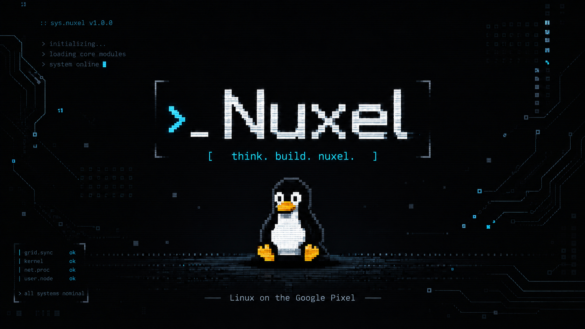

# Nuxel Phone OS — Linux on Google Pixel




**v0.8.1-beta** — _Direct LAN RDP/VNC, truthful security status and a mode-aware USB Tri-Link._

> **v0.8.1-beta (2026-11-08).** XRDP and VNC are directly reachable on the
> owner LAN on **TCP 13389** and **TCP 15900**, bound to the current trusted WLAN
> IPv4 address. XRDP is TLS + PAM in a separate X11 session; VNC is PAM +
> VeNCrypt TLS/RSA-AES and mirrors the active Phoc session. Every bridge/UI
> security field is derived from the effective daemon configuration. USB
> Tri-Link is now mode-aware and honestly reports NCM as blocked on the recorded
> 4.14.253 kernel and RNDIS as unverified. See
> [RELEASE-NOTES.md](RELEASE-NOTES.md) and [REPORT-USBNET.md](REPORT-USBNET.md).
>
> **Previously in v0.7.7-beta:** **Nuxel Doom is now a real WAD engine.**
> The old lookalike raycaster is gone: `org.nuxel.Doom` runs the **Chocolate
> Doom 3.0 engine compiled to WebAssembly**, loads Freedoom or an imported WAD
> through a read-only bridge catalogue, and renders the actual DOOM maps with
> a two-thumb multitouch HUD. The same release adds **Chocolate Doom** and
> **UZDoom** comparison apps, both installable/removable from **NuXtore**.
> Every foreground app is now immersive by default: the triple buttons and top
> bar disappear, a bottom-edge swipe brings navigation back, and a top-edge
> pull brings the status bar back. The same gesture works for native apps: the
> layer-shell dock keeps a 14 px bottom strip instead of vanishing. Home and
> the lockscreen are exempt. The phone also always boots in portrait and holds
> that pose through the lockscreen; the saved rotation mode resumes only after
> unlock. No Doom screen contains a text field or raises the system keyboard. See
> [`docs/games/doom.md`](docs/games/doom.md),
> [`docs/games/doom-engines.md`](docs/games/doom-engines.md) and
> [`docs/releases/v0.7.7-beta.md`](docs/releases/v0.7.7-beta.md).
>
> **Previously in v0.7.5-beta:** rotation works (owner-confirmed, transform and
> scale as one transaction, touch calibration follows it), GPU acceleration is
> **partial** (Phoc and WebKit render on the Mali-G76, WebKit presents through
> SHM), and Flatpak/bubblewrap works through kernel user namespaces. The
> release workflow builds the same kernel capability set the phone runs and
> publishes the exact installed BOOT image. See
> [`docs/releases/v0.7.5-beta.md`](docs/releases/v0.7.5-beta.md).

A hardened, GrapheneOS-spirited **Linux phone operating system** built from
scratch on a pure Linux substrate. **Zero Android dependencies.** Immutable OS.
**Flatpak-sandboxed app model** (PWA-first for mainstream apps, native GTK4 for
system apps) on a Phosh/GTK4/Wayland shell. Three device bring-ups in progress.

```text
App model:       Flatpak-sandboxed (Bubblewrap) + XDG portals
                   ├─ PWAs        — hardened WebKitGTK, isolated profiles (PWA-first)
                   └─ Native apps — GTK4/libadwaita, C/Python
Shell:           Phosh + phoc (GTK4)
Display:         Wayland only
Packaging:       Flatpak — org.gnome.Platform//46 base + org.nuxel.Platform PWA runtime
Android deps:    ZERO (no AOSP, no APK, no Play Store, no Waydroid, no libhybris)
Explicitly not:  Snap — Flatpak chosen (better portal/permission fit for this model)
No ambient trust.
VM first.
Hardware only after per-device Phase 0 gates pass.
```

---

> **Test hardware (for now).** We're currently testing Nuxel on three devices —
> not because they're the goal, but because we happen to have them lying around
> and they aren't our daily phones: **Motorola Moto G7 Power**, **Samsung Galaxy
> S10 Plus**, and **Google Pixel 10 Pro XL**. The Pixel 10 Pro XL is the target
> device.

## What is Nuxel?

Nuxel is a mobile-first Linux OS built from scratch on a pure Linux substrate.
It borrows the **security mindset** of GrapheneOS without borrowing Android as
the base platform.

| | Nuxel | Android | GrapheneOS |
|---|---|---|---|
| Base | Fedora/GNOME Flatpak runtime (immutable) | AOSP/Linux | AOSP/Linux |
| Kernel | Linux 6.12 LTS | Linux (ACK) | Linux (ACK) |
| Shell | Phosh + GTK4 | SurfaceFlinger | SurfaceFlinger |
| Apps | Flatpak: PWA (WebKitGTK) + native GTK4 | APK | APK |
| Sandbox | 5-layer + Bubblewrap/Flatpak + portals | SELinux | SELinux + hardened |
| Immutable | dm-verity + AVB | dm-verity + AVB | dm-verity + AVB |
| Android deps | **ZERO** | Full AOSP | Full AOSP |

## App Model

Nuxel has **one sandboxed app model** with two app flavours, both delivered and
confined the same way:

| Flavour | Runtime | Used for |
|---|---|---|
| **PWA (PWA-first)** | Hardened **WebKitGTK**, one isolated `WebContext` per app, shipped as a **Flatpak** | Mainstream/user-facing apps: mail, calendar, notes, files, camera, dashboards, social clients |
| **Native GTK4** | **GTK4/libadwaita** (C / Python), Flatpak- or system-confined with AppArmor | Hardware-critical & system apps: dialer, messages, contacts, settings, permissions, sandbox |

**Packaging & sandboxing.** Everything user-installable is a **Flatpak**:
Bubblewrap sandbox (Linux namespaces + seccomp + Landlock + AppArmor + nftables)
that reaches hardware, files, network and devices only through **XDG portals** and
the `nuxel-bridge` capability mediator. The immutable runtime base is
`org.gnome.Platform//46`; PWAs run on the `org.nuxel.Platform` hardened PWA
runtime and are launched with `flatpak run <app-id>` (see `pwa/flatpak/`).

> **Snap is not used.** Nuxel standardises on **Flatpak** — its portal model and
> precise D-Bus/filesystem permissions fit this phone architecture better than
> Snap's interface model, and every app is a Flatpak (there are no Snap
> manifests in this repo). Full detail: [`docs/app-store.md`](docs/app-store.md)
> and [`docs/pwa-model.md`](docs/pwa-model.md).

## Architecture

See [ARCHITECTURE.md](ARCHITECTURE.md) for the component map, capability
ownership, remote-access data flow and USB Tri-Link architecture.

## Quick Start

```bash
# Read the quickstart guide
cat prompts/QUICKSTART.md

# Test in UTM VM (Apple Silicon Mac)
bash vm/nuxel-vm-bootstrap.sh
bash vm/phosh-phone-resolution.sh 414x896

# Build images (requires a cross-compiler; the device key is explicit)
NUXEL_DEVICE=mustang bash images/build.sh --quick
NUXEL_DEVICE=g7power bash images/build.sh --quick
NUXEL_DEVICE=s10plus bash images/build.sh --quick

# Flash to hardware (per-device; requires an unlocked device)
NUXEL_DEVICE=mustang bash boot/flash.sh --unlock --wipe

# Bring-up guides
#   Moto G7 Power (SDM632, ocean):  docs/g7power-bringup.md
#   Galaxy S10+   (Exynos 9820):    docs/s10plus-bringup.md
#   Pixel 10 Pro XL (mustang):      docs/pixel10proxl-device-inventory.md
```

## Project Structure

| Directory | Contents |
|---|---|
| `services/` | Core D-Bus services (bridge, portal, notifications) |
| `shell/` | Native GTK4 apps (dialer, messages, contacts, settings, permissions) + `nuxel-sandbox` |
| `pwa/` | Progressive Web Apps + Flatpak manifests (`pwa/flatpak/`) + PWA launcher |
| `boot/` | Shared initramfs + per-device flash/recovery/boot config |
| `images/` | Per-device build orchestration (kernel → rootfs → signing) |
| `kernel/` | Per-device defconfig + patches (mustang, s10plus, g7power) |
| `configs/` | Shared security configs + per-device display/audio/touch |
| `tools/` | Device selection, AVB key generation, image signing, boot-image tooling |
| `vm/` | UTM VM bootstrap, phone resolution, snapshots |
| `docs/` | Architecture, security model, build guide, device setup |
| `phones/` | Per-device documentation bundles (`g7power/`, `s10plus/`, `pixel10proxl/`) |
| `prompts/` | Planning / analysis prompt archive (historical reference) |
| `device/` | Per-device postmarketOS package + deviceinfo |
| `firmware/` | Per-device firmware manifests, install/verify, blobs |
| `ci/` | Build validation |
| `assets/` | Wallpaper + boot animation |

## Release history

See [RELEASE-NOTES.md](RELEASE-NOTES.md) for user-facing release notes and
[CHANGELOG.md](CHANGELOG.md) for the complete engineering history.

## Honest Status — v0.8.1-beta

**S10+ (SM-G975F, beyond2lte) — NUXEL BOOTS, TOUCH WORKS, BLUETOOTH AND
SPEAKER AUDIO WORK, AND NETWORK LOCATION WORKS.**
S-Boot loads the raw arm64 `Image` with the initramfs embedded, the Fedora 43
ext4 rootfs mounts, `switch_root` hands over to **systemd 258 as PID 1**, the
service graph reaches `running`, and the panel shows the boot animation before
the launcher takes ownership. The **touchscreen produces real finger contact
events** through evdev → libinput → phoc → WebKit. Unlock → Home, app launching
and the Tri-Link console entries are physically verified.

**Bluetooth is no longer a blocker.** `CONFIG_BT_HCIUART`/H4 and
`btattach -P h4` register `hci0`; BlueZ reports the controller powered and a
12-second scan discovers a peer. The bridge, Quick Settings, Settings app,
status bar and lockscreen all read that same adapter state. Pairing and
connection actions are implemented and return the real BlueZ result; a specific
headset/keyboard profile test is still an owner step.

**Audio works and is owner-confirmed.** The ABOX Calliope core reaches
`MUB0`, both CS35L41 DSP1 protection images run, `ABOX RDMA1_EN=1`, the
amplifier gain is 12/12, the default sink is `alsa_output.hw_0_1` at 48 kHz and
`hw_ptr` advances. The silent speaker was a **PLL reference** fault: the device
tree programs 6.144 MHz while ABOX UAIF1 clocks the amps at 1.536 MHz. The fix
writes `0x4804=0x1b`, `0x2c04=0x370`, `0x6000=0x8000` and `0x2024=0x0` on both
amps and keeps them alive through the driver cache (`Digital PCM Volume=817`,
`AMP Mute=Unmuted`). `nuxel-audio-warmup` powers the DAPM speaker path with an
inaudible 8 s stream before the 366 ms cue. The owner typed `works` for the
boot cue, the volume cue, Settings Test Audio and after a full reboot. Volume
ceiling is 100 % with a 50 % first-boot default. Microphone/headset/USB-C
capture is still untested.

**Network location works; satellite GNSS is blocked.** A new per-UID GeoClue
agent plus a narrow `CAP_NET_RAW` grant produce a real Wi-Fi/IP fix
(`51.4005, 5.47196 ±25 km`, source `network_wifi`) across reboots, and the PWA
shim never invents coordinates, timestamps or accuracy. Satellite GNSS stays
`BLOCKED_FIRMWARE`: there is no BBD sensor-hub patch and no Android
`lhd`/`gpsd`/HIDL runtime, so no satellite fix is claimed. USB-C HDMI needs
`CONFIG_DRM` plus a Type-C DP Alt Mode stack, camera capture has no usable
V4L2 node, and the Shannon modem has no ModemManager object. Those remain
honestly blocked rather than simulated.

**PWNAGE-36000 live fixes were proven on the connected S10+ on 2026-10-28.**
The ABOX boot-done hard-IRQ panic is patched and the rebuilt BOOT image stayed
up for more than 11 minutes. HCIUART/H4 + `btattach` bring up `hci0`, the
controller powers on and a 12-second scan discovers a peer. RDMA1 audio routing
produces an advancing `hw_ptr` and successful `aplay -D default`. GPS hardware
responds on SPI but stays `BLOCKED_FIRMWARE` because the Broadcom BBD/LHD vendor
userspace is absent. This is a hardware-fix receipt; owner acceptance for
touch-driven app flows, keyboard/haptic feel, microphone/WAV capture, the full
preload-cinema sequence and laptop-side file transfer remains open.

**Rotation and touch-follow are working, and the GPU is partially
accelerated.** All seven orientation modes apply as one transform+scale
transaction and survive live readback; the libinput calibration matrix follows
the compositor transform, so landscape touches land where the finger lands.
Phoc renders on the vendor Mali-G76 through Mesa panfrost and WebKit is
GPU-rendered with SHM presentation. WebKit DMA-BUF and zero-copy presentation
remain `BLOCKED_KERNEL_ABI`: `drmMainDevice()` is null, `CONFIG_DRM_VGEM` is
unset and there is no `/dev/dri`. `nuxel-wl-fb` still copies the frame into
`/dev/fb0`, which is disclosed and not called zero-copy. Flatpak/bubblewrap now
works through kernel user namespaces, and microphone capture is a real WDMA1
source.

**The release ships the exact image installed on the handset.** The workflow
publishes `nuxel-installed-s10plus-boot.img.gz` — the complete BOOT partition
read back from the owner's SM-G975F on 2026-11-01 (`2cbc5085…`, 57,671,680
bytes) — together with a 5,873-entry hash inventory of the installed userspace
and an `INSTALLED-IMAGES.json` provenance manifest.
`tools/release/capture-installed-image.sh` reproduces the capture read-only.
The separately built `nuxel-<version>-s10plus.tar.gz` contains the reproducible
source rebuild and is explicitly labelled as such: it is not byte-identical to
the installed image. The kbase Mesa/wlroots bytes running on the phone are
shipped as the hash-pinned `release/s10plus/gpu/` input. See
[`docs/a61-penguin-eyes/INSTALLED-IMAGE-RELEASE.md`](docs/a61-penguin-eyes/INSTALLED-IMAGE-RELEASE.md)
and [`docs/releases/v0.7.7-beta.md`](docs/releases/v0.7.7-beta.md).

| Area | Score | Notes |
|---|---|---|
| Design/docs | 85% | Architecture, security model, PWA spec, three device bundles, plus the A25–A34 hardware evidence set |
| Repo structure | 90% | Legacy scratch trees and duplicate guides removed; canonical images only |
| PWA apps | 78% | Preload cinema, keyboard/navigation, connection modes, Feature-status docs, Bluetooth/audio/Wi-Fi overlays and app repairs ship; physical app interaction and hardware acceptance remain open |
| Flatpak app model | 45% | aarch64 Firefox/VLC/Signal/Stremio packages are installed and registered, but `CONFIG_USER_NS=n` blocks bubblewrap; Firefox/VLC fall back to the genuine Fedora RPMs and Signal/Stremio report the blocker |
| Native GTK apps | 45% | GTK4/libadwaita sources build and the installed native applications have registry + desktop entries; the handset launcher is the WebKit PWA shell and modem-dependent flows remain blocked |
| D-Bus bridge/portal | 60% | Bridge persistence, Bluetooth/audio/Wi-Fi providers, mail transport and runtime state publication are live; deeper portal integration is still partial |
| Sandbox/security | 25% | Configs exist; enforcement is not wired end-to-end |
| Build system | 90% | Fail-closed CI builds the current boot image and **compiles the current userspace from repo sources**; artifact verification is content-based and the release also ships the captured phone bytes |
| Flashable images | 90% | S10+ boot + Fedora rootfs and G7 Power lk2nd/boot/rootfs are byte-verified on hardware; S10+ boots |
| Pixel 10 Pro XL (mustang) | 5% | UART/initramfs-level only; no boot artifact yet |
| Galaxy S10+ (beyond2lte) | 94% | **Boots Nuxel; touchscreen, Bluetooth and speaker audio are verified working; network location works.** Display, animation, launcher, systemd service graph and single framebuffer owner are proven. Satellite GNSS, camera, modem, sensors and full Phosh acceptance remain open |
| Moto G7 Power (ocean) | 40% | Images flashed (lk2nd + boot + ext4 rootfs); still hangs at a black/flashy screen |
| UTM VM | 70% | Boots Fedora 43 + Phosh at 720×1440 with working network and **audio** (local, gitignored artifact) |

**Overall: ~76% MVP.** One of three phones (S10+) boots a Nuxel-built image,
its display path is live, its touchscreen delivers real contacts, Bluetooth
registers/powers/scans, and the speaker is owner-confirmed audible. Network
location works; satellite GNSS, camera and modem bring-up and sustained app
interaction are the remaining daily-driver gaps. G7 Power still hangs at a
black screen; mustang is UART/initramfs level only. The UTM VM demo boots and
works (display, network, sound).

### What this repo IS:
- A well-documented architecture blueprint for a Linux phone OS
- Working PWA shells with service workers and manifests
- Real Python D-Bus services (bridge, portal, notifications)
- Real native GTK4 C app source code
- Flatpak manifests + a PWA launcher (`pwa/flatpak/`, `pwa/launcher/`)
- Complete security configuration files (AppArmor, nftables, hardened_malloc)
- Build/flash/sign/recovery scripts as architectural planning material
- UTM VM testing scripts, plus a **booted UTM VM** (local artifact) running Phosh + the Nuxel service stack at phone resolution

### What this repo HAS now (verified this cycle):
- A **bootable S10+** — the Galaxy S10+ runs the Nuxel kernel, embedded
  initramfs, Fedora 43 systemd userspace, the panel animation and the launcher.
  The **touchscreen delivers real finger contacts** through evdev, libinput,
  phoc and WebKit. The open item is reliable **clickable** UI interaction.
- **A reproducible, fail-closed release CI.** The S10+ job builds the A25 boot
  image and compiles the **current A34 TOUCHDOWN** userspace from repo sources
  inside the arm64 container, then runs the A34/A33 touch regression suites and
  the strict `tools/verify-artifacts.sh` content gate. A red build cannot create
  a release.
- **A bootable UTM VM** — Fedora 43 + Phosh at 720×1440, Nuxel services + PWA
  live on the desktop, guest SSH reachable and **internet working**, with
  **verified VM audio** via `virtio-sound-pci` (local, gitignored artifact).
- **Flashed, checksummed images for two of three phones** — `g7power`
  (`lk2nd.img`, `nuxel-ocean-boot.img`, `nuxel-ocean-rootfs.img`) is flashed but
  still reaches only a black/flashy screen; `s10plus` (`nuxel-beyond2lte-boot.img`
  + the Fedora 43 ARM64 rootfs) is flashed, boots, and its userspace is live.

### What this repo IS NOT YET:
- A fully interactive phone: S10+ sustained app interaction is not fully signed
  off, and speaker audibility/microphone capture are not owner-confirmed.
- A flashable Pixel ROM (`mustang` has no boot artifact yet)
- A daily-driver phone
- A built Flatpak PWA runtime
- Hardware-validated across radio, camera, sensors and Phosh

### Measured code footprint (accuracy note)

Earlier prose (and `docs/roadmap.md`, `docs/milestones.md`) repeated an inflated
**"~25K lines"** figure for the native core. The verified, reproducible
measurements are far lower but reflect **real, present code**. The full
single-source-of-truth is **[docs/repo-audit.md](docs/repo-audit.md)**; the
headline numbers, re-measured on this cycle, are:

```text
corrected cycle: claimed 25K, actual core ~7.2K
```

```bash
# Pure-Python "true core" across services/ + shell/:
find services/ shell/ -name '*.py' | xargs wc -l
#    => 7,234 lines (services/ 2,863 + shell/ 4,371)

# Python + C (the command the older prose quoted):
find services/ shell/ -name '*.py' -o -name '*.c' | xargs wc -l
#    => 12,246 lines

# Full .py/.c/.js cross-tree total (services + shell + pwa):
find services/ shell/ pwa/ \( -name '*.py' -o -name '*.c' -o -name '*.js' \) | xargs wc -l
#    => 18,036 lines
```

The pure-Python core (bridge, portal, notifications services, the Phosh agent,
firstboot, and the native home in `services/` and `shell/`) is **~7.2K lines**.
Adding the C sources brings Python + C to **12,246** lines. The full
Python + C + JavaScript cross-tree total (which includes the PWA bridge and the
home/launcher JS) is **18,036** lines. The sandbox subsystem is **2,005** lines
(`shell/nuxel-shell/nuxel-sandbox/sandbox.c`, with `sandbox.h` at 256 and
`nftables.sh` at 315), **not** the ~20K previously documented.

**Most "gaps" are already present in the repo, not missing.** In particular:
- **systemd units** — `services/{bridge,portal,notifications}/systemd/*.service`,
  `services/nuxel-web.service`,
  `shell/config/systemd-user/{nuxel-home-native,nuxel-home-kiosk,nuxel-phosh-agent}.service`,
  `shell/nuxel-camera-portal/systemd/nuxel-camera-portal.service`,
  `configs/apparmor/systemd/nuxel-apparmor-enforce.service`
- **D-Bus policy configs** —
  `services/{bridge,portal,notifications}/dbus/*.conf` and `configs/dbus/*.conf`
- **OpenRC init scripts** — `shell/config/openrc/{nuxel-bridge,nuxel-portal,nuxel-notifications,nuxel-firstboot}`

These exist as committed files (verified in the audit checklist); what remains
is integration/wiring, not authoring.

### Development path:
1. **Now**: Fix scripts, validate syntax, test PWAs in browser ✅ Done
2. **Next**: Build the Flatpak PWA runtime, boot Phosh in a VM, run bridge/portal locally
3. **Later**: Prove kernel build for the bring-up targets, produce real boot images
4. **Eventually**: Flash to hardware only after bootloader/display/touch/storage/WiFi/modem gates pass

**Build the bunker first. The rave lights come later.**

## Security Model

- **5-layer sandbox**: Linux namespaces → seccomp BPF → Landlock → AppArmor → nftables
- **Flatpak everywhere**: user-installable apps ship as Flatpak bundles (Bubblewrap) — no ambient filesystem/network/device access
- **Portals everywhere**: hardware, files, network and D-Bus access only via `nuxel-bridge` + XDG portals, with explicit user consent
- **Immutable OS**: read-only system partition, dm-verity, atomic A/B updates, rollback
- **Verified boot**: AVB 2.0 chain, user-controlled signing keys, bootloader relock
- **Hardened allocator**: GrapheneOS-style hardened_malloc (zero-on-free, canary, guard slabs)
- **Wayland only**: no X11, no XWayland, per-app surface isolation
- **No Android**: no Waydroid, no Halium, no libhybris, no APK, no AOSP
- **No Snap**: Flatpak is the single app packaging/sandbox format

## Multi-Device Targets

Nuxel supports multiple hardware targets. Select via `NUXEL_DEVICE` or `--device`:

| Key | Device | Codename | Status |
|---|---|---|---|
| `mustang` | Google Pixel 10 Pro XL | mustang | Scaffold — no boot artifact yet |
| `s10plus` | Samsung Galaxy S10+ (Exynos) | beyond2lte | **Boots Nuxel — touchscreen works; clickable UI pending; sound unproven** |
| `g7power` | Motorola Moto G7 Power (ocean) | ocean | **Flashed to hardware** — powers on but stuck at a black/flashy screen |

Every device-specific **build** artifact lives under a per-device directory
keyed by `NUXEL_DEVICE`: `google-pixel-10-pro-xl/` (mustang), `s10plus/`,
`g7power/` across `firmware/`, `kernel/`, `device/`, `boot/`, `configs/` and
`images/`. `tools/nuxel-device-select.sh` resolves the key (CLI `--device` >
`NUXEL_DEVICE` env > explicit error; aliases `s10plus|beyond2lte`,
`g7power|ocean`) and every per-device script sources it and prints the resolved
key before any work.

Each device's **documentation bundle** (requirements, implementation prompt,
quickstart, go-guide and — for the G7 Power — the on-device stock-evidence
capture) lives under [`phones/`](phones/): `phones/pixel10proxl/`,
`phones/s10plus/` and `phones/g7power/`.

Two of the three targets have real, checksummed boot artifacts, and both are
flashed. The **S10+ (Exynos 9820)** boots Nuxel from the A25 boot image plus the
Fedora 43 ARM64 userspace; its **touchscreen works**, while reliable clicking and
S10+ audio remain open. The **G7 Power (SDM632/msm8953)** has its lk2nd
chainloader, boot image and writable ext4 rootfs flashed, but still hangs at a
black/flashy screen (display init unresolved). The `mustang` path remains a
scaffold with no boot artifact.

See `docs/s10plus-bringup.md` for the S10+ bring-up guide,
`docs/g7power-bringup.md` for the G7 Power bring-up guide, and the per-device
"do it now" checklists at
[`phones/s10plus/s10plus-go-guide.md`](phones/s10plus/s10plus-go-guide.md) and
[`phones/g7power/g7power-go-guide.md`](phones/g7power/g7power-go-guide.md).

## Hardware Targets

**Primary reference target — Google Pixel 10 Pro XL (`mustang`):**

| Spec | Value |
|---|---|
| Device | Google Pixel 10 Pro XL |
| Codename | mustang |
| Serial | 58211FDCQ001LA |
| HW / SKU | MP1.0 / G45RY |
| SoC | Google Tensor G5 (gs501) |
| GPU | Imagination PowerVR DXT-72-2304 |
| Modem | Samsung Exynos 5500 |
| Display | Samsung AMB655X 3120×1440 @120Hz |
| Touch | Samsung S6SY791 |
| WiFi | Broadcom BCM4390 (WiFi 7) |
| Kernel | Linux 6.12 LTS |

The other two bring-up targets are the **Samsung Galaxy S10+** (Exynos 9820,
`beyond2lte`) and the **Motorola Moto G7 Power** (Qualcomm SDM632/msm8953,
`ocean`); their component IDs live in [`docs/hardware-ids.md`](docs/hardware-ids.md).

## Requirements

### For UTM VM testing:
- macOS on Apple Silicon (M1/M2/M3/M4)
- UTM.app
- Fedora/Debian ARM64 ISO

### For building images:
- AArch64 cross-compiler (`aarch64-linux-gnu-gcc`)
- Linux 6.12 kernel source (per-target branch)
- GTK4/libadwaita development libraries
- **Flatpak** + `flatpak-builder` (`org.gnome.Platform//46` runtime base)

### For flashing to hardware:
- The target device with an unlocked bootloader
  (`mustang`/`g7power`: fastboot; `s10plus`: TWRP + Download Mode/heimdall)
- Google/Samsung/Motorola factory image where applicable (for firmware extraction)
- fastboot + adb (plus heimdall for the S10+)
- A completed Phase 0 device inventory for the target (build gates stay closed otherwise)

## Documentation

| Document | Description |
|---|---|
| [RELEASE-NOTES.md](RELEASE-NOTES.md) | User-facing release notes and current release summary |
| [CHANGELOG.md](CHANGELOG.md) | Full engineering changelog — v0.1.0 to v0.8.1-beta |
| [REPORT-USBNET.md](REPORT-USBNET.md) | Evidence-based USB network blocker report and next step |
| [GUI-TRI-LINK-QUICKSTART.md](GUI-TRI-LINK-QUICKSTART.md) | Direct-LAN XRDP 13389 / VNC 15900 and native mirror quickstart |
| [TRI-LINK-CLI-QUICKSTART.md](TRI-LINK-CLI-QUICKSTART.md) | Serial, Wi-Fi SSH and USB SSH host CLI quickstart |
| [ARCHITECTURE.md](ARCHITECTURE.md) | Component map, ownership, remote-access and USB architecture |
| [docs/features/README.md](docs/features/README.md) | Canonical feature-status matrix with evidence anchors |
| [prompts/QUICKSTART.md](prompts/QUICKSTART.md) | Get running in 5 minutes |
| [design/nuxel-linux-phone-design.md](design/nuxel-linux-phone-design.md) | Design bible — the full vision |
| [design/Nuxel Phone OS Project Plan and Architecture.md](design/Nuxel%20Phone%20OS%20Project%20Plan%20and%20Architecture.md) | Technical architecture + component map |
| [docs/architecture.md](docs/architecture.md) | Immutable OS architecture |
| [docs/security-model.md](docs/security-model.md) | Sandbox, mitigations, boot chain |
| [docs/app-store.md](docs/app-store.md) | App distribution model (Flatpak + portals, signed packages) |
| [docs/pwa-model.md](docs/pwa-model.md) | Hardened PWA runtime spec |
| [docs/build-guide.md](docs/build-guide.md) | Full build pipeline |
| [.github/workflows/release.yml](.github/workflows/release.yml) | Merged-PR (`main`) build → auto-tag → GitHub **Latest** release pipeline |
| [docs/device-setup.md](docs/device-setup.md) | Mustang hardware setup |
| [docs/bootloader-unlock-guide.md](docs/bootloader-unlock-guide.md) | Unlock + relock guide |
| [docs/driver-status.md](docs/driver-status.md) | Hardware driver matrix |
| [docs/hardware-ids.md](docs/hardware-ids.md) | Canonical hardware component IDs (all targets) |
| [docs/milestones.md](docs/milestones.md) | Development progress |
| [docs/roadmap.md](docs/roadmap.md) | Future plans |
| [docs/update-strategy.md](docs/update-strategy.md) | Immutable/atomic update strategy |
| [docs/s10plus-bringup.md](docs/s10plus-bringup.md) | S10+ (Exynos) bring-up guide — boot chain, TWRP/heimdall flash, Phase 0 |
| [docs/s10plus-device-inventory.md](docs/s10plus-device-inventory.md) | S10+ Phase 0 device inventory template + build gate |
| [docs/g7power-bringup.md](docs/g7power-bringup.md) | G7 Power (ocean) bring-up guide — boot chain, two-phase fastboot, dtbo-first rule, EDL unbrick |
| [docs/g7power-device-inventory.md](docs/g7power-device-inventory.md) | G7 Power Phase 0 device inventory template + build gate |
| [docs/pixel10proxl-device-inventory.md](docs/pixel10proxl-device-inventory.md) | Pixel 10 Pro XL Phase 0 device inventory template + build gate |
| [docs/service-graph.md](docs/service-graph.md) | Service dependency graph |
| [docs/repo-audit.md](docs/repo-audit.md) | Measured LOC, file inventory, verified-exists checklist |
| [phones/g7power/g7power-go-guide.md](phones/g7power/g7power-go-guide.md) | G7 Power (ocean) "do it now" flash checklist |
| [phones/s10plus/s10plus-go-guide.md](phones/s10plus/s10plus-go-guide.md) | S10+ (beyond2lte) "do it now" flash checklist |
| [phones/pixel10proxl/pixel10proxl-go-guide.md](phones/pixel10proxl/pixel10proxl-go-guide.md) | Pixel 10 Pro XL (mustang) "do it now" flash checklist |

## Releasing

Build outputs (`build/out/<device>/`) are git-ignored — they are produced by the
scripts in `images/` and `kernel/`, not committed. To publish them on GitHub:

* **Automated (recommended):** open a PR against `main`. When the PR is merged,
  [`.github/workflows/release.yml`](.github/workflows/release.yml) runs for the
  merge commit, builds the S10+ image from repo sources, verifies the
  source-to-image parity gates, creates the annotated `v<VERSION>` tag, and
  publishes a GitHub release explicitly marked **Latest** (the `-beta` tag and
  title keep the beta status). The sidebar therefore shows the newest release.
  Tag pushes do not trigger the workflow; `main` is protected, so the release
  route is a merged PR.
  The S10+ build runs `images/s10plus/build-a25-boot.sh` (raw arm64 kernel with
  the repo-source initramfs embedded) plus the Fedora 43 ARM64 phone rootfs,
  which **compiles the current A34 TOUCHDOWN userspace and socket-activated
  metrics daemon from repo sources** inside the arm64 container. It also emits
  the matching hash-manifested live userspace payload.
* **Manually / locally:** run the packager against an existing build tree, then
  upload the archives yourself:

  ```bash
  tools/package-release.sh --version "$(cat VERSION)"   # -> dist/
  ```

  Add `--device g7power` to package a single device, or `--from-assets` to
  (re)generate `SHA256SUMS.txt` + `RELEASE-NOTES.md` over archives already in
  `dist/`.

## License

Nuxel is released under the **MIT License**. See [LICENSE](LICENSE) for the
full text. Maintained by [RikkeTik](https://rikketik.dev).

```text
MIT License

Copyright (c) 2026 RikkeTik (https://rikketik.dev)
```

**Third-party components keep their own licenses** and are *not* covered by the
MIT grant above. This includes, but is not limited to:

| Component | License |
|---|---|
| Linux kernel and patches | GPL-2.0-only |
| `external/avbtool` (AOSP) | MIT |
| `bin/toybox` | 0BSD |

Any file that carries an explicit `SPDX-License-Identifier` or copyright header
is governed by that header, which overrides the project-wide MIT terms for that
file.

## Non-Goals

- No Android app compatibility (no APKs, no Play Store)
- No Waydroid, Halium, or libhybris
- No Snap — Flatpak is the single app packaging/sandbox format
- No KDE or Qt — GTK4/libadwaita only
- No X11 — Wayland only
- No banking/government app compatibility promises
- No daily-driver claim until hardware gates pass

---

_Build the bunker first. Add the rave lights later._

---

<!-- Reconciliation & code-size accuracy owned by the Repo state audit & doc reconciliation build group (briq-01-audit). Single source of truth for all measured counts: docs/repo-audit.md. -->
