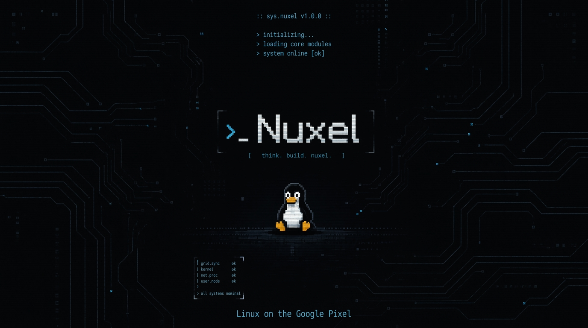

# Nuxel Phone OS — Linux on Google Pixel




**v0.2.0** — _Build the bunker first. Add the rave lights later._

A hardened, GrapheneOS-spirited **Linux phone operating system** built from
scratch on a pure Linux substrate. **Zero Android dependencies.** Immutable OS.
**Flatpak-sandboxed app model** (PWA-first for mainstream apps, native GTK4 for
system apps) on a Phosh/GTK4/Wayland shell. Three device bring-ups in progress.

```text
App model:       Flatpak-sandboxed (Bubblewrap) + XDG portals
                   ├─ PWAs        — hardened WebKitGTK, isolated profiles (PWA-first)
                   └─ Native apps — GTK4/libadwaita, C/Python
Shell:           Phosh + phoc (GTK4)
Display:         Wayland only
Packaging:       Flatpak — org.gnome.Platform//46 base + org.nuxel.Platform PWA runtime
Android deps:    ZERO (no AOSP, no APK, no Play Store, no Waydroid, no libhybris)
Explicitly not:  Snap — Flatpak chosen (better portal/permission fit for this model)
No ambient trust.
VM first.
Hardware only after per-device Phase 0 gates pass.
```

---

> **Test hardware (for now).** We're currently testing Nuxel on three devices —
> not because they're the goal, but because we happen to have them lying around
> and they aren't our daily phones: **Motorola Moto G7 Power**, **Samsung Galaxy
> S10 Plus**, and **Google Pixel 10 Pro XL**. The Pixel 10 Pro XL is the target
> device.

## What is Nuxel?

Nuxel is a mobile-first Linux OS built from scratch on a pure Linux substrate.
It borrows the **security mindset** of GrapheneOS without borrowing Android as
the base platform.

| | Nuxel | Android | GrapheneOS |
|---|---|---|---|
| Base | Fedora/GNOME Flatpak runtime (immutable) | AOSP/Linux | AOSP/Linux |
| Kernel | Linux 6.12 LTS | Linux (ACK) | Linux (ACK) |
| Shell | Phosh + GTK4 | SurfaceFlinger | SurfaceFlinger |
| Apps | Flatpak: PWA (WebKitGTK) + native GTK4 | APK | APK |
| Sandbox | 5-layer + Bubblewrap/Flatpak + portals | SELinux | SELinux + hardened |
| Immutable | dm-verity + AVB | dm-verity + AVB | dm-verity + AVB |
| Android deps | **ZERO** | Full AOSP | Full AOSP |

## App Model

Nuxel has **one sandboxed app model** with two app flavours, both delivered and
confined the same way:

| Flavour | Runtime | Used for |
|---|---|---|
| **PWA (PWA-first)** | Hardened **WebKitGTK**, one isolated `WebContext` per app, shipped as a **Flatpak** | Mainstream/user-facing apps: mail, calendar, notes, files, camera, dashboards, social clients |
| **Native GTK4** | **GTK4/libadwaita** (C / Python), Flatpak- or system-confined with AppArmor | Hardware-critical & system apps: dialer, messages, contacts, settings, permissions, sandbox |

**Packaging & sandboxing.** Everything user-installable is a **Flatpak**:
Bubblewrap sandbox (Linux namespaces + seccomp + Landlock + AppArmor + nftables)
that reaches hardware, files, network and devices only through **XDG portals** and
the `nuxel-bridge` capability mediator. The immutable runtime base is
`org.gnome.Platform//46`; PWAs run on the `org.nuxel.Platform` hardened PWA
runtime and are launched with `flatpak run <app-id>` (see `pwa/flatpak/`).

> **Snap is not used.** Nuxel standardises on **Flatpak** — its portal model and
> precise D-Bus/filesystem permissions fit this phone architecture better than
> Snap's interface model, and every app is a Flatpak (there are no Snap
> manifests in this repo). Full detail: [`docs/app-store.md`](docs/app-store.md)
> and [`docs/pwa-model.md`](docs/pwa-model.md).

## Architecture

```text
┌──────────────────────────────────────────────────┐
│  Flatpak-sandboxed apps (Bubblewrap)             │
│  PWA apps        — WebKitGTK, isolated profiles  │
│  Native apps     — GTK4/libadwaita (C/Python)    │
├──────────────────────────────────────────────────┤
│  nuxel-home launcher                             │
│  nuxel-bridge (D-Bus capability mediator)        │
│  nuxel-portal (GTK4 consent dialogs)             │
│  nuxel-notifications (FDO bridge)                │
├──────────────────────────────────────────────────┤
│  Sandbox: namespaces + seccomp + Landlock        │
│          + AppArmor + nftables                   │
├──────────────────────────────────────────────────┤
│  Phosh + phoc compositor (Wayland)               │
├──────────────────────────────────────────────────┤
│  ModemManager | NetworkManager | PipeWire        │
│  GeoClue | xdg-desktop-portal                    │
├──────────────────────────────────────────────────┤
│  Linux 6.12 LTS (per-device defconfig/patches)   │
│  dm-verity system + A/B slots + AVB              │
├──────────────────────────────────────────────────┤
│  Hardware targets (see Multi-Device Targets):    │
│  Google Pixel 10 Pro XL (mustang)                │
│  Samsung Galaxy S10+     (beyond2lte)            │
│  Motorola Moto G7 Power  (ocean)                 │
└──────────────────────────────────────────────────┘
```

## Quick Start

```bash
# Read the quickstart guide
cat prompts/QUICKSTART.md

# Test in UTM VM (Apple Silicon Mac)
bash vm/nuxel-vm-bootstrap.sh
bash vm/phosh-phone-resolution.sh 414x896

# Build images (requires a cross-compiler; the device key is explicit)
NUXEL_DEVICE=mustang bash images/build.sh --quick
NUXEL_DEVICE=g7power bash images/build.sh --quick
NUXEL_DEVICE=s10plus bash images/build.sh --quick

# Flash to hardware (per-device; requires an unlocked device)
NUXEL_DEVICE=mustang bash boot/flash.sh --unlock --wipe

# Bring-up guides
#   Moto G7 Power (SDM632, ocean):  docs/g7power-bringup.md
#   Galaxy S10+   (Exynos 9820):    docs/s10plus-bringup.md
#   Pixel 10 Pro XL (mustang):      docs/pixel10proxl-device-inventory.md
```

## Project Structure

| Directory | Contents |
|---|---|
| `services/` | Core D-Bus services (bridge, portal, notifications) |
| `shell/` | Native GTK4 apps (dialer, messages, contacts, settings, permissions) + `nuxel-sandbox` |
| `pwa/` | Progressive Web Apps + Flatpak manifests (`pwa/flatpak/`) + PWA launcher |
| `boot/` | Shared initramfs + per-device flash/recovery/boot config |
| `images/` | Per-device build orchestration (kernel → rootfs → signing) |
| `kernel/` | Per-device defconfig + patches (mustang, s10plus, g7power) |
| `configs/` | Shared security configs + per-device display/audio/touch |
| `tools/` | Device selection, AVB key generation, image signing, boot-image tooling |
| `vm/` | UTM VM bootstrap, phone resolution, snapshots |
| `docs/` | Architecture, security model, build guide, device setup |
| `phones/` | Per-device documentation bundles (`g7power/`, `s10plus/`, `pixel10proxl/`) |
| `prompts/` | Planning / analysis prompt archive (historical reference) |
| `device/` | Per-device postmarketOS package + deviceinfo |
| `firmware/` | Per-device firmware manifests, install/verify, blobs |
| `ci/` | Build validation |
| `assets/` | Wallpaper + boot animation |

## What's new in v0.2.0

Everything below landed between **v0.1.0** (the mustang-only scaffold) and this
release. Full detail, per area, is in **[CHANGELOG.md](CHANGELOG.md)**.

- **Three device targets, not one.** `mustang` (Pixel 10 Pro XL) is now joined
  by two active bring-ups: `s10plus` (Samsung Galaxy S10+, Exynos 9820,
  `beyond2lte`) and `g7power` (Motorola Moto G7 Power, SDM632/msm8953, `ocean`).
- **Per-device orchestration + safety gates.** Every device has its own
  `firmware/ kernel/ device/ boot/ configs/ images/` subtree, resolved by
  `tools/nuxel-device-select.sh`. Every build/flash script hard-guards its
  device key and enforces a **Phase 0 inventory gate** so nothing can be built
  or flashed with `PLACEHOLDER`/`UNKNOWN` load addresses or firmware names.
- **G7 Power bring-up advances.** Touchscreen root-caused and fixed (ILI2117 is
  handled by mainline `ili210x` / `CONFIG_TOUCHSCREEN_ILI210X`, *not* a
  nonexistent `CONFIG_TOUCHSCREEN_ILI2117`); an on-device **stock-evidence**
  bundle captured (`phones/g7power/stock-evidence/`); lk2nd boot chain worked
  out — including a QCDT boot-image packer (`tools/build-qcdt-boot.py`) that
  fixes the "lk2nd menu then black screen" packaging bug — plus a two-phase
  fastboot flash flow and an EDL unbrick path.
- **S10+ bring-up scaffolded.** Documented Exynos boot chain (S-Boot → U-Boot →
  Linux), the no-fastboot reality (TWRP + Download Mode/heimdall), Knox-tripped
  constraints, anti-cross-flash rules, and a Phase 0 inventory template.
- **Pixel/mustang prep.** Phase 0 inventory template + build gate and a
  reconciliation of the mustang path against the multi-device layout.
- **Repo hygiene.** Device documentation bundles were consolidated under
  `phones/` (`g7power/`, `s10plus/`, `pixel10proxl/`); the loose planning and
  analysis prompts now live under `prompts/`.
- **Version bump to v0.2.0** across `VERSION`, README, docs/design headers, the
  shell apps (meson + metainfo), the PWA manifest, the device `APKBUILD`s, the
  VM tooling and the OTA builder.

**Readiness at a glance:** still a scaffold — **0% verified flashable**, ~30–35%
MVP, ~40–45% patchable VM demo. The honest per-area breakdown is the table
below; the "what's left" list is in the changelog.

## Honest Status — v0.2.0

**Nuxel is a design scaffold and code prototype with three device bring-ups in progress. It is not a flashable phone OS yet.**

| Area | Score | Notes |
|---|---|---|
| Design/docs | 78% | Architecture, security model, PWA spec, three device doc bundles |
| Repo structure | 85% | Clean layout; device doc bundles consolidated under `phones/` |
| PWA apps | 45% | Manifests, SWs, JS exist — need integration testing |
| Flatpak app model | 20% | Manifests + launcher exist (`pwa/flatpak/`, `org.nuxel.Platform`); runtime not built or integration-tested |
| Native GTK apps | 25–35% | C source exists, not proven buildable on aarch64 |
| D-Bus bridge/portal | 30% | Python parses, dev-grade auth, not integration-tested |
| Sandbox/security | 20% | Configs exist, enforcement not wired end-to-end |
| Build system | 20% | Per-device dispatchers + inventory gates; still unproven on hardware |
| Flashable images | 0% | No verified boot artifact set produced |
| Pixel 10 Pro XL (mustang) | 5% | Public mustang Linux is UART/initramfs-level only |
| Galaxy S10+ (beyond2lte) | 10% | Bring-up: device package, gates, docs — no boot yet |
| Moto G7 Power (ocean) | 15% | Bring-up: touchscreen-driver fix, stock evidence, lk2nd/QCDT tooling |
| UTM VM | 25% | Scripts/docs exist, no VM image artifact produced |

**Overall: ~30–35% MVP scaffold. 0% verified flashable OS. ~40–45% patchable VM demo.**

### What this repo IS:
- A well-documented architecture blueprint for a Linux phone OS
- Working PWA shells with service workers and manifests
- Real Python D-Bus services (bridge, portal, notifications)
- Real native GTK4 C app source code
- Flatpak manifests + a PWA launcher (`pwa/flatpak/`, `pwa/launcher/`)
- Complete security configuration files (AppArmor, nftables, hardened_malloc)
- Build/flash/sign/recovery scripts as architectural planning material
- UTM VM testing scripts for early architecture validation

### What this repo IS NOT YET:
- A bootable OS image
- A flashable Pixel ROM
- A working phone
- A built Flatpak PWA runtime
- Integration-tested
- Hardware-validated

### Measured code footprint (accuracy note)

Earlier prose (and `docs/roadmap.md`, `docs/milestones.md`) repeated an inflated
**"~25K lines"** figure for the native core. The verified, reproducible
measurements are far lower but reflect **real, present code**. The full
single-source-of-truth is **[docs/repo-audit.md](docs/repo-audit.md)**; the
headline numbers, re-measured on this cycle, are:

```text
corrected cycle: claimed 25K, actual core ~7.2K
```

```bash
# Pure-Python "true core" across services/ + shell/:
find services/ shell/ -name '*.py' | xargs wc -l
#    => 7,234 lines (services/ 2,863 + shell/ 4,371)

# Python + C (the command the older prose quoted):
find services/ shell/ -name '*.py' -o -name '*.c' | xargs wc -l
#    => 12,246 lines

# Full .py/.c/.js cross-tree total (services + shell + pwa):
find services/ shell/ pwa/ \( -name '*.py' -o -name '*.c' -o -name '*.js' \) | xargs wc -l
#    => 18,036 lines
```

The pure-Python core (bridge, portal, notifications services, the Phosh agent,
firstboot, and the native home in `services/` and `shell/`) is **~7.2K lines**.
Adding the C sources brings Python + C to **12,246** lines. The full
Python + C + JavaScript cross-tree total (which includes the PWA bridge and the
home/launcher JS) is **18,036** lines. The sandbox subsystem is **2,005** lines
(`shell/nuxel-shell/nuxel-sandbox/sandbox.c`, with `sandbox.h` at 256 and
`nftables.sh` at 315), **not** the ~20K previously documented.

**Most "gaps" are already present in the repo, not missing.** In particular:
- **systemd units** — `services/{bridge,portal,notifications}/systemd/*.service`,
  `services/nuxel-web.service`,
  `shell/config/systemd-user/{nuxel-home-native,nuxel-home-kiosk,nuxel-phosh-agent}.service`,
  `shell/nuxel-camera-portal/systemd/nuxel-camera-portal.service`,
  `configs/apparmor/systemd/nuxel-apparmor-enforce.service`
- **D-Bus policy configs** —
  `services/{bridge,portal,notifications}/dbus/*.conf` and `configs/dbus/*.conf`
- **OpenRC init scripts** — `shell/config/openrc/{nuxel-bridge,nuxel-portal,nuxel-notifications,nuxel-firstboot}`

These exist as committed files (verified in the audit checklist); what remains
is integration/wiring, not authoring.

### Development path:
1. **Now**: Fix scripts, validate syntax, test PWAs in browser ✅ Done
2. **Next**: Build the Flatpak PWA runtime, boot Phosh in a VM, run bridge/portal locally
3. **Later**: Prove kernel build for the bring-up targets, produce real boot images
4. **Eventually**: Flash to hardware only after bootloader/display/touch/storage/WiFi/modem gates pass

**Build the bunker first. The rave lights come later.**

## Security Model

- **5-layer sandbox**: Linux namespaces → seccomp BPF → Landlock → AppArmor → nftables
- **Flatpak everywhere**: user-installable apps ship as Flatpak bundles (Bubblewrap) — no ambient filesystem/network/device access
- **Portals everywhere**: hardware, files, network and D-Bus access only via `nuxel-bridge` + XDG portals, with explicit user consent
- **Immutable OS**: read-only system partition, dm-verity, atomic A/B updates, rollback
- **Verified boot**: AVB 2.0 chain, user-controlled signing keys, bootloader relock
- **Hardened allocator**: GrapheneOS-style hardened_malloc (zero-on-free, canary, guard slabs)
- **Wayland only**: no X11, no XWayland, per-app surface isolation
- **No Android**: no Waydroid, no Halium, no libhybris, no APK, no AOSP
- **No Snap**: Flatpak is the single app packaging/sandbox format

## Multi-Device Targets

Nuxel supports multiple hardware targets. Select via `NUXEL_DEVICE` or `--device`:

| Key | Device | Codename | Status |
|---|---|---|---|
| `mustang` | Google Pixel 10 Pro XL | mustang | Scaffold (0% flashable) |
| `s10plus` | Samsung Galaxy S10+ (Exynos) | beyond2lte | Bring-up in progress |
| `g7power` | Motorola Moto G7 Power (ocean) | ocean | Bring-up in progress |

Every device-specific **build** artifact lives under a per-device directory
keyed by `NUXEL_DEVICE`: `google-pixel-10-pro-xl/` (mustang), `s10plus/`,
`g7power/` across `firmware/`, `kernel/`, `device/`, `boot/`, `configs/` and
`images/`. `tools/nuxel-device-select.sh` resolves the key (CLI `--device` >
`NUXEL_DEVICE` env > explicit error; aliases `s10plus|beyond2lte`,
`g7power|ocean`) and every per-device script sources it and prints the resolved
key before any work.

Each device's **documentation bundle** (requirements, implementation prompt,
quickstart, go-guide and — for the G7 Power — the on-device stock-evidence
capture) lives under [`phones/`](phones/): `phones/pixel10proxl/`,
`phones/s10plus/` and `phones/g7power/`.

None of the three targets is flashable/verified yet. The S10+ (Exynos 9820, no
fastboot; TWRP + Download Mode/heimdall only) is a bring-up in progress gated
on the Phase 0 device inventory, and the G7 Power (SDM632/msm8953, fastboot +
lk2nd + EDL) is a bring-up in progress gated on the same Phase 0 inventory.
The mustang path remains a scaffold (0% flashable).

See `docs/s10plus-bringup.md` for the S10+ bring-up guide,
`docs/g7power-bringup.md` for the G7 Power bring-up guide, and the per-device
"do it now" checklists at
[`phones/s10plus/s10plus-go-guide.md`](phones/s10plus/s10plus-go-guide.md) and
[`phones/g7power/g7power-go-guide.md`](phones/g7power/g7power-go-guide.md).

## Hardware Targets

**Primary reference target — Google Pixel 10 Pro XL (`mustang`):**

| Spec | Value |
|---|---|
| Device | Google Pixel 10 Pro XL |
| Codename | mustang |
| Serial | 58211FDCQ001LA |
| HW / SKU | MP1.0 / G45RY |
| SoC | Google Tensor G5 (gs501) |
| GPU | Imagination PowerVR DXT-72-2304 |
| Modem | Samsung Exynos 5500 |
| Display | Samsung AMB655X 3120×1440 @120Hz |
| Touch | Samsung S6SY791 |
| WiFi | Broadcom BCM4390 (WiFi 7) |
| Kernel | Linux 6.12 LTS |

The other two bring-up targets are the **Samsung Galaxy S10+** (Exynos 9820,
`beyond2lte`) and the **Motorola Moto G7 Power** (Qualcomm SDM632/msm8953,
`ocean`); their component IDs live in [`docs/hardware-ids.md`](docs/hardware-ids.md).

## Requirements

### For UTM VM testing:
- macOS on Apple Silicon (M1/M2/M3/M4)
- UTM.app
- Fedora/Debian ARM64 ISO

### For building images:
- AArch64 cross-compiler (`aarch64-linux-gnu-gcc`)
- Linux 6.12 kernel source (per-target branch)
- GTK4/libadwaita development libraries
- **Flatpak** + `flatpak-builder` (`org.gnome.Platform//46` runtime base)

### For flashing to hardware:
- The target device with an unlocked bootloader
  (`mustang`/`g7power`: fastboot; `s10plus`: TWRP + Download Mode/heimdall)
- Google/Samsung/Motorola factory image where applicable (for firmware extraction)
- fastboot + adb (plus heimdall for the S10+)
- A completed Phase 0 device inventory for the target (build gates stay closed otherwise)

## Documentation

| Document | Description |
|---|---|
| [CHANGELOG.md](CHANGELOG.md) | Release notes — everything from v0.1.0 to v0.2.0 + readiness |
| [prompts/QUICKSTART.md](prompts/QUICKSTART.md) | Get running in 5 minutes |
| [design/nuxel-linux-phone-design.md](design/nuxel-linux-phone-design.md) | Design bible — the full vision |
| [design/Nuxel Phone OS Project Plan and Architecture.md](design/Nuxel%20Phone%20OS%20Project%20Plan%20and%20Architecture.md) | Technical architecture + component map |
| [docs/architecture.md](docs/architecture.md) | Immutable OS architecture |
| [docs/security-model.md](docs/security-model.md) | Sandbox, mitigations, boot chain |
| [docs/app-store.md](docs/app-store.md) | App distribution model (Flatpak + portals, signed packages) |
| [docs/pwa-model.md](docs/pwa-model.md) | Hardened PWA runtime spec |
| [docs/build-guide.md](docs/build-guide.md) | Full build pipeline |
| [docs/device-setup.md](docs/device-setup.md) | Mustang hardware setup |
| [docs/bootloader-unlock-guide.md](docs/bootloader-unlock-guide.md) | Unlock + relock guide |
| [docs/driver-status.md](docs/driver-status.md) | Hardware driver matrix |
| [docs/hardware-ids.md](docs/hardware-ids.md) | Canonical hardware component IDs (all targets) |
| [docs/milestones.md](docs/milestones.md) | Development progress |
| [docs/roadmap.md](docs/roadmap.md) | Future plans |
| [docs/update-strategy.md](docs/update-strategy.md) | Immutable/atomic update strategy |
| [docs/s10plus-bringup.md](docs/s10plus-bringup.md) | S10+ (Exynos) bring-up guide — boot chain, TWRP/heimdall flash, Phase 0 |
| [docs/s10plus-device-inventory.md](docs/s10plus-device-inventory.md) | S10+ Phase 0 device inventory template + build gate |
| [docs/g7power-bringup.md](docs/g7power-bringup.md) | G7 Power (ocean) bring-up guide — boot chain, two-phase fastboot, dtbo-first rule, EDL unbrick |
| [docs/g7power-device-inventory.md](docs/g7power-device-inventory.md) | G7 Power Phase 0 device inventory template + build gate |
| [docs/pixel10proxl-device-inventory.md](docs/pixel10proxl-device-inventory.md) | Pixel 10 Pro XL Phase 0 device inventory template + build gate |
| [docs/service-graph.md](docs/service-graph.md) | Service dependency graph |
| [docs/repo-audit.md](docs/repo-audit.md) | Measured LOC, file inventory, verified-exists checklist |
| [phones/g7power/g7power-go-guide.md](phones/g7power/g7power-go-guide.md) | G7 Power (ocean) "do it now" flash checklist |
| [phones/s10plus/s10plus-go-guide.md](phones/s10plus/s10plus-go-guide.md) | S10+ (beyond2lte) "do it now" flash checklist |
| [phones/pixel10proxl/pixel10proxl-go-guide.md](phones/pixel10proxl/pixel10proxl-go-guide.md) | Pixel 10 Pro XL (mustang) "do it now" flash checklist |

## License

See [LICENSE](LICENSE)

## Non-Goals

- No Android app compatibility (no APKs, no Play Store)
- No Waydroid, Halium, or libhybris
- No Snap — Flatpak is the single app packaging/sandbox format
- No KDE or Qt — GTK4/libadwaita only
- No X11 — Wayland only
- No banking/government app compatibility promises
- No daily-driver claim until hardware gates pass

---

_Build the bunker first. Add the rave lights later._

---

<!-- Reconciliation & code-size accuracy owned by the Repo state audit & doc reconciliation build group (briq-01-audit). Single source of truth for all measured counts: docs/repo-audit.md. -->
