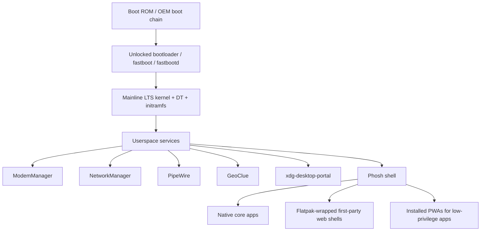
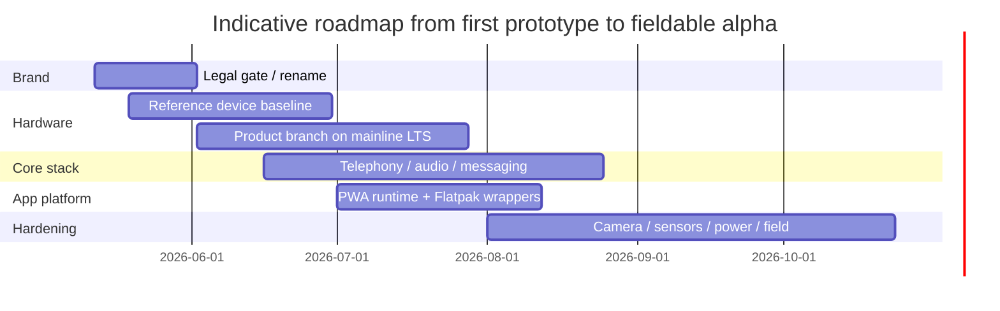

# Fonux, NuDroid, and the Best Path to a Linux-Only PWA-First Smartphone

## Executive summary

On the naming side, neither **Fonux** nor **NuDroid** is clean. **Fonux** already exists as an active software/app brand: I found a live browser-based healthcare platform at urlfonux.com.brturn17search1, a current Google Play app named **Fonux** published by **FONUX SOLUCOES TECNOLOGICAS LTDA**, and the `.com` domain is already registered and parked for sale. I also found an unrelated product use of “Fonux” in a DALI lighting-control listing. That makes **Fonux** a practical branding conflict for software/mobile use, even if I did not uncover a web-indexed exact-match EU/US/UK trademark record I would treat as definitive. citeturn17search1turn17search2turn11view0turn19view0turn7view0turn25search11

**NuDroid** is worse. I found exact historical product use for an Android wallet called **NuDroid**, with specifications, Google Play distribution history, and a GitHub release trail. More importantly, the **DROID** component is a known U.S. trademark hazard: official USPTO TTABVUE results show multiple live **DROID** registrations tied to Lucasfilm and opposition history against names like **SUNDROID**, **CYDROID**, and **JELLYDROIDS**. So even if the exact combined term looks quieter than “Fonux,” the legal tail risk is materially higher. If you force me to pick one of the two, **Fonux is the less bad option**, but my honest recommendation is: **do not launch publicly under either name without a new round of formal clearance, and ideally pick a third name**. citeturn20search1turn21search2turn20search4turn27search1turn27search4turn27search7turn27search9turn27search11

On the technical side, the cleanest route to a **Linux-only phone with no Android userspace** is to base the product on entity["software","postmarketOS","mobile Linux distribution"] or entity["software","Mobian","Debian-based mobile Linux distribution"], use entity["software","Phosh","mobile shell"] as the default shell, and choose a phone with strong **mainline** support. For purity, the best baseline is the **Librem 5**. For repurposed Android hardware with the strongest mainline community momentum, the best practical short list is **SHIFT6mq**, **OnePlus 6/6T**, and **POCO F1**. If “no Android” is absolute, do **not** make entity["software","Droidian","Debian-based mobile GNU/Linux distribution"] or entity["software","Ubuntu Touch","mobile operating system"] your primary architecture, because their Android-device story relies heavily on entity["software","Halium","Linux-on-Android hardware adaptation project"], Android kernels, and Android HAL reuse. They are excellent references and fallback tracks, but not the purest foundation. citeturn37search1turn37search3turn37search0turn37search5turn48search5turn49search0

Your application model should be **PWA-first for general productivity and content apps, not PWA-only for hardware-critical phone functions**. In the reviewed sources, browser-grade APIs cover installability, offline caching, camera/microphone, geolocation, some motion/orientation, experimental Bluetooth, and experimental NFC. The native Linux telephony stack, by contrast, is exposed through entity["software","ModemManager","cellular modem management service"] and related D-Bus services. That means dialer, SMS/MMS, contacts, firmware, modem settings, and probably camera tuning should stay native or be wrapped in a privileged shell; third-party apps can then be predominantly PWAs. The most sensible packaging split is **native packages for core system apps**, **Flatpak-wrapped first-party web shells**, and **installed PWAs for lower-privilege apps**. citeturn43search0turn43search2turn43search7turn38search9turn38search0turn42search3turn42search0turn41search2turn39search2turn39search3turn39search8turn40search0turn40search3turn38search2turn38search3

## Brand and legal position

A proper trademark clearance needs the office-native databases that the IP offices themselves point you to, especially urlEUIPOturn7view0 and urlTMviewturn8search2 for EU coverage, the public services behind urlCompanies Houseturn25search11 for UK company names, and the public USPTO record system. EUIPO is explicit that the legal issue is not just identical marks but also *similar* signs in overlapping goods/services. So the absence of a clean, web-indexed exact hit is never enough on its own. Treat the verdicts below as **commercial-risk assessments**, not a substitute for counsel. citeturn7view0turn8search2turn25search11turn27search10

| Name | Evidence found | Practical verdict |
|---|---|---|
| **Fonux** | Active SaaS/health platform at urlfonux.com.brturn17search1; current Google Play app “Fonux” with developer listing **FONUX SOLUCOES TECNOLOGICAS LTDA**; `urlfonux.comturn11view0` already registered and parked; unrelated product use “Fonux Addressable monitoring system SEMM-2” in DALI listing. citeturn17search1turn17search2turn11view0turn19view0 | **Likely conflict** for software/mobile; **not available in practical branding terms**. |
| **NuDroid** | Exact historical app/product use for the **NuDroid** wallet, with docs and Google Play release history; GitHub release trail referenced at `urlCybnate/NuDroidhttps://github.com/Cybnate/NuDroid`; `nudroid.com` appeared in a newly-registered-domain dataset in late 2025. On top of that, **DROID** itself is actively registered and defended in the U.S. by Lucasfilm, with opposition history against similar names. citeturn20search1turn21search2turn20search4turn12search1turn27search1turn27search4turn27search7turn27search9turn27search11 | **High risk**. This is the kind of name that can get messy even if you think your exact use is different. |

There is also a **similar-mark** issue around **Fonux** because it sits uncomfortably close to **urlFonixturn28search2**, an active UK-listed mobile payments and telephony company. The overlap is not exact, but the phonetics are close and the sector overlap is real enough that I would not treat “Fonux” as relaxed or wide-open in the EU/UK tech space. citeturn28search2turn29search5turn29search0

My bottom-line brand call is straightforward:

| Candidate | EU/US/UK exact-mark confidence from gathered sources | Product-use collision risk | Domain friction | Overall call |
|---|---|---|---|---|
| **Fonux** | No strong exact office hit surfaced in the gathered web-indexed material, but that is a weak negative. citeturn7view0turn8search2turn27search10 | High, because there is already an active exact software/app brand. citeturn17search1turn17search2 | High, because `.com` is taken. citeturn11view0turn14search2 | **Do not assume available**. Use only as an internal placeholder unless counsel clears it. |
| **NuDroid** | Exact office-hit confidence is less important here because the historical product use plus the **DROID** family risk already make it bad. citeturn20search1turn27search1turn27search11 | High. citeturn20search1turn21search2turn20search4 | Medium-to-high. `nudroid.com` appears already registered. citeturn12search1 | **Do not use**. |

## Platform and distro strategy

The distro decision is really a decision about **purity versus hardware enablement speed**. entity["software","postmarketOS","mobile Linux distribution"] is explicitly positioning itself as a real Linux distro for phones, built around upstreaming, shared components, and long device life. entity["software","Mobian","Debian-based mobile Linux distribution"] focuses heavily on Linux-first devices and a short list of Android-origin devices that can run a mainline kernel. By contrast, entity["software","Droidian","Debian-based mobile GNU/Linux distribution"] and entity["software","Ubuntu Touch","mobile operating system"] give you a faster route on many Android phones precisely because they lean on entity["software","Halium","Linux-on-Android hardware adaptation project"], Android kernels, and Android HAL compatibility. That is useful, but it is not the cleanest interpretation of “Linux-only, no Android.” citeturn37search1turn37search3turn37search0turn37search5turn48search5

| Base | What it really is | Best use | Why it is good | Why it is risky for your goal |
|---|---|---|---|---|
| entity["software","postmarketOS","mobile Linux distribution"] | Alpine-based mobile Linux distro with strong upstream/mainline culture. citeturn37search1 | **Primary engineering base** | Best fit for “real Linux” and for keeping driver work upstreamable. citeturn37search1turn47search1turn47search4 | Not “ready for everyone”; some devices still have partial calls/camera/audio. citeturn37search1turn33search0turn36search0 |
| entity["software","Mobian","Debian-based mobile Linux distribution"] | Debian mobile image set prioritizing Linux-first hardware and a small mainline-capable Android shortlist. citeturn37search3 | **Daily-driver benchmark and Debian package base** | Good if you want Debian userspace and conservative package habits. citeturn37search3 | Smaller device matrix than postmarketOS. citeturn37search3 |
| entity["software","Ubuntu Touch","mobile operating system"] | Polished community mobile OS with broad device support and good installer story. citeturn37search5turn48search1 | **Reference implementation / fallback** | Bigger end-user smoothness on some Android-origin phones. citeturn37search5turn37search7 | Much of that breadth comes from Halium/Android adaptation, not pure mainline. citeturn37search4turn48search5 |
| entity["software","Droidian","Debian-based mobile GNU/Linux distribution"] | Debian on Android phones via libhybris and Halium. citeturn37search0turn37search8 | **Reference track when functionality matters more than purity** | Good for quickly reusing Android hardware, and Flatpak is supported. citeturn37search0 | The project itself says it relies on Android kernels/drivers. That clashes with your “no Android” target. citeturn37search0 |

If you want the best compromise between usability and architectural honesty, I would build around **postmarketOS + Phosh**, and test against **Mobian + Phosh** as the secondary distribution. Phosh’s own project page is basically the stack description you want: a daily-usable shell for mainline Linux phones, with a session built around calls, SMS/MMS, mobile settings, feedback, and XDG portals. citeturn49search0turn37search1turn37search3

For the kernel tree, the sensible choice in May 2026 is **mainline-based LTS**, specifically **6.12 LTS** where the device support is there, and **6.6 LTS** where a phone’s enablement is still catching up. kernel.org lists both as longterm series; stable documentation also makes it crystal clear that the healthiest downstream strategy is to keep your local patch set small and upstream-first. citeturn47search6turn47search0turn47search1turn47search7

My recommended tree strategy is this:

- **Product tree:** mainline LTS (`linux-6.12.y` preferred, `6.6.y` fallback) plus a thin downstream patch stack.
- **Bring-up tree:** vendor / Android-common kernel only as a reference branch to study camera, DSP, touchscreen, or power quirks; not your long-term product kernel.
- **Firmware handling:** keep modem, Wi-Fi, Bluetooth, DSP, and camera firmware as clearly separated redistributable packages where possible; do not bury binary blobs in ad-hoc kernel hacks.
- **Device description:** upstream DT bindings and DTS changes early, because that is how you stop one phone from becoming a permanent maintenance tarpit. citeturn47search4turn47search8turn47search1turn33search2

Android-origin hardware also forces you to respect **AVB**, **A/B slots**, **dynamic partitions**, and newer **boot/init_boot/vendor_boot** layouts. The AOSP documentation is explicit about Verified Boot’s chain of trust and the way dynamic partitions and generic boot images are structured; Sony’s bootloader documentation is also clear that unlocking wipes the device and can void warranty. In other words: you do not “just flash Linux” on modern phones; you manage a real boot chain. citeturn46search3turn46search6turn46search5turn46search2turn45search0turn45search1turn45search2

That architecture keeps the low-level system Unix-native, keeps privileged hardware access in native daemons, and still lets you make the user-facing app model heavily web-centric. It is the least wonky way to respect your “Linux-only” requirement without turning the phone into a toy. citeturn49search0turn39search2turn39search3turn39search8turn40search2turn44search8

## App model and sandboxing

PWAs are a good idea here, but only if you are ruthless about **where they stop**. Modern PWAs can be installable, cache content offline via service workers, and access some useful device APIs under secure-context rules. That is real value. It does **not** magically make the web a suitable direct API surface for modem control, SMS routing, firmware actions, or camera ISP tuning on Linux phones. citeturn43search0turn43search2turn43search3turn43search7turn41search1

| App format | Keep | Avoid | Best role on your phone |
|---|---|---|---|
| **PWA** | Installability, offline cache, fast iteration, cross-device reuse. citeturn43search0turn43search2turn43search7 | Direct telephony expectations; browser support fragmentation for advanced hardware APIs. Camera/geolocation are fine; Bluetooth and NFC are still patchy/experimental. citeturn38search9turn38search0turn42search0turn42search3turn41search2 | Mail, calendar, notes, maps front-end, admin console, streaming, store/client portals. |
| entity["software","Flatpak","application distribution and sandboxing framework"] | Strong sandboxing, good portal story, precise D-Bus and filesystem permissions. Camera portal integrates with entity["software","PipeWire","multimedia server"]. citeturn40search0turn40search3turn40search5turn39search8turn40search2 | Granting broad system-bus access casually. citeturn40search5 | **Best wrapper for first-party hardware-adjacent web apps**. |
| entity["software","Snap","application packaging system"] | Strict confinement and interface model. citeturn38search2turn38search3turn43search6 | Using it as the default app model for a heterogeneous mobile Linux stack. Its permissions story is more store/interface-centric and less elegant for your specific portal-heavy Linux-mobile target. citeturn38search2turn38search3 | Optional on Ubuntu-centric deployments, not my first choice for this product. |
| **Native distro package** | Maximum integration with modem, shell, system D-Bus, firmware, audio policies. Supported by the normal distro tooling model. citeturn37search1turn37search3turn39search2 | Shipping everything as native when a browser app would do; that just raises maintenance cost. | Dialer, messaging, contacts, settings, update agent, camera, system UI. |

The browser/API reality from the sources is pretty blunt. Standard web APIs in scope here include:

- **Camera/microphone** through `getUserMedia()` under secure contexts. citeturn38search9turn38search8
- **Geolocation** through the Geolocation API under secure contexts. citeturn38search0turn38search1turn41search1
- **Motion/orientation** through device-orientation events and sensor APIs. citeturn42search3turn42search2turn42search7
- **Bluetooth** through experimental, non-baseline Web Bluetooth. citeturn42search11turn42search13
- **NFC** through experimental Web NFC, with very limited real-world support. citeturn41search2turn41search0

By contrast, the native phone control plane on Linux is exposed through entity["software","ModemManager","cellular modem management service"] D-Bus interfaces for bearers, messaging, calls, location, and more; location can also be fed through entity["software","GeoClue","geolocation service"]. That is why a serious Linux phone still needs native daemons and, for privileged user-facing apps, a native bridge. citeturn39search2turn39search3turn39search1turn44search0turn44search8

My packaging recommendation is therefore:

- **Native system apps** for dialer, SMS/MMS, contacts, camera, settings, updates, and emergency features.
- **Flatpak-wrapped first-party web shells** for apps that need a branded, installable feel and selective bridge access.
- **Installed PWAs** for general apps with no privileged hardware role.
- **No direct telephony API for third-party PWAs**. Give them intents/handoffs (`tel:`-style flows, share targets, contact picking, notifications), not modem access.
- **Portal-first security model** for camera and media. Use the Camera portal to obtain camera access and PipeWire transport instead of poking device nodes directly. citeturn39search8turn40search2turn40search0turn40search5

If you want a clean first-party web-app story, build a small privileged **phone bridge** service and keep it narrow:

- D-Bus on the inside.
- Local authenticated API or portal-like mediator on the outside.
- Explicit capabilities: call initiate/end, SMS send, contact lookup, geolocation handoff, camera capture request, share sheet, notifications.
- No raw modem shell, no arbitrary AT command surface, no unrestricted system-bus exposure. citeturn39search2turn40search5turn49search0

## Hardware shortlist

There is no perfect phone. If you want **maximal mainline honesty**, Linux-first hardware wins but is slower, rougher, and less power-efficient. If you want **better performance and broader community effort**, repurposed Android devices with active mainlining win, but you inherit Android-era boot complexity and more incomplete peripherals. That is the trade. citeturn36search0turn32search0turn37search3turn33search2turn34search0turn35search0

| Model | Mainline status | Telephony / modem status | Biggest current pain points | Blob dependence | Fit for your project |
|---|---|---|---|---|---|
| **Librem 5** by urlPurismhttps://puri.sm | Mainline **yes**. citeturn36search0 | Calls/SMS/data **work**. citeturn36search0 | Camera only **partial**; suspend/resume still a known issue. citeturn36search0 | **Low-to-medium** by phone standards; still not “blob-free” in the real cellular world, but architecturally the cleanest baseline. | **Best pure-Linux baseline** if you care more about architecture than slickness. |
| **PinePhone Pro** by urlPINE64https://pine64.org | Mainline **yes**. citeturn32search0 | Calls/SMS **partial**, data **works**. citeturn32search0 | Source itself warns it should still be considered a **development platform**; camera **partial**. citeturn32search0 | **Low-to-medium**; separate modem/Wi‑Fi modules but still firmware realities. | Strong hacker device, weaker product starting point. |
| **Fairphone 4** by urlFairphonehttps://www.fairphone.com | Mainline **yes**, prebuilt images available. citeturn30search0 | Calls **partial**, SMS/data **work**. citeturn30search0 | Battery reporting **broken**, audio **broken**, camera **broken**. citeturn30search0 | **Medium-to-high**; Android-origin device with A/B partition complexity. | Good ethics/repairability story, but not the least-pain path today. |
| **Fairphone 5** by urlFairphonehttps://www.fairphone.com | Mainline **yes**, testing tier. citeturn33search0turn32search1 | Calls **partial**, SMS/data **work**. citeturn33search0 | Audio **broken**, camera **partial**, NFC **broken**. citeturn33search0 | **Medium-to-high**. | Promising future target, not the least-risk first product target. |
| **OnePlus 6** | Mainline **yes**. citeturn33search2 | Calls/SMS/data **partial**. citeturn33search2 | Wi‑Fi and GPS **partial**; call audio still has known glitches in the notes. citeturn33search2 | **Medium**; pmOS page explicitly says firmware such as GPU/modem is supplied alongside the port. citeturn33search2 | One of the best-supported repurposed Android mainline devices. |
| **OnePlus 6T** | Mainline **yes**. citeturn33search1 | Calls **partial**. citeturn33search1 | Audio/camera/GPS/NFC all still partly rough. citeturn33search1 | **Medium**. | Very viable engineering mule; not a polished consumer phone yet. |
| **POCO F1** | Mainline **yes**. citeturn34search0 | Calls/SMS/data **partial**. citeturn34search0 | PipeWire call-audio issues are documented; camera is improving and worked out-of-box on recent 6.11 setups in the wiki notes. citeturn34search0 | **Medium**. | Huge community energy; excellent bring-up device. |
| **SHIFT6mq** | Mainline **yes**. citeturn35search0 | Calls/SMS/data **work**. citeturn35search0 | Camera **broken**, GPS **broken**, USB OTG **broken**. citeturn35search0 | **Medium**. | **Best repurposed Android candidate if telephony matters most and PWA-first reduces camera pressure.** |

My shortlist, if I were actually building this, would be:

- **Pure Linux showcase / reference hardware:** **Librem 5**.
- **Repurposed Android engineering mule:** **SHIFT6mq** first, **OnePlus 6/6T** second, **POCO F1** third.
- **Do not start with:** **PinePhone Pro** unless your goal is community development first; **Fairphone 4/5** unless you explicitly want to invest in upstreaming those platforms. citeturn36search0turn35search0turn33search2turn33search1turn34search0turn32search0turn30search0turn33search0

A very real hidden issue is **VoLTE / modern carrier compatibility**. The OnePlus 6 notes explicitly mention countries where 3G shutdowns create network rejection and point to ongoing VoLTE progress work. So “calls work” is never just kernel/mainline; regional carrier policy can bite you later. That risk is why a pure-Linux phone can still fail as an actual phone. citeturn33search2

## Roadmap and collaboration

The most realistic way to do this is to split the work into a **reference device**, a **product device**, and a **web-app platform**. Trying to solve name clearance, base OS, kernel/mainlining, camera, telephony, PWA install model, and UI at the same time on a half-supported phone is how these projects turn into beautiful but permanently unfinished science fair rigs. citeturn37search1turn37search3turn49search0turn48search5

A practical roadmap looks like this:

| Milestone | What “done” means | Indicative effort |
|---|---|---|
| **Name and filing gate** | Choose a third candidate name, or keep **Fonux** only if counsel and office-native searches clear it. | **2–4 weeks** |
| **Reference hardware baseline** | Boot, UI, Wi‑Fi, BT, calls, SMS, data on **Librem 5** or **SHIFT6mq**. | **4–8 weeks** |
| **Mainline product branch** | Stable 6.12/6.6 LTS branch, reproducible images, flash/install docs, CI. | **6–10 weeks** |
| **Core phone stack** | Dialer, messaging, contacts, notifications, mobile settings, suspend policy, audio policy, feedback. | **6–12 weeks** |
| **PWA runtime and bridge** | Installable web apps, offline cache, Flatpak wrappers, notification bridge, contact/share/camera mediation. | **4–8 weeks** |
| **Camera and sensor hardening** | Acceptable photo capture, preview, permissions, orientation, geolocation, call audio edge cases. | **8–16 weeks** |
| **Field validation** | Carrier tests, battery life, thermal, OTA/update story, recovery flow, user data migration. | **6–10 weeks** |

Those effort ranges are my engineering estimate, not a published project promise, but they line up with the maturity levels shown in the project/device sources: the hardware is not greenfield, yet it is also not consumer-finished. citeturn36search0turn35search0turn33search2turn34search0turn49search0

The best communities to collaborate with are the ones already solving the exact layers you need:

- entity["software","postmarketOS","mobile Linux distribution"] for device bring-up, mainline work, and pmbootstrap-driven images. citeturn37search1
- entity["software","Mobian","Debian-based mobile Linux distribution"] for Debian mobile packaging and a sober daily-driver bar. citeturn37search3
- entity["software","Ubuntu Touch","mobile operating system"] and the urlUBports Installerturn48search1 for installer UX and multi-device deployment lessons. citeturn48search1turn48search2
- entity["software","Halium","Linux-on-Android hardware adaptation project"] as a reference path for devices that are not ready for pure mainline yet. citeturn48search5turn37search0
- entity["software","Phosh","mobile shell"] and entity["software","Sxmo","minimal mobile Linux environment"] for opposite ends of the UX spectrum: polished GNOME-style shell versus minimal/hackable shell-first design. citeturn49search0turn48search0
- entity["software","ModemManager","cellular modem management service"], entity["software","PipeWire","multimedia server"], and entity["software","GeoClue","geolocation service"] maintainers for API boundary questions. citeturn39search2turn39search3turn39search8turn40search2turn44search8

The tooling stack should stay boring and reproducible: **fastboot/fastbootd**, **adb** where needed for Android-origin hardware, **pmbootstrap** for postmarketOS images, **UBports Installer** only where it reduces flashing friction, Git-based kernel trees, and CI that produces reproducible images on every merge. On devices with bootloader features like those documented for the SHIFT6mq, use them; on devices with Sony-style unlock flows, script them and write exact recovery docs. citeturn35search0turn48search1turn48search2turn45search1turn45search2

## Risks, verdicts, and recommendation

The main risks are not mysterious. They are the same few gremlins that always come back in Linux-phone land:

| Risk | Why it matters | Mitigation |
|---|---|---|
| **Brand collision** | Both candidate names are already dirty. **NuDroid** is the dirtier one. citeturn17search1turn17search2turn20search1turn27search1turn27search11 | Pick a third name, or at minimum do office-native similarity searches and counsel review before filing. |
| **Telephony correctness** | Calls/SMS/data often show as “partial,” and regional carrier policies like VoLTE can sink devices that seem fine in the lab. citeturn33search2turn33search1turn34search0turn35search0 | Choose hardware with the strongest telephony status first; test with actual carriers early. |
| **Camera pain** | Camera is still one of the hardest areas to fully upstream on phone hardware. citeturn36search0turn32search0turn33search0turn35search0 | Treat camera as a separate milestone; do not block the whole phone on it if your first release can tolerate “adequate, not impressive.” |
| **PWA capability gaps** | PWAs are good, but the web does not natively replace modem control on Linux phones. citeturn38search9turn38search0turn42search11turn39search2 | Keep a native hardware control plane and expose only narrow privileged bridges. |
| **Downstream kernel debt** | A large private patch stack becomes permanent maintenance sludge. citeturn47search1turn47search7turn47search4 | Mainline-first, LTS-based, and upstream DT/bindings early. |
| **Boot chain complexity** | Modern phones bring AVB, A/B, dynamic partitions, `dtbo`, `vendor_boot`, `init_boot`, and recovery traps. citeturn46search3turn46search5turn45search0turn45search1 | Document flashing and recovery as a first-class product feature, not an afterthought. |

My final recommendation is this:

**Name:**  
Choose **Fonux over NuDroid only if you absolutely must choose between the two**, because **NuDroid is high-risk** and the `DROID` component is a legal magnet. But I would still tell you, with zero fluff, that **Fonux is not truly available either**. The grown-up move is to pick a third name. citeturn17search1turn17search2turn20search1turn27search1turn27search11

**OS and UI:**  
Use **entity["software","postmarketOS","mobile Linux distribution"] + entity["software","Phosh","mobile shell"]** as the primary stack, with **entity["software","Mobian","Debian-based mobile Linux distribution"]** as the comparison target and packaging sanity-check. Use **6.12 LTS** where possible, **6.6 LTS** where necessary. citeturn37search1turn37search3turn49search0turn47search6

**Hardware:**  
If you want the cleanest Linux story, start on **Librem 5**. If you want the best repurposed Android path for a serious engineering program, start with **SHIFT6mq**, then **OnePlus 6/6T**, then **POCO F1**. citeturn36search0turn35search0turn33search2turn33search1turn34search0

**App model:**  
Go **PWA-first, not PWA-only**. Put telephony, messaging, settings, contacts, and camera in native or Flatpak-wrapped first-party apps; let third-party apps be installed PWAs wherever possible. Flatpak is the best packaging bridge because the portal model fits your phone architecture better than Snap for this specific use case. citeturn39search8turn40search0turn40search3turn38search2turn38search3

### Open questions and limitations

The biggest limitation in the legal section is that several official trademark search systems are not fully web-indexable, so the **strongest positive evidence here is real-world product/company/domain use**, not a perfect negative trademark clearance. That is why my recommendation is hard-nosed: treat **both candidate names as commercially unsafe**, with **NuDroid** clearly worse. Formal filing should happen only after office-native similarity searches and counsel review. citeturn7view0turn8search2turn27search10