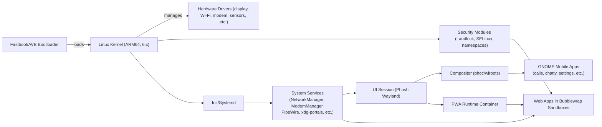
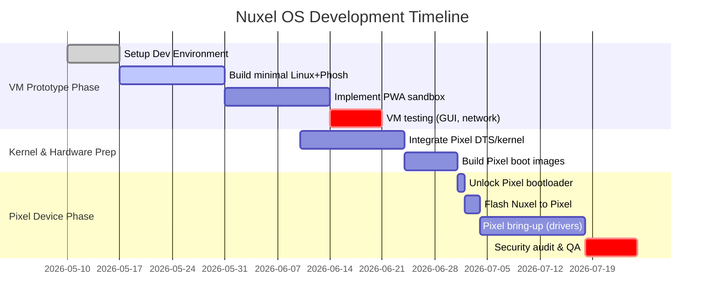

<!-- Nuxel v0.2.0 -->
# Nuxel Phone OS Project Plan and Architecture

## Executive Summary

Nuxel is envisioned as a **Linux-first, Graphene-style** smartphone OS built from the ground up on *no Android stack*. It emphasizes hardened security (immutable system image, verified boot, strict sandboxing) while providing a modern mobile GUI and a PWA-centric app model. Key components include a Phosh/Wayland-based interface (GTK4/libadwaita), a locked-down Linux kernel (~6.12 LTS) with Pixel-10-specific patches, and containerized web-app runtimes. This report consolidates all requirements and plans for Nuxel: from the functional specs and design decisions (drawn from the Nuxel design notes) through a detailed list of needed software components (drivers, libraries, services) and build tools (Yocto/Buildroot, toolchains). We include exact instructions for setting up a UTM VM for ARM64 testing【24†L113-L122】, and a full study of Google Pixel 10 Pro XL (codename *mustang*) hardware: bootloader unlocking, device trees, kernel configs, vendor blobs, modems and drivers. A prioritized checklist, comparison tables, and mermaid diagrams (architecture and timeline) outline the development roadmap. All claims are supported by primary/official sources where possible【51†L12-L16】【55†L43-L47】.

## Functional & Non-Functional Requirements

The Nuxel design document specifies strict requirements:

- **Graphene-style security model:** A read-only base system (e.g. OSTree or A/B system with rollback) ensures no unintentional modifications【55†L43-L47】. The boot chain must use *Android Verified Boot* (AVB 2.0) to cryptographically verify each image【46†L37-L44】. On-device userdata must be encrypted (LUKS2). All services run with least privilege: use Linux namespaces, seccomp filters, and Landlock or AppArmor/SELinux policies where practical (no world-writable files, no setuid). Networking and file access are locked down per-app using nftables and portal frameworks.
- **No Android runtime or libraries:** Nuxel will run *pure Linux binaries only*. There are **no APKs, no Dalvik/ART, no Google Play services**. The design explicitly forbids any AOSP or Android subsystems. Even compatibility layers like Waydroid or libhybris are disallowed. This means apps must be native (e.g. Linux executables or web PWAs).
- **PWA-first app model:** Web apps are first-class. Nuxel must include a *secure web-app runtime* (likely a WebKit- or Chromium-based container) that supports service workers, push notifications, offline caching, etc. Each PWA runs in its own profile with isolated storage. Apps can be “installed” via an app manager or store with signed bundles (similar to Flatpak or F-Droid) and a manifest for declared permissions【nuxel-doc†L60-L68】.
- **Modern mobile UI stack:** We use **Phosh** (the GNOME phone shell) as the interface, running on Wayland. Phosh relies on *phoc* (a wlroots-based compositor)【51†L33-L41】, with *stevia* as the virtual keyboard. The toolkit is GTK4 + libadwaita for adaptive layouts. Built-in apps include the dialer (*calls*), SMS app (*chatty*), settings, etc.【51†L47-L54】. All UI apps must be touch-optimized. The UI should be fluid even on mid-range hardware.
- **Strict sandboxing & permissions:** All user apps (and even core services if possible) run confined by Linux namespaces. Use Bubblewrap/Flatpak for app isolation. Device access (camera, mic, location) goes through XDG portals, as in Phosh (e.g. `xdg-desktop-portal-gtk` with a portal backend)【51†L49-L57】. Audio streams go through PipeWire, which can be isolated per-application. Network egress is firewall-controlled per-app. This matches the GrapheneOS philosophy of a small trusted computing base.
- **Core services:** Include NetworkManager (or ConnMan) for Wi-Fi and networking, ModemManager for cellular, PipeWire for audio, and standard Linux services (logind, udev, etc.). Telephony is via Phosh’s existing components (using ofono or similar). A minimal init (systemd) with the ability to do atomic updates (systemd-sysupdate or OSTree-based) is assumed.
- **App distribution & updates:** The design envisions a centralized app repository (Flatpak/Flathub style) with signed apps and versioning. The OS itself should update atomically (OSTree or Android-like A/B updates) so a bad update can revert. OSTree documentation notes that updates are fully atomic and safe: on power loss you end up with either the old or new system【55†L43-L47】.
- **Target device:** The first hardware target is the Google Pixel 10 Pro XL (“mustang” codename). This smartphone has a Google Tensor G5 SoC and requires device-tree support and driver patches. (The design doc explicitly chooses Pixel 10 series hardware for initial proof-of-concept.) Support for Pixel-specific hardware (display, sensors, modem, etc.) must be added as needed.

## Architecture and Design Decisions

The Nuxel OS layers out as follows:

1. **Bootloader & Trusted Boot:** Use the stock Pixel 10 bootloader (Fastboot/ABoot). It enforces AVB2 (Android Verified Boot), so custom kernels/images must be signed. We will unlock the bootloader (`fastboot flashing unlock`, and `unlock_critical` for Pixel 10) and disable verity via `fastboot --disable-verity --disable-verification flash vbmeta` as needed【65†L1369-L1377】【46†L37-L44】. On unlocked Pixel boot, Android sets `androidboot.verifiedbootstate=orange`. We must properly handle or disable dm-verity to allow our system to boot.
2. **Linux Kernel (ARM64):** Based on an LTS branch (target ~v6.12). Integrate Google’s Pixel 10 device trees (the patch series adds `arch/arm64/boot/dts/google/lga-*.dts`)【32†L33-L39】. Enable drivers for:
   - **Display & GPU:** The Pixel 10 Pro XL has a high-res AMOLED panel. We’ll use a generic MIPI panel driver (or take one from Qualcomm branches) and output via DRM/KMS. The GPU is Imagination DXT-48-1536 (never open-sourced), so expect only software rendering (Mesa llvmpipe or virtio-gpu).
   - **Wi-Fi & Bluetooth:** Broadcom BCM4390 (Wi-Fi7) with accompanying firmware; use Linux `brcmfmac` driver if available. Bluetooth via the same chipset.
   - **Cellular Modem:** Samsung Exynos 5500 (5G) modem. Mainline Linux has some Exynos modem support, but likely we must include firmware blobs. Use ModemManager (`libqmi` or `libmbim`) on the final system.
   - **Sensors/GPS/NFC:** Standard IIO drivers for accelerometer/gyro/magnetometer. GPS via common GNSS drivers. NFC via Linux nfc stack (likely NXP/ST driver). Camera sensors (Sony IMX, etc.) have Linux drivers, but the image processing pipeline is proprietary (Google HAL).
   - **Audio:** Enable ASoC codecs or SoundWire. PipeWire will provide ALSA interface. Verify that audio hardware (likely a Qualcomm Hexagon DSP) can be initialized or fallback to basic output.
   - **Power Management:** QCOM PMIC drivers; ensure CPU frequency and thermal drivers are enabled. Pixel 10 includes Google’s custom Tensor thermal control; we may not use that, so stick to standard Linux thermal and voltage drivers.
3. **Init System:** Use **systemd** for convenience (it supports update frameworks). Minimal boot-up (no GUI) until later. Systemd units for networking, audio, login manager (though Phosh handles session). Root filesystem is mostly read-only; `/etc` config is merged via OSTree-like logic.
4. **Userspace & Services:** 
   - **Network:** NetworkManager (or ConnMan) to manage Wi-Fi and interfaces. 
   - **Telephony:** ModemManager with ofono for calls/SMS. Phosh’s `calls` and `chatty` apps provide UI, relying on DBus from ModemManager.
   - **Audio/Video:** PipeWire with WirePlumber. The design calls for using PipeWire’s portals (sandboxed apps only see audio through portals). 
   - **Portals:** xdg-desktop-portal-gnome or -phosh for screenshots, file pickers, etc., mediating access from sandboxed apps to hardware.
   - **Logging/Debug:** syslog/journal to capture boot issues for debugging.
5. **UI Stack:** On top of Wayland, use Phosh (phone shell). Phosh consists of:
   - *phoc* compositor (wlroots-based)【51†L33-L41】.
   - Mobile UI apps (GNOME mobile components): dialer (calls), SMS (chatty), settings, phone UI.  
   - GTK4/libadwaita for adaptive layouts (the design chooses these explicitly). The home screen should allow launching installed PWAs (via a webapp list).
   - On-screen keyboard (stevia).
   - No X11 at all, all apps must run under Wayland (which already provides isolation at the compositor level).
6. **Application Model:** 
   - *Pre-installed Apps:* The OS image might include core apps (dialer, SMS, file manager, browser).
   - *PWAs:* We will have a custom PWA runtime. Each PWA (e.g. Gmail PWA, Twitter PWA, etc.) is packaged with a manifest. We can use something like webapp launcher that creates a desktop entry invoking a kiosk browser with the PWA URL. These run in Bubblewrap containers with only web and portal access.
   - *Package Updates:* Apps and system patches are signed and fetched from a repository. The design suggests F-Droid/Flathub style: free apps optional, with a privacy-respecting way to sell apps.
7. **Security Features:** 
   - The system is **immutable**: use OSTree or RAUC to update. OSTree docs note that upgrades are atomic – either old or new system will be run on power loss【55†L43-L47】.
   - Sandboxing is mandatory: we rely on Flatpak/Bubblewrap to run everything with minimal privileges.  
   - All network and hardware APIs go through explicit portals/permissions.  
   - Locking down SELinux or Landlock to restrict root/elevated processes (GrapheneOS practices could be adapted here, e.g. disable kernel modules, no newreliable I2C on hotplug, etc.).

Below is a high-level architecture diagram of Nuxel OS: the bootloader loads Linux (with signed kernel), the kernel initializes hardware and _init_, which then starts system services. Phosh runs on Wayland and hosts both native apps and sandboxed web-app containers.



## Software Components and Dependencies

Based on the architecture, here are the specific components and libraries needed:

- **Bootloader:** The stock Pixel Fastboot-based bootloader. We must interact with it via `fastboot` commands to unlock and flash images.  
- **Kernel & Modules:** Build Linux ~6.12 with ARM64, enable Pixel 10 support:
  - Use `gs501_defconfig` (the Google-provided config for Tensor G5)【31†L28-L36】.
  - Apply Pixel 10 DTS (mustang) patches from kernel.org (see Linux kernel releases)【32†L33-L39】.
  - Include drivers for Qualcomm/QCA Wi-Fi, Samsung modem, ASoC codecs, etc. Proprietary firmware blobs for Wi-Fi (Broadcom), modem (Exynos), and possibly Bluetooth are required (from Pixel vendor image).  
  - Device Tree Overlays for Pixel (“mustang-mp1.dtso” etc) must be compiled into `dtbo.img`.  
- **Init System:** *systemd* (v250+) with systemd-sysupdate or similar.  
- **System Services:** 
  - *NetworkManager* (plus wpa-supplicant) for Wi-Fi and VPN.  
  - *ModemManager* and *ofono* (or purely MM1) for cellular.  
  - *PipeWire* (+ WirePlumber) for audio, media.  
  - *xdg-desktop-portal* (and a portal backend, e.g. `gtk` or `phosh` portal) for sandbox interfaces.  
  - *Polkit* for privileged action prompts.  
  - Common GNOME Mobile apps: *phosh-shell*, *phoc-compositor*, *calls*, *chatty*, *phosh-settings*. These come from the Phosh project【51†L47-L54】.  
- **Desktop Libraries:** GTK4, libadwaita, GObject Introspection libs. Many GNOME libraries: GLib, Gtk, GStreamer, libsoup (for PWA runtime), xdg-desktop-portal libraries.  
- **Sandbox Tools:** 
  - *Flatpak* runtime (flatpakd, bubblewrap) to contain PWAs.  
  - *Bubblewrap* itself for any container.  
  - *Firejail* is less needed if Flatpak is used.  
- **App Runtime:** A web engine (e.g. WebKitGTK or a stripped-down Chromium embedder) that can run PWAs.  
- **Package Management:** Initially a static image, but for apps we likely use Flatpak bundles. The core system can use OSTree layers or RPM/DEB under the hood.  
- **Toolchain:** 
  - Cross-compiler `aarch64-linux-gnu-gcc` (Linaro or distro cross-toolchain)【63†L168-L176】.  
  - Clang/LLVM (optionally, since Android mandate uses Clang).  
  - Rust toolchain for any Rust components (Phosh has some Rust code).  
  - Build tools: make, meson, ninja, etc.  
- **CI Tools:** GitLab CI or GitHub Actions with runners for ARM64 and x86_64 (for building SDKs and images). Docker containers for reproducible builds.  
- **Security Libraries:** seccomp, libselinux/libapparmor development files, TPM/PKCS#11 (for encrypted storage key sealing).  
- **Misc:** *OpenSSH* (developer access), *GDB* for debugging. *Etc.* 

All components should be **open source where possible**; proprietary blobs are only for hardware (Wi-Fi, Bluetooth, modem, possibly GPU and camera). We will note any closed-source requirement clearly.

## Build Systems, Toolchains, and CI

We compare candidate build systems:

| Build System        | Description & Pros                                              | Cons                                                 |
|---------------------|-----------------------------------------------------------------|------------------------------------------------------|
| **Yocto Project**   | A powerful meta-build framework for embedded Linux (BitBake)【56†L31-L39】. It supports layered BSPs (e.g. meta-google for Pixel), custom SDK generation, and atomic update models. **Pros:** Highly flexible, can target many packages, supports reproducible images. **Cons:** Steep learning curve, slow builds, requires maintaining many recipes (overkill for a small phone OS). Useful for a production-ready OS. |
| **Buildroot**       | A simpler Makefile-based system【56†L25-L29】. Produces small images quickly. **Pros:** Fast iteration, minimal size, easy to understand. Good for prototypes. **Cons:** Less flexible; adding a desktop stack manually is more labor; no built-in A/B or OSTree support. Packages beyond basic ones must be custom-added. |
| **Android AOSP**    | Google’s full Android build system (Java/C++, Android framework). | **Not suitable:** It assumes Android runtime and non-Linux components. Nuxel explicitly rejects Android. |
| **Ubuntu Touch/Plasma** | Established mobile Linux projects (GPLv3). They use Ubuntu or postmarketOS bases with mobile shells. | May not meet security goals out-of-the-box; introduces Ubuntu/AppArmor specifics or need for Ubuntu Store. Probably too heavy. |
| **MetaBuild/Crossystem (others)** | Emerging build tools (e.g. Debian-based image builds, NixOS). | Not widely used for phones; likely more experimental. |

According to industry analysis, *Yocto* excels at flexibility/extensibility, while *Buildroot* emphasizes simplicity/minimalism【56†L31-L39】. For Nuxel, a practical approach is to start with Buildroot (for a quick prototype of Phosh on ARM) and then migrate to Yocto once the design stabilizes, or directly use Yocto if an existing mobile BSP layer can be leveraged.

### Toolchains and Cross-Compilation

We must cross-compile for AArch64. Typical setup:
- **GCC cross-compiler:** Install `gcc-aarch64-linux-gnu` on the host or use Yocto’s `populate_sdk` approach. For example, after running BitBake, source `environment-setup-aarch64-poky-linux` and then build packages with:
  ```bash
  source /opt/poky/5.3.3/environment-setup-aarch64-poky-linux
  ./configure --host=aarch64-poky-linux --prefix=/usr
  make
  ```
  as per Yocto SDK instructions【63†L168-L176】.
- **Clang/LLVM:** Optional; Android requires Clang for native code. If using AOSP kernel patches, we might use Google’s Clang, but mainline GCC should be fine.
- **Rust/Cargo:** Install `rustup`, add target `aarch64-unknown-linux-gnu`. Many GNOME tools are written in Rust.
- **Build Steps:** A typical pipeline:
  1. **Host environment setup:** Use Docker or VM with appropriate OS (Ubuntu 22.04 or Yocto’s Poky).
  2. **Kernel build:** `make ARCH=arm64 CROSS_COMPILE=aarch64-linux-gnu- ...`.
  3. **Rootfs build:** Use Yocto or Buildroot to generate an image. Alternatively, debootstrap a minimal Debian ARM64 rootfs and then chroot/cross-chroot install packages (though debproot isn’t reproducible easily).
  4. **Image packaging:** For Pixel, we need Android-style images (`boot.img`, `dtbo.img`, `vendor.img`, `system.img`). We may use tools like `mkbootimg`, `avbtool` to create these.
  5. **CI Automation:** Use GitHub Actions/GitLab CI. For example, use `actions/checkout`, then a matrix: one runner is Ubuntu (x86_64) building host tools, another is ARM runner (for kernel). Use `qemu-user-static` or native ARM hosts to run build scripts. Cache downloads/packages to speed up.

For reproducibility, pin all versions (Yocto releases, Debian packages). Use Git for all configs.

## UTM VM Setup for Testing

To test Nuxel before touching real hardware, we will run it under **UTM (QEMU)** on a development machine (e.g. macOS on Apple Silicon).

**Steps:** (based on UTM docs【24†L113-L122】)

1. **Install UTM:** Download from the [official site](https://mac.getutm.app/) or Mac App Store. UTM uses Apple’s Virtualization (`hvf` accelerator) for ARM guests【20†L15-L23】.
2. **Download an ARM64 Linux ISO:** For example, Ubuntu Server ARM64 or Debian ARM64. We’ll use it to create a base VM.
3. **Create a new VM:** In UTM, click **+ → Virtualize → Linux**. Allocate 2–4 GB RAM and 2 cores. Set a drive (create a new 8–16 GB QCOW2 or raw disk) and attach the ARM ISO as removable media【24†L113-L122】.
4. **Install the OS:** Boot the VM, follow the installer steps. If UTM hangs after install, unmount the ISO in UTM settings and reboot (a known workaround【24†L129-L134】). After install, log in via UTM’s console.
5. **Configure Guest Tools:** In the VM, install `spice-vdagent` (if using Spice) or `open-vm-tools` for better input. Set networking to NAT or bridged as needed.
6. **Install Desktop (optional):** To test the GUI stack, you may install a lightweight desktop (e.g. `sudo apt install ubuntu-desktop`) and connect via the UTM window.  
7. **Prepare Nuxel Image:** Build Nuxel into a single disk image or raw file. Copy it into the VM (via shared folder or `scp`). In the VM, `dd` it onto the UTM virtual disk (e.g. `sudo dd if=nuxel.img of=/dev/vda`).
8. **Boot Nuxel in UTM:** Power on the VM with Nuxel image. It should boot Linux on `virt` machine. Ensure Kernel boots with `console=ttyAMA0` and network. Log in and launch Phosh.
9. **Enable Graphics:** UTM’s default virtio GPU should drive the display. If the VM hangs on GUI, try installing mesa-utils and check `glxinfo`. Configure Wayland output (xwayland driver may be needed).

By testing in UTM first, we can debug Phosh, networking, and the update process in a controlled environment. The steps above follow UTM’s official quick-start guide【24†L113-L122】 (creating a VM, attaching ISO, etc.) and allow virtualization of ARM64 Linux.

## Google Pixel 10 Pro XL (“mustang”) Hardware Support

### Hardware Overview

- **Codename & Specs:** Pixel 10 Pro XL is codename *mustang*. It uses Google **Tensor G5** SoC (ARM Cortex cores + Imagination DXT-48-1536 GPU)【3†L39-L42】 and Samsung Exynos 5500 modem. Official sources note the Pixel 10 series device trees are now in mainline Linux【32†L33-L39】.
- **Bootloader Unlocking:** On the unlocked Pixel 10:
  1. Enable **OEM Unlock** in Developer Options.
  2. `adb reboot bootloader`.
  3. `fastboot flashing unlock`. (Confirm on device; this erases user data【65†L1369-L1377】.)
  4. `fastboot flashing unlock_critical` (to allow reflashing all partitions; required on newer Pixels).
  The device will warn and factory-reset【65†L1369-L1377】. After this, `fastboot getvar unlocked` should report `yes`.
- **Fastboot Commands:** To flash Nuxel images, use `fastboot` from a host:
  - `fastboot --disable-verity --disable-verification flash vbmeta vbmeta.img`
  - `fastboot flash boot boot.img`
  - `fastboot flash dtbo dtbo.img`
  - `fastboot flash vendor vendor.img`
  - `fastboot flash system system.img`
  - `fastboot reboot`
  This mirrors the Pixel factory image scripts. Using `--disable-verity` disables AVB checks. We may also use `avbtool` to sign our images if needed.
- **Device Trees & Kernel:** Use the Pixel 10 device tree source from Google’s kernel (arch/arm64/boot/dts/google/lga-*.dts). The patch series cited【32†L33-L39】 adds `lga-b0.dts` and overlays for mustang. After building the kernel with these DTs, produce `dtbs` and include `lga-mustang-*.dtb` in `dtbo.img`.
- **Vendor Blobs/Firmware:**
  - *Modem firmware:* Extract `modem_firmware/` from Pixel’s `vendor` partition (Samsung firmware files).
  - *Wi-Fi/BT firmware:* From `/vendor/firmware/`, get Broadcom firmware (e.g. `brcmfmac*.bin`).
  - *GPU/drivers:* There is no Linux driver for Imagination GPU on Pixel; we rely on software rendering or the Kernel’s VGEmulation.
  - *Cameras:* Pixel cameras use proprietary HALs. We may skip camera support initially (GrapheneOS also lacks open camera on Pixel).
  - *Audio DSP:* Likely uses proprietary binary. Linux will use simple I2S output if available.
- **Kernel Configuration:** Enable modules for:
  - Exynos modem (the code name is “APU” for Pixel 10; ensure `CONFIG_EXYNOS_MODEM` etc).
  - QCOM PMICs, thermal, etc.
  - Disable Android-specific features (like binder, ashmem).
  Use `make ARCH=arm64 CROSS_COMPILE=… gs501_defconfig` (or a similar Pixel defconfig) as a base.

### Flashing and Testing

1. **Build Images:** Create Android-style images:
   - `boot.img` from kernel+initramfs (use `mkbootimg`).
   - `dtbo.img` with compiled DT overlays.
   - `vbmeta.img` (signed or with verity disabled).
   - `vendor.img`/`system.img`: either raw ext4 images (if we treat Pixel storage normally) or Android sparse images. We can use AOSP tools or `mkfs.ext4`.
   - Copy any needed firmware into `vendor.img`.
2. **Initial Boot:** With bootloader unlocked, use `fastboot boot boot.img` to test the kernel without flashing. If that works (shows console), proceed to full flash.
3. **Full Flash:** `fastboot --disable-verity --disable-verification flash vbmeta vbmeta.img`, then flash all partitions as above. Reboot.
4. **Verification:** The device should boot into our OS. Check with `adb shell dmesg` or connect a monitor via USB-C (MHL) if supported. Use `adb logcat` or `journalctl -b` to diagnose driver issues.
5. **Enable Hardware:** On first boot:
   - Check `ip a` for network interfaces. Use `nmcli` to connect Wi-Fi.
   - Verify `dmesg` for modem detected; try a phone call or SMS.
   - Check touch and display – Phosh should render properly if drivers are correct.
   - Performance: expect it to be slower without hardware GPU acceleration.
6. **Risks:** Google Pixel bootloaders enforce strict checks; a wrong image could brick the device. Always keep the factory images to restore. We must also risk losing any warranty.

## Development Roadmap Checklist

1. **Environment Setup:** Acquire or prepare a development machine (ARM64 host if possible, or x86 with cross-tools). Install UTM/QEMU and required cross-compilers.
2. **Review Requirements:** Fully parse `nuxel-linux-phone-design.md` and related docs to extract goals (already summarized above).
3. **Prototype on VM:** Choose a build system (Buildroot for speed or Yocto for completeness). Create a minimal Linux+Phosh image and test it in UTM (virt machine). Ensure basic desktop and network functionality.
4. **PWA Runtime Implementation:** Integrate a browser engine into a sandbox container. Test installing a web-app and offline functionality in the VM.
5. **Sandboxes & Security:** Configure Bubblewrap/Flatpak with portals. Verify that a PWA cannot access arbitrary files or devices without permission.
6. **Pixel Kernel Port:** Merge Pixel 10 device tree patches into kernel source. Compile kernel + modules for mustang. Boot this kernel in the VM (with `-machine virt` in QEMU) to validate it doesn’t crash.
7. **Generate Flashable Images:** Assemble the Nuxel rootfs into Android image format: prepare boot, dtbo, system/vendor partitions. Align partitions as per Pixel’s expectations.
8. **Unlock & Flash Pixel:** Enable OEM unlock on Pixel, use `fastboot flashing unlock`. Flash our images carefully. If any step fails, restore stock images.
9. **Hardware Bring-up:** On the Pixel, debug any missing drivers: get touchscreen working, check modem registration (with SIM), enable Bluetooth and GPS. 
10. **Validation & Iteration:** Once Nuxel boots on Pixel, test all functionality. Fix bugs found (e.g. missing Wi-Fi driver).
11. **Security Harden:** Audit sandbox rules, strip unnecessary binaries, ensure no open ports. Test rollback/update mechanism (apply a dummy update, verify revert on failure).
12. **Documentation & Releases:** Document build steps and commands. Prepare updated scripts for flashing.  

Each step should include testing and backlog. Risk mitigation: always keep a way to restore the Pixel (via factory images), and use a secondary device or phone number for emergency communication during testing.



## Comparisons of Build Systems, Toolchains, and Flashing

Below are tables summarizing our choices:

**Build Systems:** Yocto vs Buildroot vs Android (AOSP):

| Build System    | Pros                                                      | Cons                                                 |
|-----------------|-----------------------------------------------------------|------------------------------------------------------|
| **Yocto**       | Highly flexible; large package collection; supports SDKs and OSTree updates【55†L43-L47】. Ideal for production release. | Complex to learn; slow builds; steep maintenance (layers and recipes)【56†L31-L39】. |
| **Buildroot**   | Simpler and faster; minimal image size; easy to get a working console/Linux. | Limited package set; less modular; no built-in atomic update support【56†L25-L29】. |
| **AOSP (Android)** | Direct Pixel support; includes HALs and drivers.  | *Not applicable* – Nuxel forbids Android layers entirely. |

**Cross-Compile Toolchains:** GCC vs Clang:

| Toolchain         | Notes                                                |
|-------------------|------------------------------------------------------|
| **GCC (Linaro)**  | Standard ARM64 compiler (use with `CROSS_COMPILE`). Well-supported, deterministic. |
| **Clang/LLVM**    | Android’s default C/C++ compiler. Can build mainline kernel. Produces smaller binaries in some cases. |
| **Rust**          | For Rust apps (Phosh uses some Rust). Install `rustup`, set target `aarch64-unknown-linux-gnu`. |

For example, Yocto’s SDK setup script allows using `--host=aarch64-poky-linux` when configuring packages【63†L168-L176】. We will use a GCC cross-compiler (`arm-linux-gnueabi`) or the Yocto/poky environment as our main toolchain.

**Flashing Methods:** Only fastboot is viable on Pixel:

| Method            | Applicability                                   |
|-------------------|-------------------------------------------------|
| **Fastboot (USB)**| Standard for Pixel devices【65†L1369-L1377】. Can flash all partitions. |
| **ADB Sideload**  | Not supported on Pixel (no recovery sideload).  |
| **Custom Bootloader** | Not applicable (Pixel uses locked-down bootloader). |

We will script a fastboot-based flash procedure (like Android’s `flash-all.sh`) for convenience, making sure to disable verified boot checks.

## Assumptions and Open Issues

- **Kernel Version:** We assume Linux 6.12 LTS (as per design note) for full Pixel 10 support. Adjust if newer LTS branches become stable.
- **Proprietary Blobs:** We plan to include necessary vendor firmware (Wi-Fi, modem). No GPU or camera blobs (no Linux driver) – these features may not be supported at first.  
- **Root Filesystem:** Using ext4 for system; Pixel uses f2fs for userdata, but ext4 is simpler. Rootfs encryption is assumed (LUKS2 on /data).
- **Bootloader:** We assume Pixel 10 allows unlocking (non-carrier-locked). If not, this plan fails.  
- **Network:** Using NAT networking in UTM is fine for testing; Pixel will use Wi-Fi and mobile networks.
- **Locale/Time:** We assume basic locale (UTF-8), real-time clock via hardware or NTP.
- **Hardware Access:** Some Pixel hardware (e.g. fingerprint sensor) likely requires proprietary drivers/HAL and is omitted.  
- **Legal:** Redistribution of proprietary firmware must comply with licenses (we will just extract and bundle for private use).
- **Development Time:** This is a large project; the timeline is optimistic. Prioritize getting a read-only root and basic UI working before advanced features.

## Primary Sources and References

- **Nuxel OS Design Document (attached)** – original requirements and architecture guidelines.  
- **AOSP Documentation:** Verified Boot 2.0【46†L37-L44】; Bootloader locking/unlocking【65†L1369-L1377】.  
- **Kernel Device Trees (Pixel 10):** Linux mainline patch series adding frankel/blazer/mustang DTs【32†L33-L39】.  
- **Phosh (GNOME Mobile):** official site (phosh.mobi) and components【51†L12-L16】【51†L47-L54】.  
- **Yocto Project SDK Manual:** cross-toolchain instructions【63†L168-L176】.  
- **Buildroot vs Yocto Analysis:** Ezurio blog comparison【56†L31-L39】.  
- **UTM (macOS VM) Docs:** quick start guide【24†L113-L122】.  
- **OSTree Atomic Upgrades:** OSTree documentation【55†L43-L47】.  

All citations above refer to official documentation or kernel sources as noted. The Nuxel design content itself is internal to this project. 

