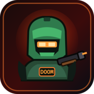

# Nuxel Doom

**Application ID:** `org.nuxel.Doom`
**Version:** `2.0.0` (shipped with Nuxel `v0.7.7-beta`)
**Type:** offline-first PWA with an embedded WebAssembly engine
**Engine:** Chocolate Doom 3.0 (Cloudflare `doom-wasm` build)
**Content:** Freedoom Phase 1/2/FreeDM or a user-imported WAD; no commercial
DOOM WAD, sprite or sound asset is bundled.

Nuxel Doom is no longer a lookalike raycasting game. It is a **real WAD engine
port**: the Chocolate Doom engine runs inside the app as WebAssembly, parses
the actual IWAD/PWAD (vertices, linedefs, sectors, nodes, textures, things and
the status bar), and renders the real maps in landscape. Nuxel supplies the
launcher, the read-only WAD catalogue, the touch HUD and the lifecycle/chrome
integration.

## Install from NuXtore

1. Open **NuXtore** from Nuxel Home.
2. Open **Available**.
3. Select **Nuxel Doom** and press **Install**.
4. NuXtore verifies the signed bundle and every staged file digest, then
   registers `org.nuxel.Doom` with the canonical app registry.
5. Return Home. The Nuxel Doom icon appears in the launcher and app drawer.

The install is a launcher registration against the payload already present in
the read-only image. It does not download anything.

## Remove from NuXtore

1. Open **NuXtore → Installed**.
2. Select **Nuxel Doom → Remove**.

Remove unregisters the Home entry and preserves settings and saves. The
read-only payload remains available for reinstall without a network.

## Play

1. Open **Nuxel Doom**.
2. Pick a WAD. Freedoom Phase 1 is selected by default when present.
3. Press **PLAY DOOM**. The engine warps to the first map.
4. The display enters landscape, the top bar and triple buttons disappear, and
   the touch HUD appears.
5. Move with the left joystick; strafe by pushing sideways; drag the right side
   to turn; hold **FIRE**; tap **USE** for doors and switches; use **WPN +/−**
   and **RUN**; tap **MENU** to pause.

The engine receives ordinary keyboard events (`ArrowUp`, `ArrowDown`, comma,
period, `Ctrl`, `Space`, `Shift`, number keys, `Escape`) generated by the HUD.
There is no global input injection service and no privileged `uinput` device.

## WAD catalogue

The app asks the local Nuxel bridge for `/api/v1/doom/wads`. The bridge scans
only these read-only game-data roots:

- `/home/nuxel/doom`
- `/home/nuxel/Downloads`
- `/home/nuxel/Documents`
- `/usr/share/doom`
- `/usr/share/games/doom`
- `/usr/local/share/doom`

Each result is addressed by SHA-256. The app downloads the selected WAD from
`/api/v1/doom/wad?id=<sha256>` and writes it into the WebAssembly file system
for the current session. The client never sends a filesystem path and cannot
read an arbitrary file. A PWAD is loaded on top of the first available IWAD
with `-file`.

Freedoom 0.13 is installed by the OS image. To add another legally obtained
WAD, copy it into `~/doom` (for example over the SSH console), then press
**SCAN AGAIN**.

## Fullscreen chrome

The whole app is immersive. While Doom is playing:

- **Swipe up from the bottom edge** to reveal Back/Home/Recents. Recents can
  kill the app; Home minimises it; Back opens the pause overlay.
- **Pull down from the top edge** to reveal the status bar.
- Both strips hide again automatically.
- Nuxel Home and the lockscreen never use this mode.

The same bottom/top gesture contract applies to every other foreground app,
not only Doom. PWAs use the DOM immersive controller; native apps use the
`nuxel-navdock` 14 px gesture strip, which reveals the full dock upward and
auto-hides it. See [`doom-touch-controls.md`](doom-touch-controls.md).

Cold boot always starts in portrait and holds that pose through the lockscreen.
The rotation mode selected before boot is restored only after a successful
unlock.

## Engine comparison

Nuxel also ships two native comparison apps:

| App | Package | why |
|---|---|---|
| Nuxel Doom | `org.nuxel.Doom` | Touch-first Chocolate Doom WASM; the default phone experience |
| Chocolate Doom | `org.nuxel.Doom.Chocolate` | Native Fedora Chocolate Doom 3.1.1; keyboard/gamepad |
| UZDoom | `org.nuxel.Doom.UZDoom` | Modern GZDoom lineage; software renderer on this kernel |

See [`doom-engines.md`](doom-engines.md) for the comparison and the exact
launch paths.

## Configuration

The **TOUCH & AUDIO** screen stores:

| Setting | Effect |
|---|---|
| Sound | Web Audio engine sound; off means `-nosound` |
| Haptics | Nuxel host vibration on fire/use/menu where available |
| Strafe joystick | Horizontal joystick axis strafes instead of turning |
| Left handed | Mirrors joystick and action cluster |
| Turn sensitivity | Mouse-look drag threshold/multiplier |

There are no text inputs anywhere in the Doom shell. The system keyboard is
explicitly dismissed when the app starts, regains focus, resumes or exits.

## License

The engine is Chocolate Doom, GPL-2.0-or-later, distributed through the
Cloudflare `doom-wasm` WebAssembly build. Its source commit, artifact hashes and
licence text are recorded in `pwa/nuxel-apps/doom/engine/PROVENANCE.md` and
`COPYING.md`. The Nuxel launcher and HUD are GPL-3.0-or-later.

## Related documentation

- [Touch controls](doom-touch-controls.md)
- [Engine comparison](doom-engines.md)
- [Troubleshooting](doom-troubleshooting.md)
- [v0.7.7-beta release notes](../releases/v0.7.7-beta.md)
