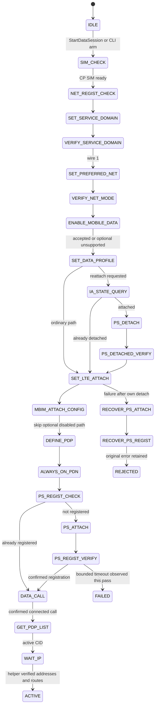

# Nuxel LTE implementation and physical state

## Latest execution update — 2026-11-25

**LTE remains blocked at real PS registration.** This update supersedes the
older audit's deployment/management statements below; historical protocol
findings remain unchanged. See [production acceptance](NUXEL-LTE-PRODUCTION-ACCEPTANCE.md).

USB SSH was physically verified on port 2022, carrier1, alongside ZeroTier SSH.
One bounded CP initialization used the historical verified NV loader
`530732cb…`, unchanged `/dev/sda16`, and the device-owned read-only EFS NV image.
It returned ONLINE, exit0; native OES transferred 987 bytes and SIM became ready.
A subsequent native session with the successful build17 daemon `6893af43…`
again failed PS_REGIST_VERIFY: wire1 CS+PS, preferred mask11, raw PS7/UNKNOWN,
CS NOT_REGISTERED, no attachment/IP. The old loader mismatch was real but
is not the sole cause. Carrier availability or another cause is **unproven**.
No data-call activation was accepted without registration; decoder unchanged.

Production boot-layer correction (`f42c18ef`): a separate NV-capable loader at
`/usr/lib/nuxel/nuxel-modem/nuxel-cpbootd.production.hw`, a root-only persistent
JSON config, and `nuxel-cpbootd-production.service` pulled in before radiod.
The guard verifies loader/firmware/manifest hashes and Samsung NV integrity,
requires OFFLINE to boot, skips ONLINE without reset, refuses other states or
existing FMT/RFS owners, and bounds a single attempt. EFS mount readiness is
required. The original Stage04 loader/guard remain intact for recovery.
Physical preflight and ONLINE no-op passed; **normal reboot not tested**.

The running radio daemon/helper are unchanged. The complete startup radio
readiness, session-bus readiness, persistent APN/data policy, NetworkManager
integration, UI state, signal decoding, DNS ownership and normal reconnect
remain unfinished. Owner's existing uncommitted implementation drafts were
preserved, not deployed or represented as acceptance. Native NM currently
reports rmnet0 as unmanaged PPP, and MM exposes no modem; a fake modem was not
introduced. Existing Wi-Fi/USB/ZeroTier routing was preserved. Neither IPv4 nor
IPv6 internet worked in this pass; only the historical IPv6 evidence stands.
Reboot tests, UI toggles, transitions and benchmark remain blocked/unperformed.

Detailed receipts and deployment/rollback procedure are in the updated
[handover](DEEPSEEK-STAGE06-HANDOVER.md). No SMS or calls were performed.

---

Authoritative consolidation audit, 2026-11-24 CET. Read alongside
[DeepSeek handover](DEEPSEEK-STAGE06-HANDOVER.md). This is a source/evidence
assessment, **not a persistent-LTE acceptance certificate**.

## Executive state

Astra physically demonstrated IPv6 cellular DNS and TLS-verified HTTP 200 on
`rmnet0`, including Wi-Fi-radio-off tests. DeepSeek subsequently connected the
native FSM to automatic Linux address/route configuration. Both implementations
are preserved in Git. The live phone at the beginning of this pass had already
rebooted and **did not have working cellular data**. CP was ONLINE and SIM ready,
but PS registration was NOT_REGISTERED, CS registration DENIED, and `rmnet0`
DOWN with zero traffic. One normal native session-start retry failed at
`PS_REGIST_VERIFY`; no new internet acceptance succeeded.

The final native `RadioState` property is also `unknown`; normal radio-power/network-selection readiness is not established by CP ONLINE. The deployed CP loader is the pre-NV implementation, while Astra's verified
NV-capable loader remains in the Round43 recovery directory. This mismatch is
proven by executable hashes. It is a leading recovery issue, **not proof of the
cause of current registration failure**: this pass did not reset CP to compare
loaders. The installed boot service is static/inactive and still uses the old
Stage04 guard. Production startup, persisted policy, real disconnect, DNS,
Settings, Quick Settings and top-bar integration remain incomplete.

The execution followed the mission's substantial-unexpected-blocker hard stop.
No new production implementation was installed. No CP restart, daemon restart,
phone reboot, Wi-Fi disable, call or SMS transmission was performed. Source,
private deployment snapshots, historical recovery artifacts and management
connectivity were preserved. **Not ready for normal phone mobile-data use.**

| Capability | Evidence and current status |
|---|---|
| CP boot with verified device-owned NV | Physically verified historically, Round43 operation 13; source retained; not installed as the production boot path |
| SIM readiness | Physically verified this pass using native `GetSimState`: `ready` |
| Registration / bearer | Historical LTE success; current registration failure, no bearer |
| Dynamic IP configuration | Implemented; Round44 reported native `ACTIVE`, `ip_configured=true`, source-bound HTTPS |
| Cellular-only DNS / HTTPS | Historical operations 21/22 passed; not reproduced this pass |
| IPv4 / dual stack | No physical success established; prior CP assignment was IPv6-only |
| Shared mobile-data policy | Missing; CLI arming and a disconnected Settings schema are not a persisted user preference |
| OFF / automatic reconnect / reboot | Incomplete; no ON/OFF/ON or enabled/disabled reboot acceptance |
| NetworkManager DNS | Missing for this native bearer; current resolver is Wi-Fi-derived |
| Settings / QS / status bar | Existing surfaces, no complete native Radio1 integration |

## Hardware, firmware and interfaces

Device: Samsung Galaxy S10+ SM-G975F, beyond2lte, Exynos 9820, Shannon S5000AP.
The CP again reported baseband **G975FXXSEFUJ2** through `GetDataSessionState`.
The earlier DTK9 artifact is an offline reference, not the actual baseband.
EFUJ2/DTK9 compatibility checks and pinned artifact hashes are documented in
[`../S5000AP-IPC41-DATA.md`](../S5000AP-IPC41-DATA.md).

Native architecture: `nuxel-radiod` owns SIPC FMT `/dev/umts_ipc0` (channel
0xeb) and RFS `/dev/umts_rfs0` (0xf5); `/dev/umts_boot0` (0xd7) is the loader
and status interface. Kernel modem state is
`/sys/devices/platform/10000.mif_pdata/modem_state`. CID 1 is mapped to `rmnet0`
by the board's verified transport mapping. Other CIDs/interfaces are not
implemented by `cellular_link.py`. No Android process, QMI or generic MBIM
control transport is required by the working data path. The optional recovered
MBIM attach path is off by default and not a reason to replace SIPC.

The known-good kernel/BOOT/DTB/DTBO and firmware remain untouched. Their
historical identities and recovery arrangement are in
`reports/S5000AP-MOBILE-NETWORKING-FINAL-ACCEPTANCE.md` and
`pwn-mob/09_TWRP_A_ONLY_RECOVERY_AGREEMENT.md`; those reports' early registration
and NV-provisioning conclusions are superseded (see handover).

## CP initialization and installation mismatch

Source: `tools/s10plus/s5000ap-uapi/nuxel-cpbootd.c`:

- `parse_itoc()` validates the firmware table and required stages/load ranges.
- `prepare_nv()` requires both `--nv-image` and `--nv-md5` on hardware. It
  opens without following symlinks, requires a regular file with the exact
  TOC NV size, validates destination bounds and checks the checksum before
  mutating CP ioctls. Mock boots can omit NV; that is not hardware acceptance.
- `nv_vendor_md5_hex()` in `tools/s10plus/s5000ap-05/src/nv_items.c` computes
  `MD5(image || "Samsung_Android_RIL")`. The sidecar read is exactly 32 bytes.
  A plain MD5 is rejected. This is integrity checking, not authentication or
  permission to edit calibration, identity or provisioning records.
- `xmit_nv()` transfers the verified input to the TOC-derived volatile CP RAM
  destination. `run_boot()` executes the security/download/handshake stages
  and verifies actual ONLINE status. `main()` applies hardware/manifest gates.
- Historically verified inputs: the existing read-only RADIO `/dev/sda16`,
  device-owned `/mnt/vendor/efs/nv_data.bin` and `.md5`. Do not substitute another
  device's EFS or infer physical offsets from APN descriptor metadata.
- `oes_cert.c` and radiod's OES handling answer the actual CP startup request
  using the existing device certificate. No new identity or key is generated.

Installed control path:

1. `/etc/systemd/system/nuxel-cpbootd.service` is static and inactive. It has
   `After=systemd-udevd.service`, a boot-node condition and the Stage04 guard.
2. `/usr/libexec/nuxel/nuxel-cpbootd-stage04-guard` pins the old loader hash
   `d963219f…`. It reads `/etc/nuxel/modem/stage04-trial.env`, invokes the
   installed loader with firmware/manifest/deadline, and supplies **no NV inputs**.
3. `services/nuxel-modem/bin/nuxel-modem-install.sh` installs loader artifacts,
   guard and units, but intentionally does not enable physical boot. Updating
   only the binary leaves the guard hash mismatch and omitted-NV problem.
4. The NV-capable, physically verified executable is presently
   `/var/lib/nuxel/round43-20261124-fixed-wire/nuxel-cpbootd.aarch64.hw`.
5. `/etc/systemd/system/nuxel-radiod.service` is enabled. It orders after dbus
   and udev, not a verified CP bootstrap or the actual Nuxel session bus. Its
   startup code falls back to the system bus if the session bus is unavailable;
   consumers must not silently connect to the wrong bus after reboot.
6. The installed unit lacks the repository unit's `StateDirectory=nuxel-radio`.
   A deployed `20-sms-storage.conf` supplies `ReadWritePaths=/var/lib/nuxel-radio`.
   Neither base unit establishes the `/run/nuxel-radio` writable runtime
   directory needed by the helper under `ProtectSystem=strict`. Audit this
   against the previously successful runtime overrides before installation.

A complete production boot unit must retain verification, mount readiness,
exclusive loader ownership, finite deadlines and failure reporting, skip boot
if CP is already ONLINE, and order radiod against real readiness. Do not just
add sleeps or enable the old Stage04 unit. Preserve the one-shot recovery path
separately. No such production unit was created or accepted in this pass.

## Protocol regression boundaries

The normative wire details and vectors are in `docs/S5000AP-IPC41-DATA.md` and
`tools/s10plus/s5000ap-05/tests/vendor_*vectors.h`.

| Concern | Verified implementation |
|---|---|
| Service domain | `fmt_tx_set_service_domain()`: internal CS+PS 0 -> wire **1**; PS-only 1 -> wire 3; CS-only 2 -> wire **2**. `decode_gating_response()` requires readback 1 for CS+PS. Current physical readback is correct. |
| Registration | `fmt_rx_reg_state()`: raw **1 -> NOT_REGISTERED**, raw 2 -> REGISTERED_HOME, raw 6 -> REGISTERED_ROAMING. `fmt_rx_registered()` accepts converted home/roaming only. |
| SIM | `fmt_rx_sim_ready()` and `method_get_sim_state()` use CP SEC_PIN_STATUS. Board `ds_detect` is not card readiness. `SimPinRequired` currently returns false without a complete lock-state implementation; do not interpret that alone as ready. |
| RAT | `fmt_rx_rat()` vendor table, `fmt_rx_rat_name()`. Wire 33 -> LTE, wire 4 -> UMTS. Current UMTS response does not establish registration. |
| Preferred mode | `fmt_tx_set_preferred_net_type()`: Android mode 9 -> wire mask 11 (LTE/WCDMA/GSM auto); mode 11 -> mask 8 (LTE-only). Installed session uses auto. Preserve telephony compatibility. |
| GEN validation | `fmt_rx_gen()`, `ds_expect()`, `ds_gen_response()`: exact five-byte original-command/result response, complete little-endian 0x8000 success. Data gating matches the expected origin tuple/phase; the legacy `resolve_pending()` explicitly does not match ACK sequence. SMS/call services do sequence matching separately. Stale data responses across rapid resets still require work. |
| Optional mobile-data command | Rejection 0x8003 is explicitly unsupported, not already enabled. It cannot replace an AP policy or an actual disconnect lifecycle. |
| Initial attach | `ds_step()`, `data_session_emit()`: verified profile, state-aware optional detach and detached readback, finite restoration after failed IA update. |
| APN / PDP | `fmt_tx` serializers, `fmt_rx_pdp_profiles()`, `GetPdpProfiles`. Native session-start accepts profile 1 and validates APN syntax. No Settings APN editing integration yet. |
| Bearer | GPRS CALL_STATUS 1/10/11 means connected; state 3 does not. GET PDP list confirms CID state independently of generic ACK. |
| IP | `fmt_rx_ip()` and native `GetIpInfo`; decoded family/address/DNS/MTU feed the helper. Do not hardcode prior assignments. |
| NV metadata | Logical APN descriptor indices 220/224, size 360 bytes; not EFS byte offsets. Direct NV provisioning stays disabled. |

`fmt_rx_sim_network()` currently recognizes only two home-PLMN prefixes. Do
not turn that helper into a hardcoded serving-carrier label: use actual serving
network state with safe unknown handling. Signal is a separate gap:
`method_get_signal()` returns `0,0,0,false`; no validated signal-to-bars
conversion is currently published. Historical RSSI frame receipt is not that
implementation.

## Existing cellular session state machine

Sources: `src/data_session.{c,h}`, `src/radiod.c`, `src/cellular_link.{c,h}`
under `tools/s10plus/s5000ap-05/`. The diagram describes existing code, not the
proposed mobile-data preference state machine.

Any nonterminal phase can timeout or reject; restoration applies where
`needs_ps_restore` is set. `SYNC_PROFILE` remains an enum branch but is bypassed
because the CP rejected it. `ds_step()` retries individual phases within finite
bounds; this does **not** implement a persistent reconnect policy.

`method_start_data_session()` resets the transaction, selects environment
profile/mode values, clears cached IP and arms execution. It does not persist
a user preference or guard repeated start requests against resetting active
work. `data_session_tick()` drives wire steps, polls one helper child, requires
successful IP configuration before ACTIVE, and runs periodic link checks.
`cellular_link_poll()` bounds helpers to 30 seconds and kills timed-out process
groups. `StateChanged(ss)` is emitted for selected transitions; a complete
policy-state subscription contract is missing.

**Disconnect defect:** `method_stop_data_session()` only clears
`data_path_armed` and `wrote_phase`. It sends no PDP deactivation, does not
request `cellular_link_down()`, does not clear the old phase/IP state, and
persists nothing. CP loss schedules helper cleanup in `tick_handler()`; user
OFF does not. Do not expose the existing Stop method as a working OFF toggle.
A periodic helper check can repair a Linux configuration failure, but terminal
registration failure does not automatically restart the session.

## Linux networking and DNS

`src/cellular_link.c::cellular_link_apply()` serializes **decoded** CID1 IP
configuration into argv for `/usr/libexec/nuxel/nuxel-cellular-link`.
`scripts/cellular_link.py` implements `configuration()`, `Link.apply()`,
`Link.verify()`, `Link.down()`, `resolved_available()` and `main()`.

- IPv4 and IPv6 arguments are validated; IPv6 prefix /64 and CP-derived lower
  interface ID for link-local are used. IPv4 prefix is passed from decoding.
- The helper sets rmnet0 UP/MTU, adds addresses, default route metric 2100 to
  main and table 106, source rule priority 30600 and output-interface rule
  30601. Table, priorities and metric are reserved policy constants, not
  carrier-specific values. Existing unowned addresses/routes cause rejection.
- `/run/nuxel-radio/cellular-link.json` records each inverse operation before
  mutation. `Link.down()` unwinds in reverse order and retains failed undo
  work. A lock prevents concurrent helper mutation. These properties do not
  by themselves resolve daemon restart or rapid policy-toggle races.
- Historically Wi-Fi metric 600 had preference; source-bound cellular traffic
  used table 106. This pass found no table106 cellular route or 30600/30601
  rules. Current counters are zero after the earlier reboot, not the historical
  5,030 RX / 8,221 TX values.
- DNS is installed via `resolvectl` only if resolve1 exists. If absent,
  `resolved_available()` makes apply/verify **skip DNS**. On this phone
  `/etc/resolv.conf` is NetworkManager-generated. Therefore successful helper
  completion does not prove ordinary applications have cellular DNS.
- No native-bearer NetworkManager DNS provider/profile adoption was found.
  ModemManager is running but exposes only its root object, no modem object.
  Native radiod plus the dedicated helper own the bearer, while NetworkManager
  owns Wi-Fi and the resolver. Preserve that architecture unless a concrete
  integration defect requires a change; do not invent a fake MM modem.

IPv6 DNS and HTTPS were physically proven with a bound-socket diagnostic.
That does not prove system resolver integration or unbound application
fallback. No IPv4 assignment was reported during the successful evidence.
IPv6-only observation does not prove that the carrier never supports IPv4;
NAT64/DNS64/CLAT support and IPv4-only application compatibility remain
unverified. Do not fabricate an IPv4 address or claim dual stack.

## Policy and UI: present components, missing integration

D-Bus destination/interface `nl.nuxel.Radio1`, object `/nl/nuxel/Radio1`,
address `unix:path=/run/nuxel-wayland/bus`; XML in
`tools/s10plus/s5000ap-05/dbus/nl.nuxel.Radio1.xml`. Controls and private
message/call access use actual sender EUID through `require_control()` (root
or Nuxel owner), not a caller-supplied identity. Preserve bridge permission
checks when adding browser access.

| Surface | Current source and exact missing connection |
|---|---|
| Authoritative policy | Missing in radiod. `--arm-data-path` is an unconditional launch flag, not a stored preference. `NUXEL_APN`/mode environment is session configuration. |
| Settings schema | `pwa/nuxel-apps/settings/settings-model.js` declares `network.cellular_enabled`, default false. Radiod does not consume it. Do not introduce a second conflicting store. |
| Mobile Settings | `pwa/nuxel-apps/settings/index.html#tab-mobile`, `driver-diagnostics.js::load()` display read-only diagnostics; no real native data/APN/mode controls. |
| Quick Settings | `pwa/nuxel-home/js/qs.js::_toggle()` has no mobile branch and reports unavailable; `_syncState()` derives mobile from `status.modem.connected`, not a preference. |
| Top bar | `pwa/nuxel-home/js/status-bar.js` status handler maps `modem.connected` to registered and signal quality to bars. It cannot distinguish native data-disabled from registered without a new shared snapshot. |
| API status | `services/nuxel-bridge/src/api.py::_get_system_phone_status()` still probes ModemManager and sets signal 100/operator Nuxel if its modem lookup succeeds. Remove that invented fallback when integrating native state. |
| Bridge connector | `services/nuxel-bridge/src/bridge.py::ModemManagerConnector` has no Radio1 adaptation. |

Required shared snapshot: desired enabled policy, observed CP/SIM, registration,
roaming, RAT, signal validity, bearer/IP/route/DNS readiness, current operation
and last error. Distinguish disabled, initializing, searching, registered
without data, connecting, connected, disconnecting, unavailable and failed.
Do not label HTTP internet reachability solely from PDP ACK or LTE camping.
Persist desired state before applying it; use one transaction owner and a
request generation so repeated/rapid changes cannot revive stale work. Keep
modem power and voice/SMS registration separate from data policy.

No UI screenshot acceptance was taken: the live native backend did not recover
and these native UI connections are absent. Unsupported signal, IMS, roaming
control and other missing capabilities must be visibly unavailable.

## Production installation and acceptance remaining

`tools/s10plus/s5000ap-05/install.sh` now compiles `cellular_link.c` and installs
both radiod and helper plus the base unit. It does not install a persisted
policy, production CP boot chain or DNS integration. The modem installer still
ships the Stage04-only guard. A normal reinstall/update has not been physically
verified and would not resolve those omissions automatically.

Required sequence after restoring the verified boot/session baseline:

1. Promote verified CP boot inputs and manifest/hash checks into the normal
   installer/startup chain; validate mount/bus/runtime-directory ordering.
2. Establish one persisted policy and serialized ON/OFF lifecycle, including
   confirmed PDP release, link/DNS cleanup and bounded reconnect.
3. Integrate dynamic DNS with the actual resolver owner, including removal,
   Wi-Fi preference, cellular fallback and address changes.
4. Wire the same provider to Settings, QS and top bar; retain unknown signal
   until a verified conversion exists. APN changes use native profile commands.
5. With independent management, prove ON/OFF/ON, ordinary unbound DNS/TLS,
   Wi-Fi loss/restoration and ZeroTier recovery. Record counters and routes.
6. Reinstall through normal mechanisms, reboot once with enabled preference,
   require automatic connection without StartDataSession, and physically
   verify disabled startup separately when budget/recovery permit. Restore
   the owner's intended preference rather than inferring it from CLI arming.

No enabled-preference or disabled-preference persistence scenario was tested
physically or by a new automated policy test here; the policy does not exist.
The earlier reboot was outside this execution and is evidence of the entry
state, not a controlled reboot acceptance test.

## Evidence, hashes and recovery

See [handover](DEEPSEEK-STAGE06-HANDOVER.md) for the complete hash table,
checkpoints and regression receipts. Original successful logs remain in
`/tmp/nuxel-round43/` and on-device
`/var/lib/nuxel/round43-20261124-fixed-wire/`, especially operations 13, 21/22,
25 and build17. New private snapshots are in
`/tmp/nuxel-lte-consolidation/` and
`/var/lib/nuxel/lte-consolidation-20261124/`.

No rollback is needed for this pass because no deployed production file was
changed. Keep the current Wi-Fi/ZeroTier path alive. The old loader snapshot
preserves entry-state recovery only; it is not the LTE-known-good loader.
Use the verified Round43 loader and unchanged device-owned NV only after
preflighting the original recovery scripts and required inputs. Do not blindly
rerun numbered historical scripts: they include old deployment and trial
assumptions. Never restore an entire EFS or systemd archive as a routine LTE fix.
