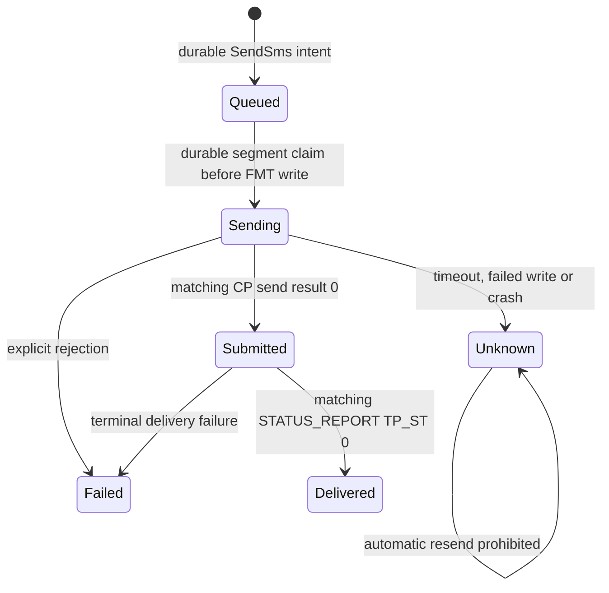

# Nuxel SMS implementation and evidence

## CodeSeeq Round02 continuation — 2026-11-25

LTE-only network mode (readback `mask=8`) is confirmed as the controllable
root cause of CS SMS rejection: `NUXEL_NETWORK_MODE=lte` forces LTE-only, CS
registration stays DENIED, and the CS-domain SMS path has no bearer (raw
result 2). No speculative domain-byte or network-mode change was made.

Physical state: storage available, DEVICE_READY accepted, SMSC received,
`registration="cs-denied"`, `ready=false`. `ResolveSms(3,"superseded")` unblocked
the queue and preserved id 3 as `unknown` with an audit row. One newly
authorized `SendSms` returned native id **4**, durably `queued`; it was NOT
transmitted because the CS gate truthfully refuses a submission against the
denied bearer. LTE baseline preserved (ACTIVE, native IPv6, rmnet0).

Remaining blocker: a real CS/SGs or IMS SMS bearer. Owner decision pending:
allow WCDMA/GSM fallback (risks LTE-only baseline) or implement SGs/IMS SMS.

## Round03 result-0x0002 root cause — 2026-11-25

Result 0x0002 is decoded: it is a low-level CP CS-domain submission rejection
with no TP-FCS cause (`SendSMS Result: 0x2, Tp cause: 0xFF`), not a 3GPP cause
and not an Android RIL error. EFUJ2 `GetSmsResult` (0x344a30) leaves raw 2
unmapped (default branch -> 0xff). Root cause is CS-domain submission while CS
registration is DENIED: the vendor `DoSendSms` (0x2197b0) would report
"CS No Service, SMS send fail" and never submit; the native path OR-ed PS
(LTE) registration into the gate and submitted a doomed CS `SEND_MSG`.

The smallest evidence-supported fix gates SMS on CS registration specifically
and reports `registration="cs-denied"` truthfully. The new authorized physical
test was NOT transmitted: there is no evidence-supported path to a genuine
carrier submission (CS denied, IMS SMS unimplemented/out of scope), and
sending against a known-denied domain would reproduce result 2. See
`NUXEL-SMS-RESULT-0x0002-REPORT.md`.

The `ready`/`registration` truthfulness change affects the aggregate
`GetSmsStatus` report only; the CS-domain serialization (`fmt_sms_send`
domain_wire 0) is unchanged and still correct for the CS bearer.

## Round02 physical submission — 2026-11-25

The corrected native daemon was rebuilt, tested, deployed and verified, then a
single owner-authorized physical SMS was submitted through the native Radio1
`SendSms` API (new native message id 3). The full transaction was captured and
durably retained instead of being lost.

- Correlation fix: PASS. A type-3 unsequenced submission result is decoded and
  persisted but is **not** correlated by modem reference; EFUJ2 returns an MR
  that is not the requested TP-MR, so reference equality is not a correlation
  token.
- Actual modem result: raw result code **2** (non-zero = rejected), returned MR
  158 with requested TP-MR 2, `correlated=false`, correlation reason
  "unsequenced-modem-reference".
- Final durable state: id 3 `queued` → `sending` → `unknown` (error -2). No
  false delivered/submitted transition was recorded.
- Reconciliation: ids 1 and 2 remain `unknown` (historical uncertainty
  preserved). Owner-authorized `superseded` audit rows authorized exactly one
  fresh submission each without resending or falsely resolving the originals.
- The previously reported recipient non-reception is explained by the modem
  rejecting the submission before carrier delivery. Submission is not delivery;
  result 0 is never assumed to mean the recipient received it.

See `NUXEL-SMS-PRODUCTION-ACCEPTANCE.md` for the gate-by-gate result.

## LTE finalizer update — 2026-11-25

The two previously authorized messages remain unsent; no separate evidence of submission was found or produced. No physical SMS test was performed.

One bounded native NV-capable CP boot completed, but packet registration
remains UNKNOWN. A separate verified production boot guard was installed;
the running radio daemon and this subsystem were not changed. Normal reboot
and LTE persistence remain unverified. Existing research below is retained.

Consolidation source/evidence audit, 2026-11-24 CET. Native SMS serialization,
encoding, decoding, durable storage and asynchronous service exist. **No
confirmed recipient delivery or real network-delivered incoming SMS is
established by the reviewed evidence.** No messages were sent in this pass.

## Functionality matrix

| Capability | Category | Evidence / remaining acceptance |
|---|---|---|
| Outbound native submission | Implemented but not physically verified | `SendSms`, queued TPDU, correlated send response; no actual message sent in the reviewed operation logs |
| Actual recipient delivery | Blocked | Requires explicitly authorized recipient and working carrier SMS path; `delivery_verified=false` live |
| Incoming network SMS | Implemented but not physically verified | Native notification decoder, durable store and ACK path; tests are synthetic |
| Incoming backend notifications | Implemented but not physically verified | Radio1 `SmsReceived` / `SmsStateChanged`; no real incoming event acceptance |
| User notification integration | Missing for native Radio1 | Existing desktop/app notification infrastructure has no audited native SMS event adapter |
| Message decoding | Implemented but not physically verified | GSM SMS-DELIVER / STATUS-REPORT codec, strict malformed-input tests |
| Message encoding | Implemented but not physically verified | GSM alphabet/extensions and UCS-2 TPDU serialization tested offline |
| Delivery reports | Implemented but not physically verified | Actual TP-STATUS-REPORT matching logic exists; no physical carrier report received |
| Unicode | Partially implemented | BMP UCS-2 supported; non-BMP and unsupported national alphabet forms explicitly rejected |
| Multipart SMS | Implemented but not physically verified | Up to eight outbound parts; inbound 8/16-bit concat references, ordering/dedup/conflict checks; synthetic fixtures only |
| Message persistence | Partially implemented end to end | Native SQLite store live available and offline durability tests pass; real message/reboot/application synchronization not accepted |
| Messaging app integration | Partially implemented | Existing app/MM/local-store path; native Radio1 SQLite/API is not connected to it |
| Error handling | Implemented but not physically verified | Raw failure results, malformed/storage ACKs, uncertainty on timeout/crash, sender authorization |
| Retry behavior | Partially implemented | Bounded setup, no automatic resend after uncertain submission; no user-facing reconciliation/retry workflow |
| IMS SMS | Unsupported by current native path | Service selects CS domain; no IMS registration or IMS SMS implementation |

Read-only live status: storage available, DEVICE_READY accepted, SMSC received,
no pending submission, not blocked, domain CS, delivery not verified. These
prove service initialization and storage access only. The current radio has
PS NOT_REGISTERED and CS DENIED; the readiness/SMSC responses do not establish
that a carrier will accept SMS.

## Architecture and source map

The exact recovered wire contract is
[`../S5000AP-IPC41-SMS.md`](../S5000AP-IPC41-SMS.md). Preserve it rather than
inventing main/subcommands or assuming generic AT/QMI/MBIM behavior.
All native source/test paths below are under `tools/s10plus/s5000ap-05/`.

| Component | Verified functions / contract |
|---|---|
| `src/fmt_sms.c`, `.h` | `fmt_sms_send`, `fmt_sms_ack`, `fmt_sms_ready`, `fmt_sms_get_smsc`, `fmt_sms_incoming`, `fmt_sms_submit_result`, `fmt_sms_smsc` |
| `src/sms_pdu.c`, `.h` | `sms_encode`, `sms_decode`, `sms_codec_name`; UTF-8 validation, GSM packing, UCS-2, address/timestamp/UDH parsing |
| `src/sms_store.c`, `.h` | `sms_store_open`, `sms_store_queue`, `sms_store_next`, `sms_store_sending`, `sms_store_submit`, `sms_store_fail`, `sms_store_receive`, `sms_store_get`, `sms_store_list`, internal `delivery` / `recalc` |
| `src/sms_service.c`, `.h` | `sms_service_open`, `sms_service_tick`, `sms_service_receive`, `sms_service_close`, internal `uncertain` / `notify`; one active segment and response correlation |
| `src/radiod.c` | `method_send_sms`, `method_list_sms`, `method_get_sms`, `method_get_sms_status`, `sms_write`, `sms_notify`, `tick_handler`, `require_control` |
| `tests/test_fmt_sms.c`, `tests/vendor_sms_vectors.h` | Wire vectors, service-center padding and malformed-response rejection |
| `tests/test_sms_pdu.c` | Encoding/decoding, alphabet extensions, Unicode boundaries, multipart and malformed input |
| `tests/test_sms_store.c` | Durable queue/inbox, retransmission deduplication, delivery report matching and recovery |
| `tests/test_sms_service.c` | Store-before-send / store-before-ACK ordering, sequence correlation, timeouts and crash uncertainty |
| `scripts/recover_vendor_vectors.py --sms-header` | Isolated vendor serialization oracle; synthetic outputs are not sent to the phone |

Radio1 is the existing daemon on the Nuxel session bus, not a separate modem
writer. Its object is `/nl/nuxel/Radio1`, destination/interface `nl.nuxel.Radio1`.

| IPC | Signature / meaning |
|---|---|
| `SendSms` | `ss -> u`, recipient/text to durable local message ID |
| `ListSms` | ` -> au`, local IDs |
| `GetSms` | `u -> a{ss}`, content/state, credential checked |
| `GetSmsStatus` | ` -> a{ss}`, aggregate transport/storage state |
| `SmsReceived` | signal `u`, local message ID only |
| `SmsStateChanged` | signal `us`, ID and state only |

Controls and private message retrieval use `require_control()` and actual
sender EUID. Bridge app permissions must remain in front of this API. Do not
copy recipients, message bodies, SMSC numbers or subscriber identifiers into
handover evidence. Native signals deliberately carry IDs rather than contents.

## Wire behavior and message state

FMT main 4 carries send (sub1), incoming (sub2), incoming ACK (sub6), device
ready (sub7), and service-center query (sub10). The native service prepends the
actual CP/SIM SMSC to the encoded TPDU. `fmt_sms_smsc()` handles the physically
observed padded 12-byte field while validating its logical length; the earlier
strict equality bug was corrected during Round43 operation 23.

Native SMS chooses **CS wire domain 0** using the recovered domain conversion.
It does not silently switch to IMS. `tick_handler()` currently permits queued
sending if either converted PS or CS registration is registered. That is an
implementation gate, not evidence that CS SMS is available on LTE-only service;
validate the carrier-supported path before treating this condition as enough.

A generic GEN success 0x8000 accepts a command. A send result 0 confirms
submission. Neither proves recipient delivery. Only a matching status-report
TPDU with TP-ST 0 marks delivered; forwarded-without-confirmation remains
submitted. Recipient observation is still necessary for physical acceptance.
A late negative report cannot downgrade confirmed delivery.

Incoming notification -> strict frame/PDU decode -> SQLite commit -> positive
ACK. Storage failure sends 0x8016; malformed/unsupported content sends 0x806f.
An ACK response acknowledges the local receive operation, not recipient
delivery. Exact retransmissions are deduplicated; conflicting multipart
segments are rejected. A complete incoming synthetic fixture only tests code.

`command` send processing is asynchronous and uses sequence correlation;
`sms_service_tick()` bounds setup and applies a 120-second submission timeout.
`uncertain()` prevents automatic resend after ambiguous outcomes. Restarting
radiod must not turn an unknown result into a second billable message.

## Encoding, storage and app boundary

Encoding supports GSM default/extension alphabet, UTF-8 input and BMP UCS-2,
with up to eight outbound parts. GSM escape pairs are not split at boundaries.
Incoming concatenation handles 8-bit and 16-bit references. Non-BMP Unicode
and unimplemented national alphabets fail explicitly. Do not render a rejected
emoji message as sent. Outgoing segments request status reports, subject to
carrier support; lack of a report is not proof of recipient failure.

Private database: `/var/lib/nuxel-radio/sms.sqlite3`, optionally overridden by
`NUXEL_SMS_DATABASE`. SQLite persists outgoing intent before any modem send,
and incoming content before positive ACK. Outstanding references and recently
completed references remain reserved to reduce report collisions. The daemon
has only one active segment, preventing concurrent write/correlation races.

Repository unit `nuxel-radiod.service` contains `StateDirectory=nuxel-radio`,
mode 0700 and UMask 0077. The installed older base unit instead relies on
`20-sms-storage.conf` with `ReadWritePaths=/var/lib/nuxel-radio`. This currently
works (live storage available), but the service/unit installer must be checked
on a fresh install and reboot. Do not commit the private SQLite database.

`shell/nuxel-shell/nuxel-messages/main.c` speaks the MM Messaging/Sms API
through `mm_conn`, `mm_modem_path`, `mm_messaging`, and async send callbacks
including `on_mm_send_ready`. It uses the shared local phone-data layer and
also has an explicitly labelled mock bridge path. It does not subscribe to
Radio1's native inbox/outbox. `nuxel-phone-data` JSON and the native SQLite
store are separate existing stores; adding a third store is not a solution.
Use native IDs/state as transport authority and map application presentation
without duplicating sends or conflating queued/submitted/delivered.

`services/nuxel-bridge/src/bridge.py::ModemManagerConnector.send_sms()` still
returns a `mock:true` success when MM is disconnected and keeps an in-memory
mock list. That is not carrier delivery. The API adapter must preserve explicit
unavailable state on physical hardware and never map that mock result to real
sent/delivered status. Native `sms_notify()` emits D-Bus signals; a complete
native-to-user-notification path was not found in the reviewed integration.

## Evidence and exact remaining implementation

Historical evidence:

- Commit `2c377487`: native SMS transactions and recovered cellular-only HTTPS.
- Commit `24e61763`: recovery/installation reconciliation and call integration.
- `/tmp/nuxel-round43/live-sms-23-initial.log`, `live-sms-23-status.log`,
  `verify-23.log`, `verify-24.log`, `verify-25-final.log`: initialization,
  SMSC parsing/storage and retained LTE. No confirmed recipient exchange.
- `reports/S5000AP-06-ROUND43-SET-APN-INFO-CP-TRACE.md` explicitly records an
  empty inbox/outbox and no outgoing SMS/call initiated. Round44 leaves
  physical delivery unverified. No reviewed artifact supersedes that boundary.

Ordered next work, only for incomplete capabilities:

1. Preserve/recover LTE and normal CP initialization; retain CS+PS, SIM and
   separate registration states. Fix data OFF without powering down SMS.
2. Connect the existing permission-checked bridge and Messages app to Radio1.
   Read native IDs/status, subscribe to receive/state changes, resynchronize
   on service restart, and show queued/submitted/delivered/failed/unknown
   distinctly. Test denied app access and avoid exposing raw modem commands.
3. Wire native receive events to one user notification and durable app view.
   Test app closed, reopened, duplicate signals, retransmitted network PDU,
   reordered multipart segments and database failures offline first.
4. Add a deliberate user reconciliation/retry action for unknown submissions;
   never auto-resend after timeout or reboot. Keep failed vs uncertain distinct.
5. With explicit recipient authorization, perform one bounded outbound SMS,
   inspect recipient receipt and correlate any actual carrier delivery report.
   Then have that consenting peer send one real incoming SMS; verify decoding,
   store-before-ACK, app update and notification. Do not run repeated billable
   loops or use synthetic fixture numbers on hardware.
6. Only if authorized and basic traffic succeeds, cover one Unicode and one
   multipart exchange, verify exact text on both ends, and test persistence
   across app/service restart and normal reboot. Keep all message content
   private and record only redacted result/IDs/timing.
7. Regress LTE DNS/HTTPS after SMS, data OFF while SMS remains usable, and
   service loss without duplicate transmissions. Document carrier restrictions
   separately from implementation failures; IMS-dependent SMS requires a
   supported IMS path, not a guessed domain-byte substitution.

## Tests and limitations

This pass re-ran the host radio build/test script, its 3,000 ordinary and 3,000
sanitized fuzz inputs, and the twelve ASan/UBSan component suites including
all four SMS suites. Twelve core native AArch64 suites also ran, including SMS.
See the [handover](DEEPSEEK-STAGE06-HANDOVER.md) for actual exit statuses,
full-suite native build failure and evidence locations. These are software
regression results, not carrier-delivered messages.

The ordinary phone-data runner failed to compile on this macOS host due to its
strict-C11 `mkdtemp` declaration issue. No live SMS app acceptance was performed.
No telephone number has been authorized for a new chargeable experiment.

## Round03 resume — 2026-11-25 (verified; no carrier submission)

Resumed from `ba15886e` with host build/tests re-run: all four SMS suites PASS
(golden vectors, codec, durable store, service durability/correlation, 0
failures). Installed and running `nuxel-radiod` hashes match
(`e439005f89edda327dc9cca91dc8b4ba39f80d9dae9869f8b89a94f7c4ddf169`) and expose
the CS-registration gate: `GetSmsStatus -> registration=cs-denied, ready=false`.
SMS init/setup is `accepted` and SMSC `received`; only the CS bearer is absent.

Live registration has been stable for >30 minutes: PS `REGISTERED_HOME` (LTE,
native IPv6), CS `DENIED` (`raw_state=4`, `rat=LTE`, `reject_cause=0`), network
mode readback `mask=8` (LTE-only from `NUXEL_NETWORK_MODE=lte`). The owner-authorized
`SendSms` call returned "Could not durably queue SMS or reserve message references":
duplicate prevention correctly refused a byte-identical re-queue because message 4
already holds that exact recipient+text in `queued`. No new native ID was created;
no retransmit; no modem submission occurred.

The demonstrated blocker is physical, not a code defect: a CS-domain SMS has no
bearer while CS is denied on an LTE-only subscription. A genuine submission needs
a real CS/SGs or IMS SMS bearer (owner decision pending), not a domain-byte or
network-mode change. Messages 1-3 stay `unknown` (audit-trailed `superseded`);
message 4 remains `queued` and untransmitted. LTE baseline preserved.

## Round04 network-mode fallback experiment — 2026-11-25 (authorized; physical)

Owner explicitly authorized switching LTE-only -> LTE/WCDMA/GSM automatic. This
was executed, read back, and observed physically.

Applied and verified:

- `NUXEL_NETWORK_MODE` changed `lte` -> `auto` (drop-in `30-native-data.conf`),
  rollback copy preserved alongside.
- `nu-xel-radiod` restarted; running binary identity unchanged
  (`3b645fca97f4b29539000d530a984a75`, same as `nuxel-radiod.new`), i.e. the
  SMS-enabled build was already active; the only blocker was the env var.
- Network-mode readback: `mask=11` (`0x0b` = LTE/WCDMA/GSM auto) — verified
  repeatedly stable across the status poll cycle (was `mask=8` LTE-only).
- Service-domain readback: `wire=1` (CS+PS), `packet_service_enabled=true`.
- PS registration: `REGISTERED_HOME` (raw 2, rat LTE).
- CS registration: still `DENIED` (raw 4, rat LTE, `reject_cause=0`), now
  visible as a domain=2 (CS) result rather than absent.

Conclusion of the authorized fallback experiment: enabling WCDMA/GSM auto mode
does NOT establish CS registration. Carrier is KPN (home PLMN `20408`), whose
2G/3G legacy CS networks are retired; the modem performs a PS-only EPS attach
(no combined EPS/IMSI attach over SGs), so no CS SMS bearer can be acquired.
This is a physical carrier limitation, not a device-configuration defect.

Result: the owner-authorized message 4 remains `queued` and untransmitted; the
CS-registration gate truthfully refuses a doomed submission. LTE baseline fully
preserved (HTTPS 200 over cellular IPv6 `rmnet0`), USB management
(`usb0`, gadget `configured`) and ZeroTier (`10.11.12.99`) independently
available. No new message was created, no historical record altered, no
auto-retransmit.

Remaining genuine SMS bearer requires SMS over SGs (combined attach; no native
userspace trigger recovered in vendor evidence, handled inside CP firmware
against network SGs capability) or IMS SMSoIP (modem exposes `IMS`/`QMIIMS`/
`SEC_IMS_AUTH` interfaces, but native IMS PDN + SIP + SMSoIP + entitlement is
unimplemented). No EFS/NV/protected-partition change was attempted.
