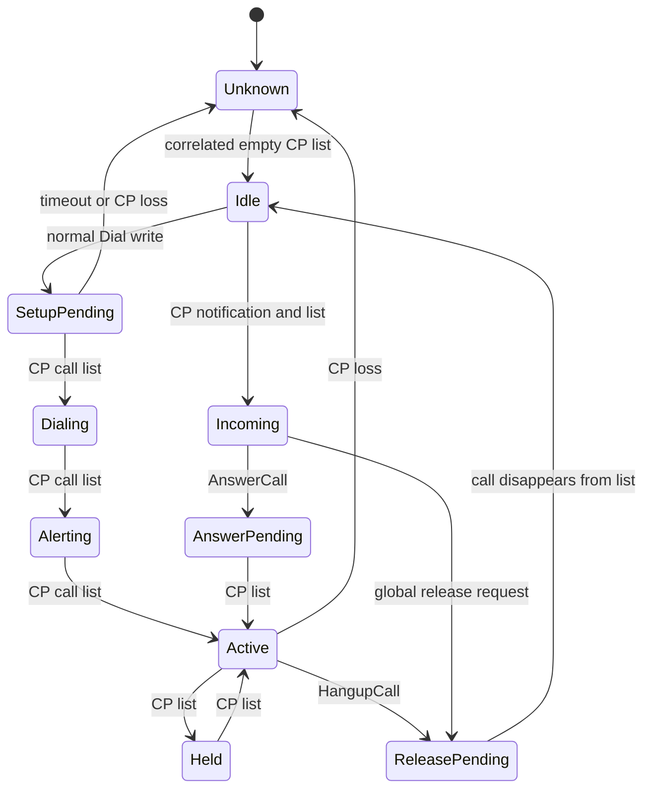

# Nuxel telephony implementation and evidence

Consolidation source/evidence audit, 2026-11-24 CET. Native normal-CS call
control exists. **No end-to-end call or two-way voice-audio acceptance is
established.** LTE data does not establish VoLTE, IMS or circuit-switched
fallback. Read [LTE state](NUXEL-LTE-STATE.md) before changing the radio.

## Functionality matrix

The categories below describe the complete user capability, not merely whether
one serializer exists. “Implemented but not physically verified” includes
synthetic wire/FSM tests; it does not mean a consenting peer received a call.

| Capability | Category | Evidence / missing acceptance |
|---|---|---|
| Outgoing normal call control | Implemented but not physically verified | `fmt_call_dial()`, `call_service_dial()`, Radio1 `Dial`; no peer ringing/connection evidence |
| Incoming call detection | Implemented but not physically verified | CALL notifications trigger list refresh; `call_service_receive()` emits incoming state; no real incoming call |
| Answer | Implemented but not physically verified | `fmt_call_answer()`, `call_service_answer()`, `AnswerCall`; guarded by incoming/waiting list entry |
| Reject | Partially implemented | `HangupCall` invokes global release; no separately verified targeted rejection semantics or UI path |
| Hang up | Implemented but not physically verified | `fmt_call_release()`, `call_service_hangup()`; no physical remote-end confirmation |
| Call-state notifications | Implemented but not physically verified | `CallStateChanged(us)`, `IncomingCall(u)`; synthetic transitions tested; empty CP list physically received |
| Caller identification | Implemented but not physically verified | Strict number/type decoding in `fmt_call_list()`, credential-checked `GetCalls`; no real incoming caller comparison |
| Earpiece call audio | Missing | Radio1 voice status explicitly returns `audio_route=unconfigured`; no native call audio coordinator |
| Microphone call audio | Missing | No verified CP uplink/ABOX route attached to call lifecycle |
| Speaker call routing | Missing | General playback routes exist; no accepted modem-call route switch |
| Bluetooth call audio | Unsupported by current native call implementation | No integrated SCO/CP call route or physical headset evidence; hardware feasibility not determined here |
| Dialer integration | Partially implemented | Existing UI/ModemManager path; native Radio1 calls are not connected to it |
| Call history | Partially implemented | Shared local phone-data store exists; no verified Radio1 lifecycle-to-history bridge |
| Cellular recovery following calls | Blocked | Requires working data plus an actual completed call; neither combined acceptance nor recovery policy implemented |
| IMS / VoLTE | Missing | `method_get_voice_status()` reports `ims=unimplemented`; no IMS registration evidence |
| Emergency/supplementary calls | Unsupported | Current encoder is for normal CS voice; no emergency capability is claimed or tested |

Current physical read-only state: CP ONLINE; SIM ready; CS registration DENIED,
reject-cause field 0; call list received; no pending call; audio unconfigured;
IMS unimplemented. Cause 0 does not override the explicit DENIED state. This
pass placed no call and queried no private caller history. No test recipient or
second-phone/audio equipment was supplied.

## Native call architecture

All following backend paths are under `tools/s10plus/s5000ap-05/`:

| Source | Symbols and responsibility |
|---|---|
| `src/fmt_call.c`, `.h` | `fmt_call_dial`, `fmt_call_answer`, `fmt_call_release`, `fmt_call_get_list`, `fmt_call_voice_registration`, `fmt_call_state_name`, `fmt_call_list`, `fmt_call_status` |
| `src/call_service.c`, `.h` | `call_service_init`, `command`, `call_service_dial`, `call_service_answer`, `call_service_hangup`, `call_service_tick`, `call_service_receive`; one pending command, correlation and bounded state refresh |
| `src/radiod.c` | `method_dial`, `method_answer_call`, `method_hangup_call`, `method_get_calls`, `method_get_voice_status`, `call_notify`, `tick_handler`, `require_control`; native API and transport integration |
| `src/fmt_rx.c` | `fmt_rx_registration`, `fmt_rx_reg_state`, `fmt_rx_registered`; independent CS registration decoding |
| `dbus/nl.nuxel.Radio1.xml` | Public contract, same method/signal family as daemon vtable |
| `tests/test_fmt_call.c` | Vendor vectors, invalid number/list/status data, normal-CS parser boundaries |
| `tests/test_call_service.c` | Command/list correlation, incoming/active/ended transitions and timeouts |
| `tests/vendor_call_vectors.h` | Recovered isolated vendor function vectors; not captured successful phone calls |

Transport is the same exclusively owned native FMT channel as LTE/SMS, not a
second raw modem writer. The native service runs on the Nuxel session bus at
`unix:path=/run/nuxel-wayland/bus`; destination and interface are
`nl.nuxel.Radio1`, object `/nl/nuxel/Radio1`.

| D-Bus operation | Signature / meaning |
|---|---|
| `Dial` | `s -> b`; request accepted for asynchronous command processing, not peer connected |
| `AnswerCall` | ` -> b`; normal incoming/waiting call answer request |
| `HangupCall` | ` -> b`; release request, not a selected-call-id API |
| `GetCalls` | ` -> a(ussb)`; local call ID, state, number, incoming-direction flag |
| `GetVoiceStatus` | ` -> a{ss}`; registration, pending/result, list/audio/IMS status |
| `IncomingCall` | signal `u`, local call ID only |
| `CallStateChanged` | signal `us`, local call ID and state only |

`require_control()` obtains the actual bus sender EUID; root and the native
Nuxel account may control calls/read private call data. Do not expose these
methods to browser code without existing application capability checks.

## Call lifecycle and proof boundaries

This diagram summarizes observed-state handling in source, not a tested
carrier call. Call-list states 1..6 map to active, held, dialing, alerting,
incoming and waiting. The parser accepts normal-CS type 0x0100 and rejects
unknown IMS/regional layouts rather than guessing optional tails.

`command()` sets a 30-second deadline and records sequence/subcommand.
`call_service_receive()` accepts a GEN only when the original call command and
ACK sequence match; it separately correlates list replies. A successful GEN
is command acceptance, not active voice. Notification subcommands prompt a
list refresh. Calls disappearing from the list emit `ended`.
`call_service_tick()` queries at one second during active work and at sixty
seconds idle, marks uncertain state on CP loss, and expires list requests.
Global release may supersede setup; targeted call release is not implemented.
Call status/list reception must not silently mark audio ready.

## Voice technology and audio

The implemented serializers and parser support the vendor's **normal
circuit-switched voice command family**. This establishes implementation
intent, not a successful circuit-switched network call. Existing evidence does
not establish CS fallback, VoLTE, IMS registration or any alternative carrier
voice mechanism. LTE data on KPN is not evidence that this SIM can place CS
calls on a currently available legacy network. Do not claim the cause of CS
DENIED is definitively carrier policy without a supported diagnostic.

`/tmp/nuxel-round43/audio-capabilities-1.log` lists actual ALSA PCM endpoints,
including ABOX RDMA/WDMA and calliope devices. Historical artifacts
`ap-audio-mode.asm`, `ap-audio-path.asm`, `hal-voice-controls.asm`,
`mixer_paths.xml`, `mixer_gains.xml` and `network-audio-prerequisites.log` show
that vendor call-audio behavior was investigated. They do not prove an
implemented native CP-to-PCM voice path or audible two-way call. No new audio
reverse engineering was performed here.

General Nuxel audio infrastructure lives in `services/nuxel-sound/` and
`configs/alsa-ucm/`. `nuxel_audio_outputs.py` handles general output policy.
Do not equate music playback, microphone recording or a PipeWire Bluetooth
sink with cellular call audio. A future call coordinator must configure and
tear down the verified CP/ABOX path, route earpiece/microphone, restore prior
media routing, and survive call/CP loss before advertising audio support.

## Dialer and storage integration

`shell/nuxel-shell/nuxel-dialer/main.c` still uses conditional libmm-glib
ModemManager orchestration (`on_call_clicked`, `on_call_created`,
`on_call_state_changed`, `on_call_deleted`). It has no native Radio1 adapter.
`services/nuxel-bridge/src/bridge.py::ModemManagerConnector` similarly routes
`initiate_call()` / `end_call()` through MM. At this pass's live inspection,
ModemManager had no modem object, while Radio1 was responding independently.
Running ModemManager is not integration evidence.

`shell/nuxel-shell/nuxel-phone-data/nuxel-phone-data.{c,h}` supplies shared
contacts/calls/messages, normalization and atomic local JSON persistence. It
stores local call entries/duration; it does not consume native call events.
The native service stores an in-memory call list, not a durable call history.
DeepSeek must choose one application-facing event/history path and prevent
missed/ended/duplicate events from producing phantom calls after reconnect.

## Ordered remaining work

| Work | Current defect / dependency | Next implementation and acceptance |
|---|---|---|
| Preserve LTE baseline | Current PS session failed after an earlier reboot; production NV boot path absent | Follow LTE recovery/install plan first; prove data before call-induced recovery tests |
| Native app adapter | Dialer/bridge speak MM, no live MM modem | Add permission-preserving Radio1 adapter, asynchronous callbacks, backend-loss state; verify UI updates for all call transitions |
| Incoming lifecycle | Backend implementation only | With explicitly authorized second phone, verify ring, caller identity, answer, reject and both-end hangup; record state timestamps without numbers |
| Outgoing lifecycle | No recipient evidence | One consenting normal test call: dial, remote ring, connect, remote/local hangup; preserve uncertainty on timeout, never redial automatically |
| Audio coordinator | CP audio mode/path and ABOX routing not implemented | Use existing vendor analysis to implement only validated routing; measure intelligible earpiece downlink and microphone uplink on a real call |
| Speaker / headset | No accepted call route | Add routing only after basic two-way voice; independently test speaker and supported Bluetooth headset; unsupported stays explicit |
| Call history | Local store disconnected from Radio1 | Map authoritative start/answer/end timestamps and failure states; test app restart, duplicate signals and CP loss |
| Post-call data | No combined acceptance or policy reconnect | Verify LTE before/during/after a call and ordinary DNS/HTTPS afterward; reconnect through policy without modem reset loops |
| Negative controls | Not physically accepted | Test no service, data OFF with telephony available, CP loss, airplane transitions and stale UI; preserve normal recovery |

If voice actually requires IMS, record that dependency separately. Do not
reinterpret native LTE success or CS command ACK as VoLTE. Extensive IMS or
audio implementation belongs to the subsequent bounded task, not this pass.

## Regression and evidence

Historical native call implementation was recovered in commit `24e61763`.
`/tmp/nuxel-round43/deploy-25.sh` and `verify-25-final.log` show deployment,
readback and retained cellular HTTPS, not a real voice call. The Round43 report
explicitly says no outgoing call was initiated; the Round44 report leaves
voice/audio acceptance pending. No contrary physical call evidence was found
in the reviewed artifacts.

This pass ran host and native call serializer/FSM suites. Full test commands,
exit codes, sanitizer results and limitations are in the
[handover](DEEPSEEK-STAGE06-HANDOVER.md). The shared phone-data test runner failed
on this macOS host because `mkdtemp` is undeclared under its strict C11 flags;
this is not a modem-call failure and was not concealed by weakening warnings.

Regression boundaries: CS+PS wire 1 must remain; never restore CS-only wire 2
under the CS+PS label. Mobile-data OFF must release user data without powering
off CP or breaking voice/SMS registration. Keep LTE/WCDMA/GSM auto unless the
user deliberately changes mode; do not permanently force LTE-only to obtain a
data success. Preserve verified NV boot inputs and require data recovery after
calls as its own acceptance gate.
