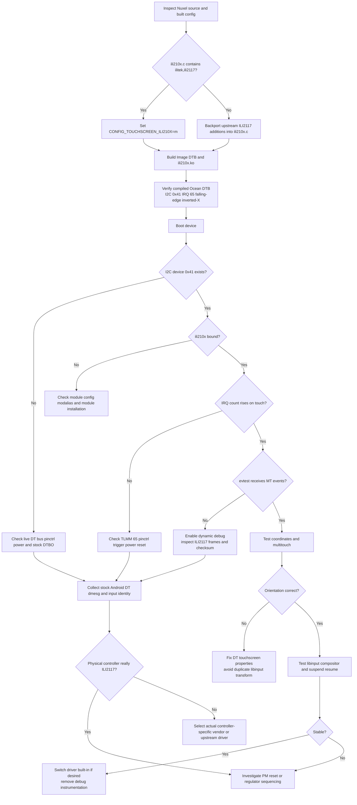

# Nuxel G7 Power ILI2117 Touchscreen Driver Research Report

## Executive summary

The touchscreen blocker is almost certainly **not a missing ILI2117 Linux driver**. The attached Nuxel archive identifies the Motorola Moto G7 Power (`ocean`) touchscreen as **Ilitek ILI2117**, on **I²C controller `i2c_3`, address `0x41`, TLMM GPIO/IRQ 65, falling-edge interrupt, X-axis inverted**. The authoritative upstream `sdm632-motorola-ocean.dts` contains the same `touchscreen@41` node with `compatible = "ilitek,ili2117"`. citeturn20view2turn13view3

The real problem is a **Kconfig/name mismatch in Nuxel**. Nuxel requests:

```text
CONFIG_TOUCHSCREEN_ILI2117=y
```

but there is intentionally no per-chip `CONFIG_TOUCHSCREEN_ILI2117` option. ILI2117 support lives in the multi-chip upstream driver:

```text
drivers/input/touchscreen/ili210x.c
CONFIG_TOUCHSCREEN_ILI210X
module: ili210x
```

The exact `msm8953-mainline/linux` tree used by Nuxel contains `CONFIG_TOUCHSCREEN_ILI210X`; its source maps the OF compatible **`ilitek,ili2117` directly to the `ili211x_chip` implementation**. In other words, the DTS and driver already match. citeturn20view0turn21view0turn21view1

This explains the contradictory statement in `g7power-go-guide.md` that the tree has “no ILI2117 driver”: the guide searched for the nonexistent symbol `CONFIG_TOUCHSCREEN_ILI2117` and apparently relied on stale Kconfig help text that still emphasizes older ILI2102/2103/2105 devices. The actual source has explicit ILI2117 support. The upstream ILI2117 support was added years before the Linux 6.19-era Nuxel kernel; the upstream patch history includes the 2019 `Input: ili210x - add ILI2117 support` work. citeturn11search3turn11search6

**The recommended fix is therefore not to write a new touchscreen driver.** It is to:

1. replace `CONFIG_TOUCHSCREEN_ILI2117=y` with `CONFIG_TOUCHSCREEN_ILI210X=m` or `=y`;
2. build/install `ili210x.ko` if modular;
3. retain the existing Ocean DTS node;
4. correct Nuxel's wrong runtime driver/product names from `ili2117` / `ILI2117*` to `ili210x` / `ILI210x Touchscreen`;
5. remove the userspace X-inversion matrix because the kernel already processes `touchscreen-inverted-x`;
6. test binding, IRQ delivery and evdev before doing any driver development.

The mainline ILI2117 implementation is a particularly strong hardware match: **I²C, 10 contacts, 43-byte native ILI211x report format, checksum checking, 2048-unit controller coordinate resolution, standard Linux multitouch slots, IRQ-driven input and no required firmware blob**. citeturn14view3turn21view3

A second Nuxel integration bug is also present. `configs/g7power/libinput/99-nuxel-ocean-touch.conf` contains an X-axis transformation for the same inversion already declared in DT. The `ili210x` driver calls the generic touchscreen-property machinery and reports coordinates through it, so `touchscreen-inverted-x` is already applied in kernel input processing. If Nuxel's userspace rule is corrected so that it actually matches the upstream input name but its `TransformationMatrix` is retained, X would be inverted **twice**. citeturn20view0turn21view3

The practical conclusion is:

> **Do not port ILI9881H, ILI213x or another Ilitek driver and do not create an `ili2117.c`. First enable the already-present `ili210x.c` driver. This is the exact upstream driver for this controller and DTS.**

## Evidence from the Nuxel archive and upstream hardware description

I inspected the provided `/mnt/data/nuxel-main.zip` directly. The relevant evidence is internally consistent about the hardware, but inconsistent about the Linux driver name.

| Item | Finding | Evidence |
|---|---|---|
| Device | Motorola Moto G7 Power, codename `ocean`, SDM632 | `device/g7power/deviceinfo:1-16` |
| Exact touchscreen model | **Ilitek ILI2117** | `device/g7power/deviceinfo:33-40` |
| Bus | **I²C**, controller label `i2c_3` | `device/g7power/deviceinfo:36`; upstream Ocean DTS confirms `&i2c_3` citeturn20view2turn13view3 |
| I²C address | **0x41** | `device/g7power/deviceinfo:37`; DTS `reg = <0x41>` citeturn20view2turn13view3 |
| Interrupt | **TLMM 65** | `device/g7power/deviceinfo:38` |
| IRQ trigger | **falling edge** | upstream DTS `interrupts = <65 IRQ_TYPE_EDGE_FALLING>` citeturn20view2turn13view3 |
| Orientation | **X inverted** | `device/g7power/deviceinfo:39`; DTS has `touchscreen-inverted-x` citeturn20view2turn13view3 |
| Display | 720 × 1520 portrait panel | `device/g7power/deviceinfo:23-27`; upstream device description is consistent with the Ocean display geometry citeturn13view3 |
| Reset GPIO | **Unspecified in zip and absent from upstream touch node** | archive contains no touchscreen reset GPIO; upstream node has none citeturn20view2turn13view3 |
| Regulators/power GPIO | **Unspecified** | no relevant touchscreen supply entry in archive; current Ocean touchscreen node does not supply one citeturn20view2 |
| Firmware blob | **None specified; not required by upstream ILI2117 path** | `firmware/g7power/manifest.yml:76-81`; ILI2117 chip implementation has no ILI251x-style firmware filename/update requirement citeturn14view3 |
| Device-tree file in zip | **None** | no `.dts`, `.dtsi` or `.dtso` is present in the archive |
| Upstream DT entry | `compatible = "ilitek,ili2117"` at `touchscreen@41` | authoritative Ocean DTS citeturn20view2turn13view3 |
| ACPI entry for this device | **None in zip; DT is used** | phone platform is described by OF/DT; relevant binding is through `ilitek,ili2117` in the driver citeturn20view0 |
| Intended Nuxel driver | incorrectly called `ili2117` | `device/g7power/nuxel-ocean.conf:10-12` |
| Nuxel Kconfig | incorrectly requests `CONFIG_TOUCHSCREEN_ILI2117=y` | `kernel/g7power/defconfig:19-20` |
| Real Kconfig | **`CONFIG_TOUCHSCREEN_ILI210X`** | target fork Kconfig citeturn21view0turn21view1 |
| Real module | **`ili210x` / `ili210x.ko`** | target Kconfig and driver source citeturn21view0turn20view0 |
| Kernel input name | **`ILI210x Touchscreen`** | `ili210x` probe code citeturn21view3 |

The effective upstream DT description is:

```dts
&i2c_3 {
        status = "okay";

        touchscreen@41 {
                compatible = "ilitek,ili2117";
                reg = <0x41>;
                interrupt-parent = <&tlmm>;
                interrupts = <65 IRQ_TYPE_EDGE_FALLING>;
                touchscreen-inverted-x;
        };
};
```

This structure is already present in both upstream Linux and the msm8953-mainline device tree. citeturn20view2turn13view3

The Nuxel guide reaches the opposite conclusion at `g7power-go-guide.md:55-57` and again at `:400-405`: it says that because `CONFIG_TOUCHSCREEN_ILI2117` does not exist, the DTS node has nothing to bind to. That inference is incorrect. The target tree's `ili210x.c` contains the ILI2117 OF match and the ILI211x-specific protocol implementation. citeturn20view0turn21view3

The likely configuration failure is straightforward:

```text
Nuxel fragment:
CONFIG_TOUCHSCREEN_ILI2117=y
             ↓
unknown Kconfig symbol
             ↓
olddefconfig drops/ignores it
             ↓
CONFIG_TOUCHSCREEN_ILI210X remains disabled
             ↓
no ili210x built
             ↓
DT creates the I²C device but no driver binds
```

That is consistent with the build procedure in `kernel/g7power/build-kernel.sh:98-106`: Nuxel generates a base config, merges its fragment, then runs `olddefconfig`. An unknown symbol in a fragment does not magically enable the differently named real symbol.

There are also two userspace naming errors in the archive:

```text
device/g7power/90-nuxel-ocean.rules
    ATTRS{name}=="ili2117*"
    ATTRS{name}=="ILI2117*"

configs/g7power/libinput/99-nuxel-ocean-touch.conf
    MatchProduct "ILI2117*"
```

The upstream driver registers the input device as **`ILI210x Touchscreen`**, so these strings do not describe what the kernel will create. citeturn21view3 These mistakes do not prevent the kernel driver itself from binding, but they can break Nuxel-specific udev tagging and any Xorg/libinput stanza intended to match it.

Finally, firmware should **not** be invented. The `ili210x` source does contain an external firmware filename for the **ILI251x** path (`ilitek/ili251x.bin`), but ILI2117 uses a different chip-data implementation with no analogous firmware request. citeturn14view3 Nuxel's manifest correctly marks the touchscreen blob as unknown/non-required; the misleading part is only the accompanying uncertainty about whether ILI2117 requires one.

## Linux and vendor ILI driver survey

Within current upstream Linux, the two important Ilitek touchscreen families are `ili210x.c` and `ilitek_ts_i2c.c`. The former contains the exact ILI2117 implementation; the latter covers a different, newer protocol family including ILI213x/23xx/252x. Vendor Android trees add substantially larger TDDI stacks such as ILI9881H, but those are protocol- and platform-heavy and are a much worse fit for Ocean. citeturn20view0turn16view0turn17view1turn22view0

| Candidate | Supported ILI family | Interface | Probe/init and report protocol | Firmware | User ABI / evdev behaviour | Dependencies | Kernel compatibility | Licence | Match to G7 Power |
|---|---|---|---|---|---|---|---|---|---|
| **Mainline `ili210x.c`, ILI2117/`ili211x_chip`** | **ILI2117** | **I²C** | OF match `ilitek,ili2117`; requires valid IRQ; gets optional `reset` GPIO; configures input/MT; ILI211x path reads a **43-byte frame** directly with `i2c_master_recv`, validates checksum and decodes up to **10 contacts** | **None required** | No private userspace ioctl needed; standard Linux MT slots/evdev; coordinates passed through generic touchscreen properties; pointer emulation/input sync | I²C; Kconfig selects CRC-CCITT; Linux input MT/touchscreen framework | **Present in target Linux 6.19-era tree and current mainline**; ILI2117 support dates from 2019-era upstream work | GPL-2.0-only | **Exact match** citeturn20view0turn21view0turn21view3turn14view3 |
| Mainline `ili210x.c`, legacy ILI210x | ILI2102/2103/2105-class devices | I²C | Same common driver/probe framework but older chip callbacks/report layouts | No ILI2117-style external FW need | Standard input/evdev; historical implementations included calibration support | I²C/input | Very old upstream lineage; older Android/common copies predate ILI2117 | GPL family | Same architectural lineage but **wrong protocol variant** citeturn15search9turn19search3 |
| Mainline `ili210x.c`, ILI2120/ILI2121 path | ILI212x | I²C | Common probe but register-oriented touch reads rather than the ILI2117 43-byte packet path; 10-contact-class implementation | No ILI251x firmware blob | Standard evdev multitouch; chip calibration path exists | Same `ili210x` framework | Current mainline/target family | GPL-2.0-only | Close family, but inferior to exact ILI2117 path citeturn12view2turn14view3 |
| Mainline `ili210x.c`, ILI251x path | ILI251x | I²C | Common probe, different register/protocol operations; supports pressure-related reporting and firmware operations | **`ilitek/ili251x.bin`** | Standard evdev MT plus variant-specific firmware handling | I²C, input, firmware loader for update path | Current mainline | GPL-2.0-only | Same framework, but unnecessary protocol/firmware machinery for ILI2117 citeturn14view3 |
| **Mainline `ilitek_ts_i2c.c`** | ILI2130/2131/2132, ILI2316/2322/2323/2326, ILI2520/2521 and related protocol-v6 family | **I²C** | reset; query protocol/MCU/FW/screen/touch information; initialize input; threaded IRQ; screen geometry and contact count obtained from controller | Mainline implementation reads firmware version; no equivalent mandatory external ILI2117 blob | Standard MT/evdev, `touchscreen_report_pos`; sysfs firmware/product information; no normal custom ioctl ABI | I²C/input/touchscreen | Present in modern mainline and target-class kernels | GPL-2.0 | Good generic Ilitek reference, **wrong controller protocol and OF ID** citeturn16view0turn17view1 |
| Vendor **ILI9881H/TDDI** stack | ILI9881H and related TDDI devices | Vendor stack can abstract **I²C or SPI**; inspected Realme implementation prominently uses SPI | Large vendor architecture with hardware-interface abstraction, firmware modes, ESD recovery, packet-ID dispatch, gesture processing and reset machinery | Vendor firmware upgrade subsystem rather than the simple ILI2117 path | Rich vendor/debug behaviour; gesture packets can be converted to key events; no `unlocked_ioctl` was found in the inspected `ilitek_main.c` itself | Numerous vendor platform abstractions/workqueues/debug and firmware components | Android downstream kernel APIs; substantial porting burden to modern mainline | GPLv2-style vendor source | **Poor fit**: different TDDI protocol generation and far too much platform baggage citeturn18search0turn18search1turn22view0turn22view1turn22view2 |

The mainline ILI2117 code has several characteristics that line up particularly well with the G7 Power:

- `max_touches = 10`; the ILI211x parser uses four bytes of coordinate data per active contact and a controller-resolution value of 2048. citeturn14view3
- It is interrupt-driven and the common probe explicitly rejects a device without an IRQ. Ocean provides GPIO/TLMM 65 as a falling-edge IRQ. citeturn21view3turn20view2
- It can use an optional reset GPIO, but does not require one. Ocean's upstream node does not specify one, which is therefore a supported configuration rather than evidence of an incomplete DTS. citeturn21view3turn20view2
- It exposes ordinary kernel input events rather than requiring an Android userspace daemon or a proprietary ioctl path. citeturn20view0turn21view3
- No ILI2117 firmware image is requested. The only explicitly named `ili210x.c` firmware blob in the inspected current implementation belongs to the ILI251x variant. citeturn14view3
- There is no reason to select the separate `CONFIG_TOUCHSCREEN_ILITEK` driver for Ocean: that driver's OF table describes ILI213x/23xx/252x parts, not ILI2117. citeturn16view0turn17view1

The vendor ILI9881H driver is useful only as a contrast. The inspected implementation has an abstract `BUS_I2C`/SPI concept, SPI ACK/ESD recovery, firmware-upgrade work, gesture mode and much larger vendor state machinery. That is exactly the sort of downstream code that should **not** be transplanted when an exact compact upstream driver exists. citeturn22view0turn22view1

## Closest driver and code-level match

The single closest driver is unequivocally:

```text
drivers/input/touchscreen/ili210x.c
    └── ILI2117 OF match
        └── ili211x_chip
```

This is not merely the “closest” driver based on family resemblance. **It is the exact model driver already used by mainline for `ilitek,ili2117`.** citeturn20view0turn21view3

A useful code-path comparison is:

| Function/path | ILI2117 requirement | Existing `ili210x.c` behaviour | Adaptation needed |
|---|---|---|---|
| OF matching | Match `ilitek,ili2117` | OF table already maps it to ILI211x chip data | **None** |
| Transport | I²C | common driver is I²C; ILI211x uses `i2c_master_recv` for report packet | **None** |
| Address | `0x41` | address is supplied by DT/I²C core, not hard-coded | **None** |
| IRQ | TLMM 65, falling edge | common probe uses `client->irq` and threaded IRQ handling; DT supplies IRQ 65/type | **None** |
| Reset | Unknown/not described | reset GPIO is optional | **None** unless physical hardware proves one is needed |
| Touch packet | ILI2117-specific | dedicated `ili211x_read_touch_data()` path, 43-byte frame/checksum | **None** |
| Multitouch | smartphone panel | `ili211x_chip` advertises ten contacts; common report path uses Linux MT slots | **None** |
| Coordinate transform | X reversed | generic touchscreen properties are parsed and used while reporting | **None**; keep DT property |
| Firmware | no known blob | ILI2117 chip data has no ILI251x firmware-image requirement | **None** |
| Input ABI | evdev/libinput | common Linux input device, `"ILI210x Touchscreen"` | **None** |
| Kconfig | Nuxel currently wrong | driver is controlled by `TOUCHSCREEN_ILI210X` | **Fix Nuxel** |

The mainline probe sequence is effectively:

```text
I²C device instantiated from DT
        ↓
OF "ilitek,ili2117" selects ili211x_chip
        ↓
verify IRQ exists
        ↓
obtain optional reset GPIO
        ↓
allocate/register input device
        ↓
set X/Y limits from chip resolution
        ↓
touchscreen_parse_properties()
        ↓
initialize multitouch slots
        ↓
request threaded IRQ
        ↓
IRQ → read ILI2117 frame → checksum → decode contacts → evdev
```

The target fork uses this same common probe and identifies the input device as `"ILI210x Touchscreen"`. citeturn20view0turn21view3

The ILI2117-specific part is what makes copying another driver especially counterproductive. Its packet decoder already knows the controller's native format: it reads the ILI211x report, identifies unused contacts, reconstructs X/Y coordinates and hands them to the common MT reporter. citeturn14view3 The ILI213x/23xx driver instead negotiates a newer protocol and retrieves controller metadata, while the ILI9881H stack has a still more elaborate packet/firmware/gesture architecture. citeturn17view1turn22view0

### The Nuxel diff that should actually be made

The first patch should be small:

```diff
diff --git a/kernel/g7power/defconfig b/kernel/g7power/defconfig
--- a/kernel/g7power/defconfig
+++ b/kernel/g7power/defconfig
@@
 # Touch — Ilitek ILI2117 (mainline)
-CONFIG_TOUCHSCREEN_ILI2117=y
+CONFIG_TOUCHSCREEN_ILI210X=m
```

For an initial bring-up, I recommend `=m`: it makes unload/reload and debugging easier. Once verified, changing it to `=y` is reasonable if Nuxel wants touch available before the root filesystem/module loader runs.

Then correct the Nuxel logical name:

```diff
diff --git a/device/g7power/nuxel-ocean.conf b/device/g7power/nuxel-ocean.conf
@@
-NUXEL_TOUCH_DRIVER=ili2117
+NUXEL_TOUCH_DRIVER=ili210x
```

Correct the udev match:

```diff
diff --git a/device/g7power/90-nuxel-ocean.rules b/device/g7power/90-nuxel-ocean.rules
@@
-# Ilitek ILI2117 touch (mainline ili2117 driver)
-SUBSYSTEM=="input", ATTRS{name}=="ili2117*", TAG+="nuxel-touch"
-SUBSYSTEM=="input", ATTRS{name}=="ILI2117*", TAG+="nuxel-touch"
+# Ilitek ILI2117, handled by mainline ili210x
+SUBSYSTEM=="input", ATTRS{name}=="ILI210x Touchscreen", TAG+="nuxel-touch"
```

And either **delete the G7 Power-specific libinput/Xorg calibration file entirely for the first test**, or make it a name-only match without another inversion:

```diff
diff --git a/configs/g7power/libinput/99-nuxel-ocean-touch.conf b/configs/g7power/libinput/99-nuxel-ocean-touch.conf
@@
-    MatchProduct "ILI2117*"
+    MatchProduct "ILI210x Touchscreen"
     Driver "libinput"
-    Option "TransformationMatrix" "-1 0 1 0 1 0 0 0 1"
```

That last deletion is important. The kernel driver invokes generic touchscreen-property parsing and reports positions through that property structure; therefore the DT `touchscreen-inverted-x` setting already belongs in the kernel coordinate path. citeturn20view0turn21view3

The comments in `kernel/g7power/patches/README.md`, `deviceinfo`, quick-start guides and requirements documents should subsequently be changed from:

```text
ili2117 / CONFIG_TOUCHSCREEN_ILI2117
```

to:

```text
ILI2117 hardware / ili210x driver / CONFIG_TOUCHSCREEN_ILI210X
```

That distinction will prevent the same diagnosis from recurring.

**Do not add** `reset-gpios`, regulator supplies or a firmware filename speculatively. The upstream Ocean DT works with no reset property in this node, and the mainline ILI2117 driver treats reset as optional. citeturn20view2turn21view3 If the physical unit later demonstrates a power/reset problem, retrieve those values from Motorola's stock DT/DTBO or vendor driver first.

## Patch and integration plan

The lowest-risk implementation has three phases: prove the existing upstream support, repair Nuxel's integration, and only then investigate board-level differences if hardware still fails.

**Kernel source files to copy:** **none** under the normal path. `drivers/input/touchscreen/ili210x.c` is already present and already contains the correct ILI2117 implementation. The target Kconfig also already defines `TOUCHSCREEN_ILI210X`. citeturn20view0turn21view0

**Kernel source files to modify:** normally **none**. The only kernel-side Nuxel edit should be the config fragment.

**Nuxel files to edit:**

```text
kernel/g7power/defconfig
device/g7power/nuxel-ocean.conf
device/g7power/90-nuxel-ocean.rules
configs/g7power/libinput/99-nuxel-ocean-touch.conf
kernel/g7power/patches/README.md
phones/g7power/g7power-go-guide.md
phones/g7power/moto-g7-power-quickstart.md
phones/g7power/g7power-requirements.md
```

The documentation changes are not needed to make the hardware function, but they are worth doing because several Nuxel documents currently propagate the same nonexistent Kconfig/module name.

**Device tree:** no patch is initially required. Keep the existing upstream form:

```dts
touchscreen@41 {
        compatible = "ilitek,ili2117";
        reg = <0x41>;
        interrupt-parent = <&tlmm>;
        interrupts = <65 IRQ_TYPE_EDGE_FALLING>;
        touchscreen-inverted-x;
};
```

The exact msm8953-mainline and upstream Ocean trees already supply this binding. citeturn20view2turn13view3

**Platform data:** none should be created. This is a DT-described ARM64 platform; the current driver obtains its match data, IRQ and optional GPIO through normal kernel device infrastructure. The old Android-era `ili210x` implementation is useful for historical comparison but should not be used as a model for introducing legacy platform data into this device. citeturn15search9turn20view0

**IRQ/GPIO handling:** let OF translate TLMM 65 into `client->irq`. Do not hard-code Linux IRQ numbers in the C driver, because GPIO 65 and the Linux IRQ number are not necessarily numerically identical. The driver intentionally uses the IRQ delivered by the I²C/OF core. citeturn21view3

**Reset handling:** leave it optional. Only add something like:

```dts
reset-gpios = <&tlmm N GPIO_ACTIVE_LOW>;
```

after recovering the real GPIO number and polarity from the stock Motorola DT/DTBO. `N` must never be guessed. The current mainline Ocean node has no reset property. citeturn20view2

**Regulators/power:** likewise, the attached Nuxel tree contains no touchscreen regulator information. The current upstream node does not describe dedicated supplies. citeturn20view2 If the I²C device never answers on real hardware, power sequencing becomes a legitimate next hypothesis, but it should be investigated from the stock device tree rather than solved by fabricating `vdd-supply` properties. Moreover, a DT supply property only has an effect if the driver actually obtains/enables that regulator, so simply adding properties to DT would not automatically fix anything.

**Firmware:** do not install `ilitek/ili251x.bin` for ILI2117. That filename belongs to the ILI251x implementation in the same multi-chip driver, not the ILI2117 implementation. citeturn14view3

**Fallback source patch:** only consider this if a local checkout unexpectedly fails the following check:

```bash
grep -n 'ilitek,ili2117' \
    kernel/g7power/.build/src/drivers/input/touchscreen/ili210x.c
```

Because ILI2117 support is established upstream and should be present in a Linux 6.19-based tree, an empty result would indicate that Nuxel is actually building an unusual or older source revision, not that Linux lacks the driver. The upstream development history contains a dedicated ILI2117 addition to `ili210x`. citeturn11search3turn11search6 In that exceptional case, the right operation is to backport the upstream ILI2117 additions to `ili210x.c`, **not** to create a second `ili2117.c`.

A source backport would need the following logical pieces from upstream:

```text
ILI211X_DATA_SIZE definition
ILI211x checksum handling
ili211x_read_touch_data()
ILI211x contact parser
ili211x_chip descriptor:
    max_touches = 10
    resolution = 2048
OF entry:
    "ilitek,ili2117" → &ili211x_chip
```

Those components are already visible in modern upstream `ili210x.c`. citeturn14view3turn20view0

## Runnable implementation and hardware validation guide

The following procedure is designed so another agent can execute it directly against the Nuxel repository.

**Step 1 — prove the source already contains ILI2117.**

From the Nuxel repository root:

```bash
export NUXEL_DEVICE=g7power

# Clone through the project's own wrapper if the source tree is not present.
kernel/g7power/build-kernel.sh --clone --jobs "$(nproc)" || true

KSRC="$PWD/kernel/g7power/.build/src"
KOUT="$PWD/kernel/g7power/.build/out"

grep -n 'config TOUCHSCREEN_ILI210X' \
    "$KSRC/drivers/input/touchscreen/Kconfig"

grep -nE 'ili2117|ili211x_chip|ili211x_read_touch_data' \
    "$KSRC/drivers/input/touchscreen/ili210x.c"

grep -nA12 -B3 'touchscreen@41' \
    "$KSRC/arch/arm64/boot/dts/qcom/sdm632-motorola-ocean.dts"
```

Expected outcome: the first command finds `TOUCHSCREEN_ILI210X`; the C-file search finds ILI2117/ILI211x code; and the DTS search finds address `0x41`, TLMM 65 and `touchscreen-inverted-x`. Those are the same elements exposed by the authoritative target sources. citeturn20view0turn20view2turn21view0

The Nuxel wrapper has an unrelated inventory gate at `kernel/g7power/build-kernel.sh:64-70`. If it refuses to clone/build because Wi-Fi or boot inventory fields are incomplete, clone the same kernel manually for this isolated touchscreen investigation:

```bash
mkdir -p kernel/g7power/.build
git clone --depth=1 \
    https://github.com/msm8953-mainline/linux \
    kernel/g7power/.build/src
```

**Step 2 — repair the Kconfig fragment.**

Run:

```bash
python3 - <<'PY'
from pathlib import Path

p = Path("kernel/g7power/defconfig")
s = p.read_text()
s = s.replace(
    "CONFIG_TOUCHSCREEN_ILI2117=y       # mainline; I2C i2c_3 @ 0x41; inverted-x",
    "CONFIG_TOUCHSCREEN_ILI210X=m       # ILI2117 is handled by ili210x.c"
)
p.write_text(s)
PY

grep -n 'TOUCHSCREEN_ILI' kernel/g7power/defconfig
```

For bring-up use:

```text
CONFIG_TOUCHSCREEN_ILI210X=m
```

For a final built-in configuration use:

```text
CONFIG_TOUCHSCREEN_ILI210X=y
```

The target driver's Kconfig depends on I²C and selects its required CRC support; the module name is `ili210x`. citeturn21view0turn21view1

Useful diagnostic options are:

```text
CONFIG_INPUT=y
CONFIG_INPUT_EVDEV=y
CONFIG_INPUT_TOUCHSCREEN=y
CONFIG_I2C=y
CONFIG_MODULES=y
CONFIG_TOUCHSCREEN_ILI210X=m

# Optional diagnostics
CONFIG_DYNAMIC_DEBUG=y
CONFIG_I2C_CHARDEV=m
```

Do not enable `CONFIG_TOUCHSCREEN_ILITEK` as a substitute. That is the other Ilitek family and does not provide the Ocean ILI2117 OF match. citeturn16view0turn17view1

**Step 3 — repair Nuxel naming and calibration.**

Change:

```bash
sed -i 's/NUXEL_TOUCH_DRIVER=ili2117/NUXEL_TOUCH_DRIVER=ili210x/' \
    device/g7power/nuxel-ocean.conf
```

Replace the touch portion of `device/g7power/90-nuxel-ocean.rules` with:

```udev
# ILI2117 hardware, mainline ili210x driver
SUBSYSTEM=="input", ATTRS{name}=="ILI210x Touchscreen", TAG+="nuxel-touch"
```

For first bring-up, disable the custom libinput/Xorg rule:

```bash
mv configs/g7power/libinput/99-nuxel-ocean-touch.conf \
   configs/g7power/libinput/99-nuxel-ocean-touch.conf.disabled
```

This removes one whole layer of orientation uncertainty. The kernel DT property remains authoritative.

After successful touch testing, a custom rule is only needed if Nuxel has some other policy requirement. If retained, it should **not** repeat the X inversion:

```text
Section "InputClass"
    Identifier "nuxel-g7power-touch"
    MatchIsTouchscreen "on"
    MatchProduct "ILI210x Touchscreen"
    Driver "libinput"
EndSection
```

The kernel's input name and generic touchscreen-property handling come directly from `ili210x.c`. citeturn21view3

**Step 4 — verify the generated config before spending time compiling.**

Nuxel's wrapper configures the kernel with:

```text
msm8953_defconfig
merge_config.sh -m
olddefconfig
```

as shown in `kernel/g7power/build-kernel.sh:98-106`.

Run the build:

```bash
export NUXEL_DEVICE=g7power

kernel/g7power/build-kernel.sh \
    --clean \
    --jobs "$(nproc)"
```

Then immediately verify:

```bash
grep '^CONFIG_TOUCHSCREEN_ILI210X=' \
    kernel/g7power/.build/out/.config

grep '^CONFIG_TOUCHSCREEN_ILI2117=' \
    kernel/g7power/.build/out/.config || true
```

Expected result:

```text
CONFIG_TOUCHSCREEN_ILI210X=m
```

There should be **no** `CONFIG_TOUCHSCREEN_ILI2117` line.

If the first line is absent, stop there: the problem is configuration merging, not hardware.

**Step 5 — verify the module and OF alias.**

Nuxel's wrapper builds `Image.gz dtbs modules` and installs modules to its staging directory at `kernel/g7power/build-kernel.sh:108-124`.

Check:

```bash
find kernel/g7power/.build/modules-staging \
    -type f -name 'ili210x.ko*' -print

MOD="$(find kernel/g7power/.build/modules-staging \
    -type f -name 'ili210x.ko*' | head -1)"

test -n "$MOD" || {
    echo "ERROR: ili210x module did not build"
    exit 1
}

modinfo "$MOD" | sed -n '1,120p'
modinfo "$MOD" | grep -iE 'ili2117|ilitek|alias'
```

Also inspect the compiled DTB rather than assuming the source was included:

```bash
dtc -I dtb -O dts \
  kernel/g7power/.build/out/arch/arm64/boot/dts/qcom/sdm632-motorola-ocean.dtb \
  > /tmp/ocean-built.dts

grep -nA12 -B3 'touchscreen@41' /tmp/ocean-built.dts
```

Expected properties:

```text
compatible = "ilitek,ili2117"
reg = <0x41>
interrupts = <65 ...falling...>
touchscreen-inverted-x
```

**Step 6 — boot and determine whether this is a binding problem, IRQ problem or electrical problem.**

Immediately after boot:

```bash
uname -a

# Built configuration
zgrep -E 'TOUCHSCREEN_ILI210X|TOUCHSCREEN_ILITEK' \
    /proc/config.gz 2>/dev/null \
    || grep -E 'TOUCHSCREEN_ILI210X|TOUCHSCREEN_ILITEK' \
       "/boot/config-$(uname -r)" 2>/dev/null

# Was the module installed?
modinfo ili210x

# Load it if modular.
sudo modprobe -v ili210x

# Relevant kernel log.
sudo dmesg -T | grep -iE \
  'ili210|ili211|ilitek|touchscreen|i2c|gpio|irq'
```

The successful kernel-side milestone is not a particular Nuxel tag. It is the presence of an input device called approximately:

```text
ILI210x Touchscreen
```

because that is what the upstream driver registers. citeturn21view3

Check:

```bash
grep -A12 -B3 -i 'ILI210x' /proc/bus/input/devices

ls -l /dev/input/by-path/ 2>/dev/null
ls -l /dev/input/event*
```

**Step 7 — confirm the I²C device and actual driver binding.**

Do not assume the DT label `i2c_3` means the runtime bus is numerically `/dev/i2c-3`; Linux adapter numbers can differ.

First enumerate buses:

```bash
i2cdetect -l
```

Then search sysfs for address `0x41`:

```bash
find /sys/bus/i2c/devices -maxdepth 1 \
    -type l -name '*-0041' -print
```

For every matching node:

```bash
for d in /sys/bus/i2c/devices/*-0041; do
    [ -e "$d" ] || continue
    echo "=== $d ==="
    cat "$d/name" 2>/dev/null || true
    cat "$d/modalias" 2>/dev/null || true
    readlink -f "$d/of_node" 2>/dev/null || true
    readlink -f "$d/driver" 2>/dev/null || true
done
```

A healthy binding should resolve `driver` to the `ili210x` I²C driver.

Also check modalias/autoloading:

```bash
cat /sys/bus/i2c/devices/*-0041/modalias 2>/dev/null
modprobe --show-depends ili210x
```

Avoid doing repeated blind `i2cdetect` scans against a live touchscreen unless necessary. Some I²C peripherals react badly to probing patterns. Sysfs and the DT-derived device are safer first diagnostics.

**Step 8 — confirm IRQ delivery.**

The common driver requires an IRQ to probe; Ocean supplies the DT interrupt. citeturn21view3turn20view2

Before touching the screen:

```bash
grep -iE 'ili210|ilitek|touch' /proc/interrupts
```

Touch repeatedly, then run it again:

```bash
grep -iE 'ili210|ilitek|touch' /proc/interrupts
```

Or monitor:

```bash
watch -n 0.5 "grep -iE 'ili210|ilitek|touch' /proc/interrupts"
```

Interpretation:

| Observation | Most likely layer |
|---|---|
| No `*-0041` I²C device | DT/controller not instantiated, wrong runtime DT, or controller disabled |
| `*-0041` exists but no `ili210x` driver link | Kconfig/module/modalias/match problem |
| Driver binds but IRQ counter never increases | IRQ pin/pinctrl/trigger/power/reset issue |
| IRQ counter increases but no evdev events | packet read/checksum/protocol problem |
| Events exist but coordinates are mirrored | orientation configuration problem |
| Correct events in `evtest` but GUI ignores them | udev/libinput/compositor/userspace problem |
| Works until suspend | resume/reset/power-management investigation needed |

This layer-by-layer split is much more useful than treating every symptom as “missing driver”.

**Step 9 — test raw evdev behaviour.**

Install/use `evtest` and locate the event node:

```bash
sudo evtest
```

or:

```bash
for e in /dev/input/event*; do
    echo "===== $e ====="
    udevadm info --query=property --name="$e" 2>/dev/null \
        | grep -E 'NAME=|ID_INPUT|ID_PATH' || true
done
```

Then:

```bash
sudo evtest /dev/input/eventN
```

A normal touch should produce events in the family of:

```text
EV_ABS  ABS_MT_SLOT
EV_ABS  ABS_MT_TRACKING_ID
EV_ABS  ABS_MT_POSITION_X
EV_ABS  ABS_MT_POSITION_Y
EV_SYN  SYN_REPORT
```

Two or more simultaneous fingers should result in multiple MT slots/tracking IDs. The exact mainline ILI2117 implementation supports up to ten contacts. citeturn14view3

Test all four display corners and centre. Check `evtest`'s advertised ABS ranges rather than assuming they equal the LCD's 720×1520 pixel resolution: the ILI211x implementation uses an internal 2048-unit coordinate resolution and the Linux input/display stack performs the subsequent mapping. citeturn14view3

**Step 10 — test libinput separately from evdev.**

Once `evtest` is healthy:

```bash
libinput list-devices
```

and:

```bash
sudo libinput debug-events \
    --device /dev/input/eventN
```

On systems with older libinput syntax:

```bash
sudo libinput debug-events
```

Touch each corner in order:

```text
top-left
top-right
bottom-right
bottom-left
centre
```

If `evtest` is correct but `libinput` is wrong, the kernel driver is no longer the suspect.

Also inspect properties:

```bash
udevadm info \
    --query=property \
    --name=/dev/input/eventN | sort
```

For Xorg-based testing:

```bash
grep -RiE 'ILI210|TransformationMatrix|CalibrationMatrix' \
    /etc/X11/xorg.conf.d \
    /usr/share/X11/xorg.conf.d 2>/dev/null
```

Do not reintroduce `TransformationMatrix "-1 0 1 0 1 0 0 0 1"` unless the kernel DT inversion has first been removed or proven ineffective. Having both layers perform the same inversion is the wrong architecture.

**Step 11 — turn on kernel diagnostics if binding occurs but packets fail.**

With `CONFIG_DYNAMIC_DEBUG=y` and debugfs mounted:

```bash
sudo mount -t debugfs none /sys/kernel/debug 2>/dev/null || true

echo 'file drivers/input/touchscreen/ili210x.c +p' \
  | sudo tee /sys/kernel/debug/dynamic_debug/control

sudo dmesg -wH
```

In another shell, touch the panel repeatedly.

Collect a complete diagnostic bundle:

```bash
mkdir -p /tmp/g7-touch-debug

uname -a > /tmp/g7-touch-debug/uname.txt
cat /proc/bus/input/devices \
    > /tmp/g7-touch-debug/input-devices.txt
cat /proc/interrupts \
    > /tmp/g7-touch-debug/interrupts.txt
sudo dmesg -T \
    > /tmp/g7-touch-debug/dmesg.txt

find /sys/bus/i2c/devices -maxdepth 1 -name '*-0041' -ls \
    > /tmp/g7-touch-debug/i2c-0041.txt

modinfo ili210x \
    > /tmp/g7-touch-debug/modinfo-ili210x.txt 2>&1

libinput list-devices \
    > /tmp/g7-touch-debug/libinput-list.txt 2>&1
```

For a reproducible raw event capture:

```bash
sudo evtest /dev/input/eventN \
    | tee /tmp/g7-touch-debug/evtest.txt
```

Touch each corner, use two fingers, then stop with `Ctrl-C`.

**Step 12 — test suspend/resume only after basic touch works.**

```bash
sudo dmesg -C
systemctl suspend
```

Resume, then:

```bash
sudo dmesg -T | grep -iE \
  'ili210|ilitek|i2c|gpio|irq|suspend|resume'

sudo evtest /dev/input/eventN
```

A failure only after suspend is a different problem from initial probe. It points toward reset/power or PM sequencing and is the point where recovering stock reset/regulator information becomes worthwhile.

**Step 13 — only if probe still fails, compare the live DT to the built DT.**

Where available:

```bash
sudo dtc -I fs -O dts \
    /sys/firmware/devicetree/base \
    > /tmp/live-ocean.dts

grep -nA15 -B5 \
    'touchscreen@41' \
    /tmp/live-ocean.dts
```

This catches a surprisingly common bring-up error: building the correct DTB but booting a different one.

Compare:

```bash
diff -u \
  <(grep -A15 -B5 'touchscreen@41' /tmp/ocean-built.dts) \
  <(grep -A15 -B5 'touchscreen@41' /tmp/live-ocean.dts)
```

**Step 14 — only if the device binds and IRQ fires but ILI2117 packets fail, instrument the driver.**

At that stage a temporary debugging patch is justified. Add rate-limited diagnostics around the ILI211x receive/checksum path rather than replacing the driver:

```c
/* Temporary bring-up instrumentation; remove after diagnosis. */
ret = i2c_master_recv(client, buf, ILI211X_DATA_SIZE);
if (ret < 0) {
        dev_err_ratelimited(dev, "ILI2117 read failed: %d\n", ret);
        return ret;
}

if (ret != ILI211X_DATA_SIZE) {
        dev_warn_ratelimited(dev,
                             "ILI2117 short frame: %d bytes\n", ret);
        return -EIO;
}

print_hex_dump_debug("ili2117 frame: ",
                     DUMP_PREFIX_NONE, 16, 1,
                     buf, ILI211X_DATA_SIZE, false);
```

The location should be the existing ILI211x read path, not a new standalone driver. The upstream implementation already owns the protocol. citeturn14view3turn20view0

**Step 15 — fallback only if the physical phone genuinely uses another controller.**

If all of the following are true:

```text
the live DT says ILI2117,
the module is correct,
the IRQ/power path is functional,
but the controller never produces valid ILI2117 packets
```

then verify the **actual physical part** rather than immediately porting another ILI driver.

From stock Android, collect:

```bash
adb shell dmesg > stock-g7-dmesg.txt
adb shell getevent -pl > stock-g7-input.txt
adb shell cat /proc/interrupts > stock-g7-interrupts.txt
adb shell ls -l /sys/bus/i2c/devices/ > stock-g7-i2c.txt
adb shell ls -laR /vendor/lib/modules/ > stock-g7-modules.txt
```

Search:

```bash
grep -iE \
 'ilitek|ili21|ili23|ili25|ili98|touch|tpd|0x41' \
 stock-g7-dmesg.txt stock-g7-input.txt stock-g7-modules.txt
```

If the unit turns out to use, for example, an ILI9881-family controller instead of ILI2117, the research direction changes materially; the vendor TDDI code has different transport, firmware and gesture machinery. citeturn22view0turn22view1 Until that evidence exists, such a port would be speculative.

The recommended development workflow is therefore:



## Assumptions, unresolved hardware facts, and information still needed

The strongest conclusion from the available material is that the **software identity is no longer unspecified**: the archive repeatedly identifies the touchscreen as **ILI2117**, and the authoritative Ocean device tree independently says `ilitek,ili2117`. The upstream Linux source independently contains a driver for precisely that compatible string. citeturn20view0turn20view2turn13view3

What remains unverified is whether the user's **particular physical G7 Power variant** actually contains that controller and follows the upstream electrical description. The archive itself warns that some units may behave differently, but it contains no captured dmesg or stock `getevent` result proving the controller on this individual handset.

The remaining facts are therefore:

| Item | Current status | What would resolve it |
|---|---|---|
| Exact model | **ILI2117 according to archive + upstream Ocean DT** | stock Android dmesg/getevent from this handset for hardware confirmation |
| Transport | **I²C** | already strongly established by DT/driver |
| Address | **0x41** | live `/sys/bus/i2c/devices/*-0041` |
| IRQ GPIO | **TLMM 65** | live DT + `/proc/interrupts` |
| IRQ trigger | **falling edge** | already specified by upstream DTS citeturn20view2 |
| Reset GPIO | **Unspecified** | stock Motorola DT/DTBO or schematic/vendor driver |
| Touch regulators | **Unspecified** | stock DT/DTBO and regulator state |
| Pinctrl details | not present in the Nuxel zip's touch metadata | live/upstream DT controller setup and stock DT if hardware differs |
| Firmware filename | **None required by mainline ILI2117 driver; none in zip** | no further data needed unless physical controller differs |
| ACPI | **not applicable/none identified for Ocean** | DT is the actual platform description |
| Controller revision | unspecified | stock dmesg or vendor diagnostics |
| Exact retail variant | unspecified here | `adb shell getprop ro.product.model` / XT1955-x |
| Live kernel config | not supplied | `/proc/config.gz` |
| Evidence driver binds | not supplied | `dmesg`, `/sys/bus/i2c/devices/*-0041/driver` |
| Evidence IRQ fires | not supplied | `/proc/interrupts` before/after touch |
| Raw touch events | not supplied | `evtest` capture |
| Coordinate orientation | only DT assertion exists | four-corner `evtest` + libinput test |
| Suspend/resume behaviour | unknown | post-resume dmesg and evtest |

The most valuable additional capture from the actual handset is a single bundle containing:

```bash
uname -a
zcat /proc/config.gz > kernel-config.txt 2>/dev/null || true
dmesg -T > dmesg.txt
cat /proc/interrupts > interrupts.txt
cat /proc/bus/input/devices > input-devices.txt
find /sys/bus/i2c/devices -maxdepth 2 -type l -print > i2c-sysfs.txt
libinput list-devices > libinput.txt 2>&1
```

plus:

```bash
modinfo ili210x
grep CONFIG_TOUCHSCREEN_ILI210X /proc/config.gz 2>/dev/null
readlink -f /sys/bus/i2c/devices/*-0041/driver
```

and a short `evtest` recording.

The evidence gathered so far changes the engineering priority substantially. **Writing or porting an ILI touchscreen driver should be removed from the critical path.** The first blocker to fix is the invalid Nuxel Kconfig symbol. The second is the incorrect runtime driver/input naming. The third is to establish whether the exact ILI2117 device at `0x41` is powered and delivering IRQ 65 on the user's handset. Only if those three checks pass while packet decoding still fails is new kernel-driver work justified. The upstream source, target kernel tree and Ocean DTS all indicate that, for a standard G7 Power using the documented ILI2117, the existing `ili210x` implementation should already provide the required Linux multitouch driver. citeturn20view0turn20view2turn21view3